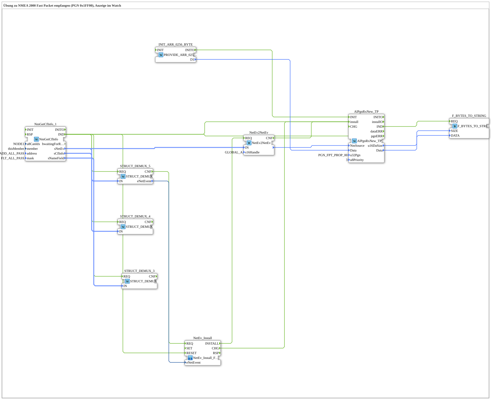

# Uebung_143: Übung zu NMEA 2000 Fast Packet empfangen (PGN 0x1FF00)

Dieser Artikel beschreibt die logiBUS®-Übung `Uebung_143`.

----

## Ziel der Übung

Eine Fast-Packet-Nachricht der PGN `0x1FF00` wird empfangen. Der Stack setzt die Rahmen zusammen, die Anwendung sieht eine Nachricht.

-----

## Beschreibung und Komponenten

### Funktionsbausteine (FBs)

- `AlPgnRxNew_TP`: `isobus::pgn::rx::AlPgnRxNew_TP` mit `u32Pgn = PGN_FPT_PROP_00` (0x1FF00) und `u8Priority = 3`. `INIT_ARR_0256_BYTE` liefert den Empfangspuffer.
- `F_BYTES_TO_STRING`: `logiBUS::utils::dyn_arr::F_BYTES_TO_STRING`, macht aus den Bytes einen Text für das Watch-Fenster.
- `NmGetCfInfo_1`, `STRUCT_DEMUX_*`, `NetEv_Install`, `NetEv2NetEv` (`GLOBAL_A`): Muster mit `thisMember`.

Die Übung nutzt das gemeinsame Muster mit `NmGetCfInfo` (IND/RSP): `IND` löst `STRUCT_DEMUX` aus, `NetEv_Install` (`MyLib::sys::NetEv_Install_Filter`) verarbeitet das Ereignis und quittiert immer mit `RSP` (die RSP-Verbindungen sind in der IDE ausgeblendet). `INIT` ist als `EInit` nicht verbunden.

-----

## Funktionsweise

1. Wenn alle Rahmen angekommen sind, meldet `AlPgnRxNew_TP` die Nachricht mit `IND`.
2. Im Watch erwartet man `u16DaSize = 32` und im Ausgang von `F_BYTES_TO_STRING` den Text `ABCDEFGHIJKLMNOPQRSTUVWXYZ01234`.
3. Fehlt ein Rahmen, kommt kein `IND`.
4. Das Gegenstück ist die Übung 142. Mehr zum Protokoll: [NMEA 2000 Fast Packet](https://meisterschulen-am-ostbahnhof-munchen-docs.readthedocs.io/projects/isobus-other-docs/de/latest/NMEA2000-Fast-Packet/).

-----

## Erwartetes Verhalten

- Gesendet wird mit Übung 142 von einem zweiten Gerät (erwartet: Anzeige wie oben).

Es sind keine Hardware-Ergebnisse dokumentiert: Die Übung ist noch nicht auf Hardware getestet. Aussagen zum Verhalten stammen aus dem Kommentar im Netzwerk der Übung und sind als erwartet zu lesen.

-----

## Anwendungsbeispiel

Empfang herstellerspezifischer Mehrrahmen-Nachrichten ohne Verbindungsaufbau, bei denen der Stack das Zusammensetzen übernimmt.

