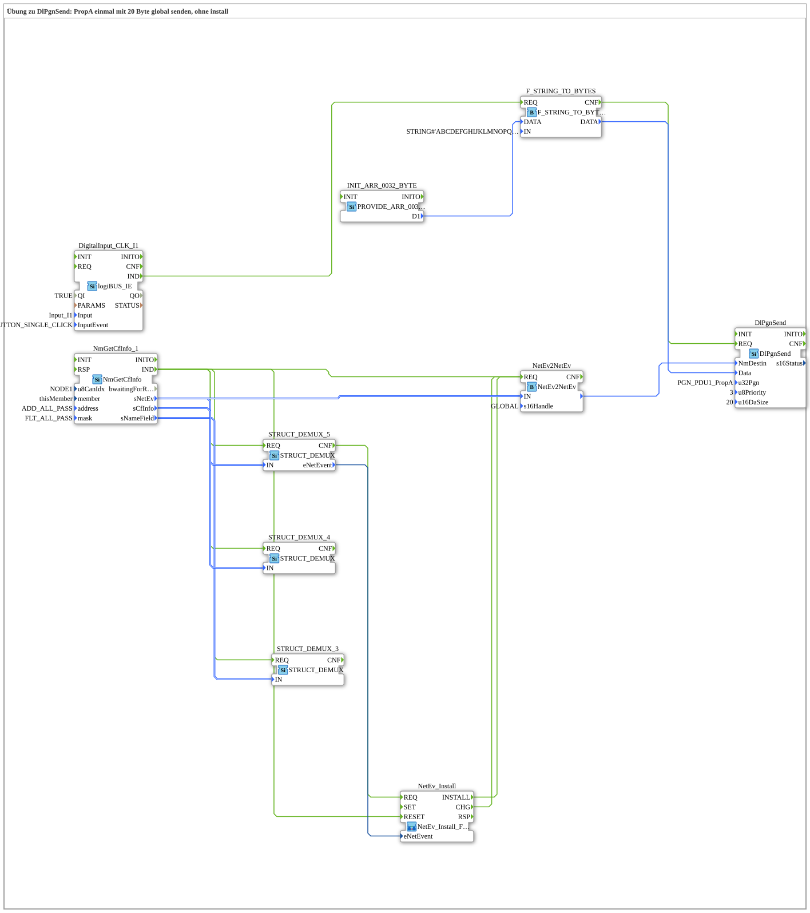

# Uebung_147: Übung zu DlPgnSend (PGN einmal senden, ohne install)

Dieser Artikel beschreibt die logiBUS®-Übung `Uebung_147`.

----

## Ziel der Übung

Eine PGN wird einmalig gesendet, ohne sie vorher zu installieren. Hier: Proprietary A mit 20 Byte, global.

-----

## Beschreibung und Komponenten

### Funktionsbausteine (FBs)

- `DlPgnSend`: `isobus::pgn::tx::DlPgnSend` mit `u32Pgn = PGN_PDU1_PropA`, `u8Priority = 3`, `u16DaSize = 20`.
- `DigitalInput_CLK_I1`: Klick auf `I1` sendet.
- `F_STRING_TO_BYTES` und `INIT_ARR_0032_BYTE`: Text `ABCDEFGHIJKLMNOPQRS` plus `16#00` (20 Byte).
- `NmGetCfInfo_1` (`thisMember`) und `NetEv2NetEv` (`s16Handle = GLOBAL`): ergeben das `NmDestin`. `s16OwnCfHnd` ist der Sender, `s16Handle = HANDLE::GLOBAL` das Ziel.

Die Übung nutzt das gemeinsame Muster mit `NmGetCfInfo` (IND/RSP): `IND` löst `STRUCT_DEMUX` aus, `NetEv_Install` (`MyLib::sys::NetEv_Install_Filter`) verarbeitet das Ereignis und quittiert immer mit `RSP` (die RSP-Verbindungen sind in der IDE ausgeblendet). `INIT` ist als `EInit` nicht verbunden.

-----

## Funktionsweise

1. Der eigene Handle kommt aus `NmGetCfInfo` (`thisMember`, bei `Active`).
2. Ein Klick auf `I1` sendet Proprietary A (`0xEF00`) mit 20 Byte global. Mehr als 8 Byte gehen per TP-BAM.
3. `s16Status = 0` heißt OK. Es sind bis zu 1785 Byte möglich, mehr ergibt `E_RANGE`.

-----

## Erwartetes Verhalten

- Als Empfänger dient Übung 139, die den Text anzeigt (erwartet).

Es sind keine Hardware-Ergebnisse dokumentiert: Die Übung ist noch nicht auf Hardware getestet. Aussagen zum Verhalten stammen aus dem Kommentar im Netzwerk der Übung und sind als erwartet zu lesen.

-----

## Anwendungsbeispiel

Seltene Einzelnachrichten, für die sich eine dauerhafte Anmeldung nicht lohnt.

