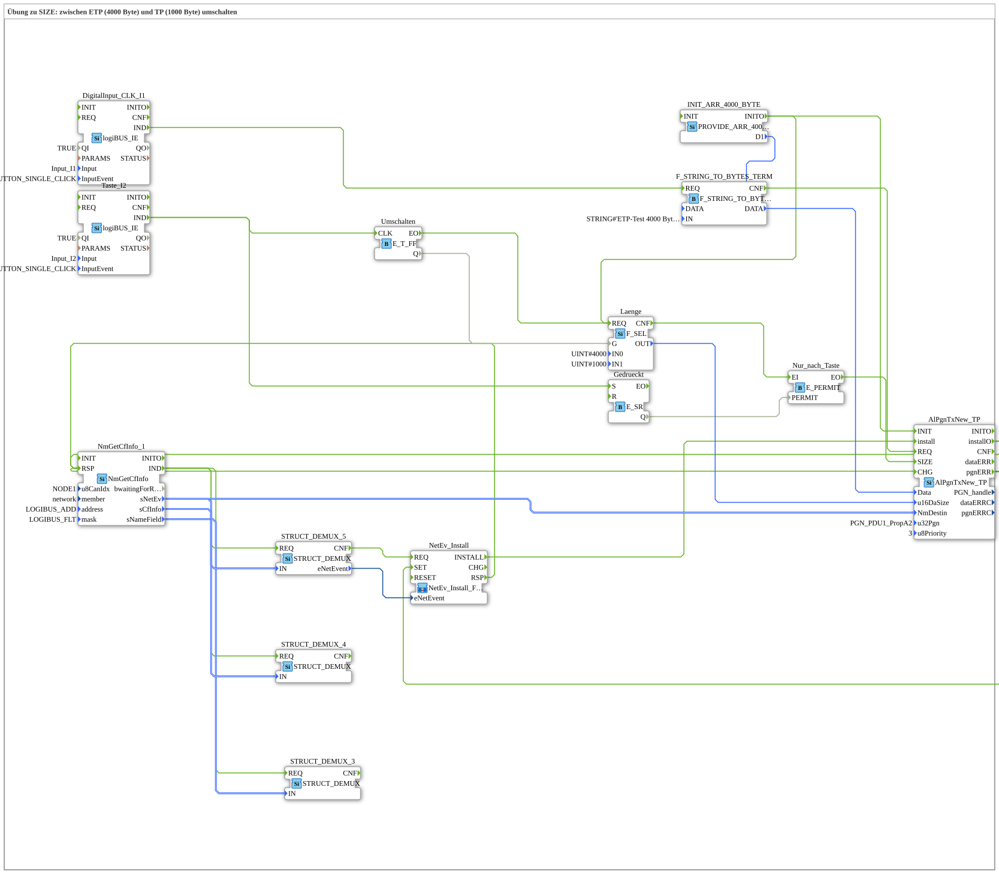

# Uebung_149d: Übung zu SIZE: zwischen ETP (4000 Byte) und TP (1000 Byte) umschalten

Dieser Artikel beschreibt die 4diac IDE Subapplikation Uebung_149d (Übung zu SIZE: zwischen ETP (4000 Byte) und TP (1000 Byte) umschalten).

----

## Ziel der Übung

Das Ziel dieser Übung ist die Umsetzung folgender Anforderung: **Übung zu SIZE: zwischen ETP (4000 Byte) und TP (1000 Byte) umschalten**

-----

## Beschreibung und Komponenten

Die Übung besteht aus der Subapplikation Uebung_149d.SUB, welche die folgende Bausteinstruktur verwendet:

### Verwendete Funktionsbausteine (FBs)

- **STRUCT_DEMUX_3**: Instanz des Typs eclipse4diac::convert::STRUCT_DEMUX.
- **NmGetCfInfo_1**: Instanz des Typs isobus::pgn::NmGetCfInfo.
  - Parameter u8CanIdx = NODE1
  - Parameter member = network
  - Parameter address = LOGIBUS_ADD
  - Parameter mask = LOGIBUS_FLT
- **STRUCT_DEMUX_4**: Instanz des Typs eclipse4diac::convert::STRUCT_DEMUX.
- **STRUCT_DEMUX_5**: Instanz des Typs eclipse4diac::convert::STRUCT_DEMUX.
- **INIT_ARR_4000_BYTE**: Instanz des Typs eclipse4diac::convert::providers::PROVIDE_ARR_4000_BYTE.
- **F_STRING_TO_BYTES_TERM**: Instanz des Typs logiBUS::utils::dyn_arr::F_STRING_TO_BYTES_TERM.
  - Parameter IN = STRING#'ETP-Test 4000 Byte'
- **AlPgnTxNew_TP**: Instanz des Typs isobus::pgn::tx::AlPgnTxNew_TP.
  - Parameter u32Pgn = PGN_PDU1_PropA2
  - Parameter u8Priority = 3
- **DigitalInput_CLK_I1**: Instanz des Typs logiBUS::io::DI::logiBUS_IE.
  - Parameter QI = TRUE
  - Parameter Input = Input_I1
  - Parameter InputEvent = BUTTON_SINGLE_CLICK
- **Taste_I2**: Instanz des Typs logiBUS::io::DI::logiBUS_IE.
  - Parameter QI = TRUE
  - Parameter Input = Input_I2
  - Parameter InputEvent = BUTTON_SINGLE_CLICK
- **Umschalten**: Instanz des Typs iec61499::events::E_T_FF.
- **Laenge**: Instanz des Typs iec61131::selection::F_SEL.
  - Parameter IN0 = UINT#4000
  - Parameter IN1 = UINT#1000
- **Gedrueckt**: Instanz des Typs iec61499::events::E_SR.
- **Nur_nach_Taste**: Instanz des Typs iec61499::events::E_PERMIT.
- **NetEv_Install**: Untergeordnete Subapplikation (SubApp) MyLib::sys::NetEv_Install_Filter.

Die Übung nutzt das gemeinsame Muster mit `NmGetCfInfo` (IND/RSP): `IND` löst `STRUCT_DEMUX` aus, `NetEv_Install` verarbeitet das Ereignis und quittiert mit `RSP`.

-----

## Ablauf und erwartetes Verhalten (aus dem Kommentar im Netzwerk)

- SIZE: zwischen ETP (4000 Byte) und TP (1000 Byte) umschalten, PGN PropA2 0x1EF00
- install mit 4000 Byte. I2 Klick schaltet um: 1000 Byte (TP), dann wieder 4000 Byte (ETP).
- I1 Klick sendet. Der Stack wählt TP oder ETP selbst nach der Länge.
- Partner wie Übung 149 (Filter LOGIBUS_ADD/LOGIBUS_FLT). Empfänger: Übung 149b, Watch u16DaSize (1000 bzw. 4000).
- Firmware ab LOGIBUS 24534469 auf BEIDEN Geräten.

Hinweis: Die Übung ist noch nicht auf Hardware getestet. Die Beschreibung stammt aus der Subapplikation und ihrem Kommentar, das Verhalten ist als erwartet zu lesen.

-----

## Zusammenfassung

Die Übung Uebung_149d demonstriert die modulare IEC 61499 Architektur in 4diac IDE.
