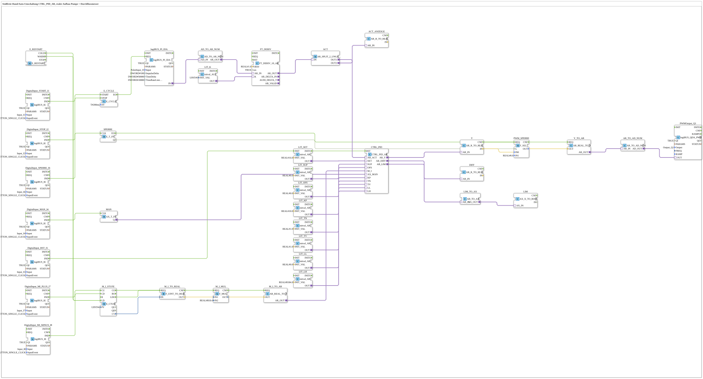

# Uebung_154b: Stoßfreie Hand/Auto-Umschaltung CTRL_PID_AR, realer Aufbau Pumpe + Durchflussmesser

Dieser Artikel beschreibt die 4diac IDE Subapplikation Uebung_154b (Stoßfreie Hand/Auto-Umschaltung CTRL_PID_AR, realer Aufbau Pumpe + Durchflussmesser).

----

## Ziel der Übung

Das Ziel dieser Übung ist die Umsetzung folgender Anforderung: **Stoßfreie Hand/Auto-Umschaltung CTRL_PID_AR, realer Aufbau Pumpe + Durchflussmesser**

-----

## Beschreibung und Komponenten

Die Übung besteht aus der Subapplikation Uebung_154b.SUB, welche die folgende Bausteinstruktur verwendet:

### Verwendete Funktionsbausteine (FBs)

- **CTRL_PID**: Instanz des Typs OSCAT_adapter::Control::CTRL_PID_AR.
- **LIT_SET**: Instanz des Typs adapter::types::unidirectional::AR::initval::initval_AR.
  - Parameter INIT_VAL = 16.0
- **LIT_SUP**: Instanz des Typs adapter::types::unidirectional::AR::initval::initval_AR.
  - Parameter INIT_VAL = 0.0
- **LIT_OFS**: Instanz des Typs adapter::types::unidirectional::AR::initval::initval_AR.
  - Parameter INIT_VAL = 0.0
- **LIT_KP**: Instanz des Typs adapter::types::unidirectional::AR::initval::initval_AR.
  - Parameter INIT_VAL = 10.0
- **LIT_TN**: Instanz des Typs adapter::types::unidirectional::AR::initval::initval_AR.
  - Parameter INIT_VAL = 1.0
- **LIT_TV**: Instanz des Typs adapter::types::unidirectional::AR::initval::initval_AR.
  - Parameter INIT_VAL = 1.0
- **LIT_LL**: Instanz des Typs adapter::types::unidirectional::AR::initval::initval_AR.
  - Parameter INIT_VAL = 0.0
- **LIT_LH**: Instanz des Typs adapter::types::unidirectional::AR::initval::initval_AR.
  - Parameter INIT_VAL = 8184.0
- **E_RESTART**: Instanz des Typs iec61499::events::E_RESTART.
- **SPERRE**: Instanz des Typs iec61499::events::E_T_FF.
- **MAN**: Instanz des Typs adapter::events::unidirectional::AX_T_FF.
- **Y**: Instanz des Typs adapter::conversion::unidirectional::AR_R_TO_REAL.
- **DIFF**: Instanz des Typs adapter::conversion::unidirectional::AR_R_TO_REAL.
- **LIM_TO_AX**: Instanz des Typs adapter::conversion::unidirectional::AB_TO_AX.
- **LIM**: Instanz des Typs adapter::conversion::unidirectional::AX_X_TO_BOOL.
- **DigitalInput_START_I1**: Instanz des Typs logiBUS::io::DI::logiBUS_IE.
  - Parameter QI = TRUE
  - Parameter Input = Input_I1
  - Parameter InputEvent = BUTTON_SINGLE_CLICK
- **DigitalInput_STOP_I2**: Instanz des Typs logiBUS::io::DI::logiBUS_IE.
  - Parameter QI = TRUE
  - Parameter Input = Input_I2
  - Parameter InputEvent = BUTTON_SINGLE_CLICK
- **E_CYCLE**: Instanz des Typs iec61499::events::E_CYCLE.
  - Parameter DT = T#200ms
- **logiBUS_PI_IDA**: Instanz des Typs logiBUS::io::PI::logiBUS_PI_IDA.
  - Parameter QI = TRUE
  - Parameter Input = PulseInput_I3
  - Parameter ImpulseDelta = 100
  - Parameter TimeDelta = 50000
  - Parameter TimeRateLimit = 10000
- **AD_TO_AR_NUM**: Instanz des Typs adapter::conversion::unidirectional::AD_TO_AR_NUM.
- **FT_DERIV**: Instanz des Typs OSCAT_adapter::Control::FT_DERIV_10_AR.
  - Parameter Faktor = 1.0
  - Parameter run = TRUE
- **LIT_K**: Instanz des Typs adapter::types::unidirectional::AUI::initval::initval_AUI.
  - Parameter INIT_VAL = 9
- **ACT**: Instanz des Typs adapter::events::unidirectional::AR_SPLIT_2_UNGATED.
- **ACT_ANZEIGE**: Instanz des Typs adapter::conversion::unidirectional::AR_R_TO_REAL.
- **DigitalInput_MAN_I4**: Instanz des Typs logiBUS::io::DI::logiBUS_IE.
  - Parameter QI = TRUE
  - Parameter Input = Input_I4
  - Parameter InputEvent = BUTTON_SINGLE_CLICK
- **DigitalInput_RST_I5**: Instanz des Typs logiBUS::io::DI::logiBUS_IE.
  - Parameter QI = TRUE
  - Parameter Input = Input_I5
  - Parameter InputEvent = BUTTON_SINGLE_CLICK
- **DigitalInput_SPERRE_I6**: Instanz des Typs logiBUS::io::DI::logiBUS_IE.
  - Parameter QI = TRUE
  - Parameter Input = Input_I6
  - Parameter InputEvent = BUTTON_SINGLE_CLICK
- **DigitalInput_MI_PLUS_I7**: Instanz des Typs logiBUS::io::DI::logiBUS_IE.
  - Parameter QI = TRUE
  - Parameter Input = Input_I7
  - Parameter InputEvent = BUTTON_SINGLE_CLICK
- **DigitalInput_MI_MINUS_I8**: Instanz des Typs logiBUS::io::DI::logiBUS_IE.
  - Parameter QI = TRUE
  - Parameter Input = Input_I8
  - Parameter InputEvent = BUTTON_SINGLE_CLICK
- **M_I_STUFE**: Instanz des Typs iec61499::events::E_CTUD.
  - Parameter PV = 4
- **M_I_TO_REAL**: Instanz des Typs iec61131::conversion::F_UINT_TO_REAL.
- **M_I_MUL**: Instanz des Typs iec61131::arithmetic::F_MUL.
  - Parameter IN2 = REAL#818.4
- **M_I_TO_AR**: Instanz des Typs adapter::conversion::unidirectional::AR_REAL_TO_R.
- **PWM_SPERRE**: Instanz des Typs iec61131::selection::F_SEL.
  - Parameter IN1 = REAL#0.0
- **Y_TO_AR**: Instanz des Typs adapter::conversion::unidirectional::AR_REAL_TO_R.
- **AR_TO_AD_NUM**: Instanz des Typs adapter::conversion::unidirectional::AR_TO_AD_NUM.
- **PWMOutput_Q1**: Instanz des Typs logiBUS::io::DQ::logiBUS_QDA_PWM.
  - Parameter QI = TRUE
  - Parameter Output = Output_Q1

-----

## Ablauf und erwartetes Verhalten (aus dem Kommentar im Netzwerk)

- Test stoßfreie Hand/Auto-Umschaltung (CTRL_PID_AR, OSCAT-Fix #385)
- Aufbau wie Übung 153: Durchflussmesser an I3, Pumpe an Q1. I1 = Takt starten, I2 = Takt stoppen.
- I4 = Hand/Auto (Start: Auto), I5 = RST Integrator, I6 = Pumpe sperren (PWM 0, Regler läuft weiter).
- Handwert M_I: Stufe 4 = 3273.6 (40 %); I7 +10 %, I8 -10 %. Watch: Y.IN, ACT_ANZEIGE.IN (Istwert), DIFF.IN, LIM.IN.
- (1) I4 Hand: Y = M_I. I4 Auto: Y springt nicht, regelt von M_I aus weiter.
- (2) Start in Auto: Y beginnt bei KP*DIFF (KP*DIFF), läuft nicht erst bis LH hoch.
- (3) Gegenprobe: in Auto I5 drücken -> Integrator 0, Y springt auf KP*DIFF.
- (4) Windup: I6 sperren -> Istwert fällt, Y läuft bis LH (8184), LIM = TRUE. Lösung im Projekt: RST bei steigender Freigabe.

Hinweis: Die Übung ist noch nicht auf Hardware getestet. Die Beschreibung stammt aus der Subapplikation und ihrem Kommentar, das Verhalten ist als erwartet zu lesen.

-----

## Zusammenfassung

Die Übung Uebung_154b demonstriert die modulare IEC 61499 Architektur in 4diac IDE.
