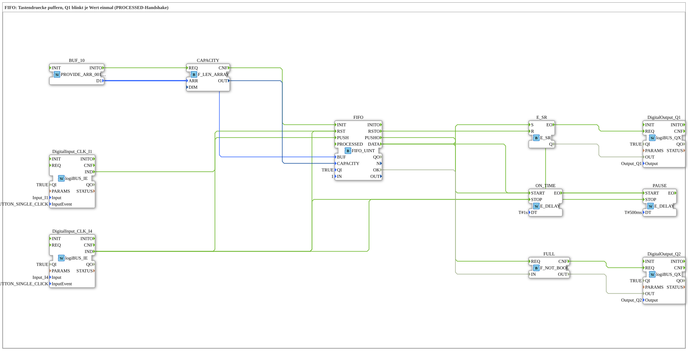

# Uebung_231: FIFO: Tastendruecke puffern, Q1 blinkt je Wert einmal (PROCESSED-Handshake)

Dieser Artikel beschreibt die 4diac IDE Subapplikation Uebung_231 (FIFO: Tastendruecke puffern, Q1 blinkt je Wert einmal (PROCESSED-Handshake)).

----

## Ziel der Übung

Das Ziel dieser Übung ist die Umsetzung folgender Anforderung: **FIFO: Tastendruecke puffern, Q1 blinkt je Wert einmal (PROCESSED-Handshake)**

-----

## Beschreibung und Komponenten

Die Übung besteht aus der Subapplikation Uebung_231.SUB, welche die folgende Bausteinstruktur verwendet:

### Verwendete Funktionsbausteine (FBs)

- **BUF_10**: Instanz des Typs eclipse4diac::convert::providers::PROVIDE_ARR_0010_UINT.
- **CAPACITY**: Instanz des Typs eclipse4diac::utils::arrays::F_LEN_ARRAY.
- **FIFO**: Instanz des Typs FIFO::FIFO_UINT.
  - Parameter QI = TRUE
  - Parameter IN = 1
- **DigitalInput_CLK_I1**: Instanz des Typs logiBUS::io::DI::logiBUS_IE.
  - Parameter QI = TRUE
  - Parameter Input = Input_I1
  - Parameter InputEvent = BUTTON_SINGLE_CLICK
- **DigitalInput_CLK_I4**: Instanz des Typs logiBUS::io::DI::logiBUS_IE.
  - Parameter QI = TRUE
  - Parameter Input = Input_I4
  - Parameter InputEvent = BUTTON_SINGLE_CLICK
- **E_SR**: Instanz des Typs iec61499::events::E_SR.
- **ON_TIME**: Instanz des Typs iec61499::events::E_DELAY.
  - Parameter DT = T#1s
- **PAUSE**: Instanz des Typs iec61499::events::E_DELAY.
  - Parameter DT = T#500ms
- **DigitalOutput_Q1**: Instanz des Typs logiBUS::io::DQ::logiBUS_QX.
  - Parameter QI = TRUE
  - Parameter Output = Output_Q1
- **FULL**: Instanz des Typs iec61131::booleanOperators::F_NOT_BOOL.
- **DigitalOutput_Q2**: Instanz des Typs logiBUS::io::DQ::logiBUS_QX.
  - Parameter QI = TRUE
  - Parameter Output = Output_Q2

-----

## Zusammenfassung

Die Übung Uebung_231 demonstriert die modulare IEC 61499 Architektur in 4diac IDE.
