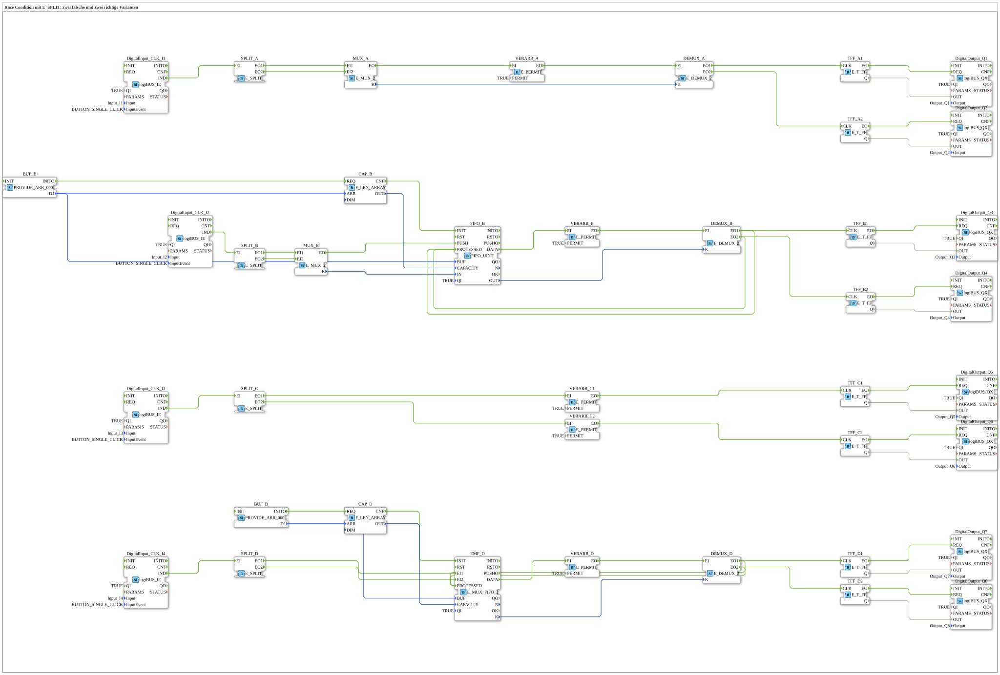

# Uebung_232: Race Condition mit E_SPLIT: zwei falsche und zwei richtige Varianten

Dieser Artikel beschreibt die 4diac IDE Subapplikation Uebung_232 (Race Condition mit E_SPLIT: zwei falsche und zwei richtige Varianten).

----

## Ziel der Übung

Das Ziel dieser Übung ist die Umsetzung folgender Anforderung: **Race Condition mit E_SPLIT: zwei falsche und zwei richtige Varianten**

-----

## Beschreibung und Komponenten

Die Übung besteht aus der Subapplikation Uebung_232.SUB, welche die folgende Bausteinstruktur verwendet:

### Verwendete Funktionsbausteine (FBs)

- **DigitalInput_CLK_I1**: Instanz des Typs logiBUS::io::DI::logiBUS_IE.
  - Parameter QI = TRUE
  - Parameter Input = Input_I1
  - Parameter InputEvent = BUTTON_SINGLE_CLICK
- **SPLIT_A**: Instanz des Typs iec61499::events::E_SPLIT.
- **MUX_A**: Instanz des Typs iec61499::events::E_MUX_2.
- **VERARB_A**: Instanz des Typs iec61499::events::E_PERMIT.
  - Parameter PERMIT = TRUE
- **DEMUX_A**: Instanz des Typs iec61499::events::E_DEMUX_2.
- **TFF_A1**: Instanz des Typs iec61499::events::E_T_FF.
- **DigitalOutput_Q1**: Instanz des Typs logiBUS::io::DQ::logiBUS_QX.
  - Parameter QI = TRUE
  - Parameter Output = Output_Q1
- **TFF_A2**: Instanz des Typs iec61499::events::E_T_FF.
- **DigitalOutput_Q2**: Instanz des Typs logiBUS::io::DQ::logiBUS_QX.
  - Parameter QI = TRUE
  - Parameter Output = Output_Q2
- **DigitalInput_CLK_I2**: Instanz des Typs logiBUS::io::DI::logiBUS_IE.
  - Parameter QI = TRUE
  - Parameter Input = Input_I2
  - Parameter InputEvent = BUTTON_SINGLE_CLICK
- **SPLIT_B**: Instanz des Typs iec61499::events::E_SPLIT.
- **BUF_B**: Instanz des Typs eclipse4diac::convert::providers::PROVIDE_ARR_0004_UINT.
- **CAP_B**: Instanz des Typs eclipse4diac::utils::arrays::F_LEN_ARRAY.
- **MUX_B**: Instanz des Typs iec61499::events::E_MUX_2.
- **FIFO_B**: Instanz des Typs FIFO::FIFO_UINT.
  - Parameter QI = TRUE
- **VERARB_B**: Instanz des Typs iec61499::events::E_PERMIT.
  - Parameter PERMIT = TRUE
- **DEMUX_B**: Instanz des Typs iec61499::events::E_DEMUX_2.
- **TFF_B1**: Instanz des Typs iec61499::events::E_T_FF.
- **DigitalOutput_Q3**: Instanz des Typs logiBUS::io::DQ::logiBUS_QX.
  - Parameter QI = TRUE
  - Parameter Output = Output_Q3
- **TFF_B2**: Instanz des Typs iec61499::events::E_T_FF.
- **DigitalOutput_Q4**: Instanz des Typs logiBUS::io::DQ::logiBUS_QX.
  - Parameter QI = TRUE
  - Parameter Output = Output_Q4
- **DigitalInput_CLK_I3**: Instanz des Typs logiBUS::io::DI::logiBUS_IE.
  - Parameter QI = TRUE
  - Parameter Input = Input_I3
  - Parameter InputEvent = BUTTON_SINGLE_CLICK
- **SPLIT_C**: Instanz des Typs iec61499::events::E_SPLIT.
- **VERARB_C1**: Instanz des Typs iec61499::events::E_PERMIT.
  - Parameter PERMIT = TRUE
- **VERARB_C2**: Instanz des Typs iec61499::events::E_PERMIT.
  - Parameter PERMIT = TRUE
- **TFF_C1**: Instanz des Typs iec61499::events::E_T_FF.
- **DigitalOutput_Q5**: Instanz des Typs logiBUS::io::DQ::logiBUS_QX.
  - Parameter QI = TRUE
  - Parameter Output = Output_Q5
- **TFF_C2**: Instanz des Typs iec61499::events::E_T_FF.
- **DigitalOutput_Q6**: Instanz des Typs logiBUS::io::DQ::logiBUS_QX.
  - Parameter QI = TRUE
  - Parameter Output = Output_Q6
- **DigitalInput_CLK_I4**: Instanz des Typs logiBUS::io::DI::logiBUS_IE.
  - Parameter QI = TRUE
  - Parameter Input = Input_I4
  - Parameter InputEvent = BUTTON_SINGLE_CLICK
- **SPLIT_D**: Instanz des Typs iec61499::events::E_SPLIT.
- **BUF_D**: Instanz des Typs eclipse4diac::convert::providers::PROVIDE_ARR_0004_UINT.
- **CAP_D**: Instanz des Typs eclipse4diac::utils::arrays::F_LEN_ARRAY.
- **EMF_D**: Instanz des Typs FIFO::E_MUX_FIFO_2.
  - Parameter QI = TRUE
- **VERARB_D**: Instanz des Typs iec61499::events::E_PERMIT.
  - Parameter PERMIT = TRUE
- **DEMUX_D**: Instanz des Typs iec61499::events::E_DEMUX_2.
- **TFF_D1**: Instanz des Typs iec61499::events::E_T_FF.
- **DigitalOutput_Q7**: Instanz des Typs logiBUS::io::DQ::logiBUS_QX.
  - Parameter QI = TRUE
  - Parameter Output = Output_Q7
- **TFF_D2**: Instanz des Typs iec61499::events::E_T_FF.
- **DigitalOutput_Q8**: Instanz des Typs logiBUS::io::DQ::logiBUS_QX.
  - Parameter QI = TRUE
  - Parameter Output = Output_Q8

-----

## Zusammenfassung

Die Übung Uebung_232 demonstriert die modulare IEC 61499 Architektur in 4diac IDE.
