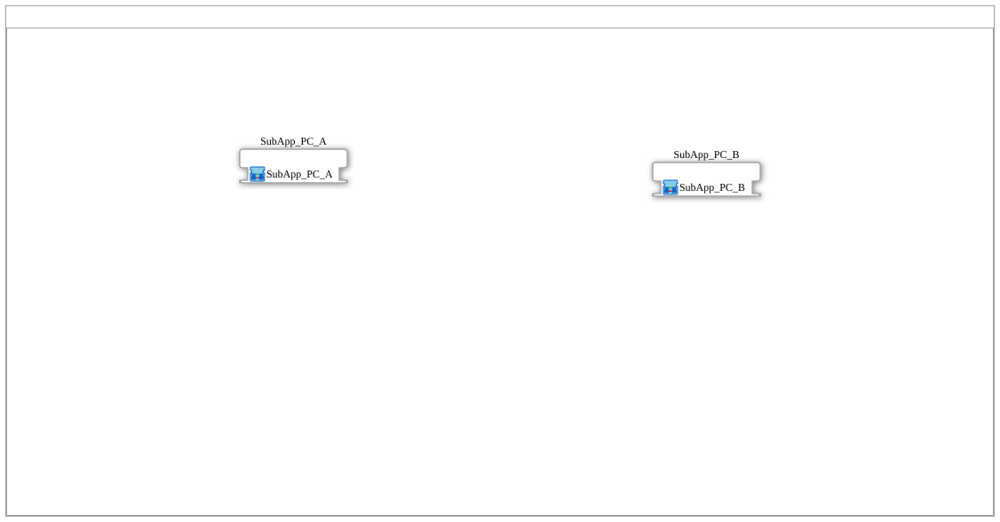

# Training_16b_OPC_UA_RES: Variablen per CLIENT, Lesen nach Rückmeldung — zwei Geräte

* * * * * * * * * *

## Einleitung

`Training_16b_OPC_UA_RES` setzt das Beispiel „Objekte/Variablen per CLIENT“ aus `opcua.adoc` auf zwei Geräten um, liest aber erst nach einer Rückmeldung von B: Gerät A schreibt 42 auf `Increment` von B, Gerät B addiert 1 und veröffentlicht `Incremented`. Gerät A abonniert `Incremented` mit [`SUBSCRIBE_1`](https://meisterschulen-am-ostbahnhof-munchen-docs.readthedocs.io/projects/4diac-library-reference-docs/de/latest/Bibliotheken/StandardLibraries/net/SUBSCRIBE_1/) (mit Endpunkt von B) und löst mit dessen `IND` das Lesen per [`CLIENT_0_1`](https://meisterschulen-am-ostbahnhof-munchen-docs.readthedocs.io/projects/4diac-library-reference-docs/de/latest/Bibliotheken/StandardLibraries/net/CLIENT_0_1/) aus. Der abonnierte Wert selbst wird nicht ausgewertet; die Subscription dient nur als Auslöser.

**B-Version von `Training_16_OPC_UA_RES`:** `READ_INCD.REQ` kommt nicht mehr von `WRITE_INC.CNF` (das bestätigt nur das Schreiben auf B), sondern von `SUBSCRIPTION.IND`, also erst, wenn B `Incremented` veröffentlicht hat. Dafür hat Gerät A zusätzlich ein `SUBSCRIPTION` (`SUBSCRIBE_1`). Die Konstanten heißen `T16B_*`, die Knoten liegen unter `/Objects/T16B/`.

## Systemaufbau

Gerät A (`FORTE_PC_A`, `MGR_ID` = `PC_A`, Station 11, `192.168.1.11`) mit `EMB_RES_A`, Gerät B (`FORTE_PC_B`, `MGR_ID` = `PC_B`, Station 12, `192.168.1.12`) mit `EMB_RES_B`, verbunden über das Segment `Ethernet`. Jede Resource enthält nur `E_TRIG` (`EVENTTYPE` = `'EInit'`), das von `START.COLD` angestoßen wird; die gesamte Logik steckt in den SubApps.

## Verwendete SubApps

| SubApp | Gerät | Inhalt |
|---|---|---|
| [`SubApp_PC_A`](./SubApp_PC_A_Training_16b_network.svg) | A (`192.168.1.11`) | `TASTER_I1` ([`logiBUS_IE`](https://meisterschulen-am-ostbahnhof-munchen-docs.readthedocs.io/projects/4diac-library-reference-docs/de/latest/Bibliotheken/ExternalLibraries/logiBUS/io/DI/logiBUS_IE/): `QI` = `TRUE`, `Input` = `Input_I1`, `InputEvent` = `BUTTON_PRESS_DOWN`), `WRITE_INC` ([`CLIENT_1_0`](https://meisterschulen-am-ostbahnhof-munchen-docs.readthedocs.io/projects/4diac-library-reference-docs/de/latest/Bibliotheken/StandardLibraries/net/CLIENT_1_0/): `QI` = `TRUE`, `ID` = `T16B_INC_CLIENT_WRITE`, `SD_1` = `INT#42`), `READ_INCD` ([`CLIENT_0_1`](https://meisterschulen-am-ostbahnhof-munchen-docs.readthedocs.io/projects/4diac-library-reference-docs/de/latest/Bibliotheken/StandardLibraries/net/CLIENT_0_1/): `QI` = `TRUE`, `ID` = `T16B_INCD_CLIENT_READ`), `RESULT_TO_DINT` ([`F_INT_TO_DINT`](https://meisterschulen-am-ostbahnhof-munchen-docs.readthedocs.io/projects/4diac-library-reference-docs/de/latest/Bibliotheken/StandardLibraries/iec61131-3/conversion/INT/F_INT_TO_DINT/)), `SUBSCRIPTION` ([`SUBSCRIBE_1`](https://meisterschulen-am-ostbahnhof-munchen-docs.readthedocs.io/projects/4diac-library-reference-docs/de/latest/Bibliotheken/StandardLibraries/net/SUBSCRIBE_1/): `QI` = `TRUE`, `ID` = `T16B_INCD_SUBSCRIBE`) |
| [`SubApp_PC_B`](./SubApp_PC_B_Training_16b_network.svg) | B (`192.168.1.12`) | `INCREMENT` ([`SUBSCRIBE_1`](https://meisterschulen-am-ostbahnhof-munchen-docs.readthedocs.io/projects/4diac-library-reference-docs/de/latest/Bibliotheken/StandardLibraries/net/SUBSCRIBE_1/): `QI` = `TRUE`, `ID` = `T16B_INC_READ`), `TO_DINT` ([`F_INT_TO_DINT`](https://meisterschulen-am-ostbahnhof-munchen-docs.readthedocs.io/projects/4diac-library-reference-docs/de/latest/Bibliotheken/StandardLibraries/iec61131-3/conversion/INT/F_INT_TO_DINT/)), `F_ADD` ([`F_ADD`](https://meisterschulen-am-ostbahnhof-munchen-docs.readthedocs.io/projects/4diac-library-reference-docs/de/latest/Bibliotheken/StandardLibraries/iec61131-3/arithmetic/F_ADD/): `IN2` = `DINT#1`), `TO_INT` ([`F_DINT_TO_INT`](https://meisterschulen-am-ostbahnhof-munchen-docs.readthedocs.io/projects/4diac-library-reference-docs/de/latest/Bibliotheken/StandardLibraries/iec61131-3/conversion/DINT/F_DINT_TO_INT/)), `INCREMENTED` ([`PUBLISH_1`](https://meisterschulen-am-ostbahnhof-munchen-docs.readthedocs.io/projects/4diac-library-reference-docs/de/latest/Bibliotheken/StandardLibraries/net/PUBLISH_1/): `QI` = `TRUE`, `ID` = `T16B_INCD_WRITE`) |

## OPC-UA-Adressraum

Die IDs stammen aus `myOpcUaAddresses.gcf`; die Stationen `PC_A`/`PC_B` stehen nur dort, die OPC-UA-IDs werden mit den Functions der Lib `MyLib_OPC` berechnet. Aufbau und Berechnung: [OPC-UA-Adressen](../OPC_UA_Adressen.md).

| Konstanten | Knoten | Bedeutung |
|---|---|---|
| `T16B_INC_CLIENT_WRITE / T16B_INC_READ` | `/Objects/T16B/Increment,1:s=T16B_Increment` | Knoten auf B; A schreibt per `CLIENT` (`WRITE` mit Endpunkt von B), B liest lokal (`READ`) |
| `T16B_INCD_WRITE / T16B_INCD_CLIENT_READ` | `/Objects/T16B/Incremented,1:s=T16B_Incremented` | Knoten auf B; B schreibt lokal (`WRITE`), A liest per `CLIENT` (`READ` mit Endpunkt von B) |
| `T16B_INCD_SUBSCRIBE` | `/Objects/T16B/Incremented,1:s=T16B_Incremented` | derselbe Knoten wie oben; A abonniert ihn mit Endpunkt von B (`SUBSCRIBE`) |

## Programmablauf und Verbindungen

1. **`SubApp_PC_A`** (Gerät A), Ereignisverbindungen:

    1. `TASTER_I1.IND` → `WRITE_INC.REQ`
    2. `SUBSCRIPTION.IND` → `READ_INCD.REQ`
    3. `TASTER_I1.INITO` → `WRITE_INC.INIT`
    4. `WRITE_INC.INITO` → `READ_INCD.INIT`
    5. `READ_INCD.CNF` → `RESULT_TO_DINT.REQ`

2. **`SubApp_PC_A`** (Gerät A), Datenverbindungen:

    1. `READ_INCD.RD_1` → `RESULT_TO_DINT.IN`

3. **`SubApp_PC_B`** (Gerät B), Ereignisverbindungen:

    1. `INCREMENT.IND` → `TO_DINT.REQ`
    2. `TO_DINT.CNF` → `F_ADD.REQ`
    3. `F_ADD.CNF` → `TO_INT.REQ`
    4. `TO_INT.CNF` → `INCREMENTED.REQ`
    5. `INCREMENT.INITO` → `INCREMENTED.INIT`

4. **`SubApp_PC_B`** (Gerät B), Datenverbindungen:

    1. `INCREMENT.RD_1` → `TO_DINT.IN`
    2. `TO_DINT.OUT` → `F_ADD.IN1`
    3. `F_ADD.OUT` → `TO_INT.IN`
    4. `TO_INT.OUT` → `INCREMENTED.SD_1`

## Technische Besonderheiten

- **Lesen nach Rückmeldung**: `SUBSCRIPTION` (`SUBSCRIBE_1`) abonniert `Incremented` von B (`T16B_INCD_SUBSCRIBE`, `F_OPC_REMOTE` mit `SUBSCRIBE`); dessen `IND` startet `READ_INCD.REQ`.
- **Vorbehalt**: `SUBSCRIPTION.IND` kann auch beim ersten Abo-Wert feuern, bevor B inkrementiert hat; die Reihenfolge ist damit besser abgesichert als in `Training_16_OPC_UA_RES`, aber nicht formal garantiert.
- **Typumwandlung**: wie in `Training_16_OPC_UA_RES` (`F_INT_TO_DINT`, `F_ADD`, `F_DINT_TO_INT`).

## Hinweis

- **Nicht auf dem Gerät getestet.** `Training_13_OPC_UA_RES` bis `Training_18_OPC_UA_RES` wurden noch nicht auf einem Gerät ausgeführt. Diese Seite beschreibt nur, was in `test_Training_16b_OPC_UA.sys`, `SubApp_PC_A.SUB`, `SubApp_PC_B.SUB` und `myOpcUaAddresses.gcf` steht; ob die Beispiele wie beschrieben laufen, ist nicht geprüft.
- Die Initialisierung kommt aus den Resources: In `EMB_RES_A` und `EMB_RES_B` führt `START.COLD` auf `E_TRIG` (`EVENTTYPE = 'EInit'`), das die Initialisierung (`EInit`) der Application auslöst. Deshalb hat der jeweils erste Baustein einer Kette in der SubApp keine eigene Verbindung auf seinen `INIT`-Eingang.

## Lernziele

- Das Lesen erst nach einer Rückmeldung des anderen Geräts auslösen, statt direkt nach dem Schreiben.
- `SUBSCRIBE_1` (mit Endpunkt) als Auslöser für ein Lesen per `CLIENT_0_1` einsetzen.

**Empfohlene Reihenfolge**: `Training_16_OPC_UA_RES`.

## Zusammenfassung

`Training_16b_OPC_UA_RES` ist die B-Version von `Training_16_OPC_UA_RES`: Gerät A liest `Incremented` erst, wenn Gerät B es veröffentlicht hat (Auslöser: Subscription), nicht schon nach der Bestätigung des Schreibens.

---

### 🌐 Passende Themen-Unterseiten auf ms-muc-docs.de

- [🌐 Eclipse 4diac IDE & Farb-Referenz auf ms-muc-docs.de](https://www.ms-muc-docs.de/iec-61499/eclipse-4diac/)
