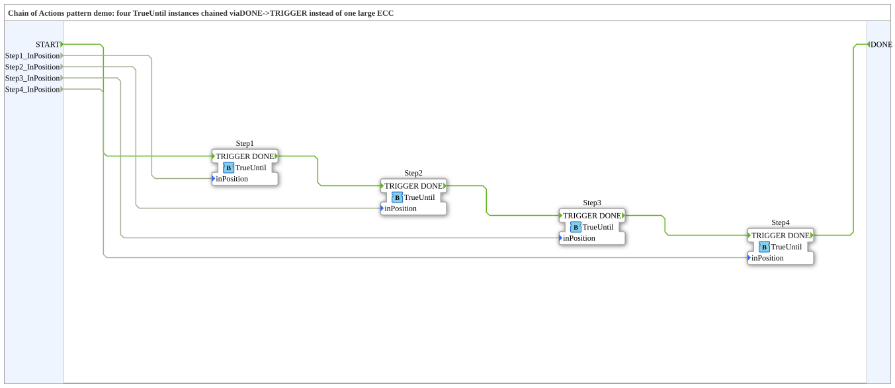

# ChainOfActionsDemo: Chain of Actions pattern with four TrueUntil blocks

* * * * * * * * * *

## Introduction

`ChainOfActionsDemo` shows the Chain of Actions pattern: four instances of the same block `TrueUntil` are chained via `DONE` → `TRIGGER` instead of using one large state machine (ECC) (type comment). Interface: event input `START`, event output `DONE` and four BOOL inputs `Step1_InPosition`...`Step4_InPosition`, which the demo uses to simulate the "position reached" feedback of the respective actuator.

## Function Blocks (FBs) Used

| Instance | Type | Parameters | Explanation |
|---|---|---|---|
| `Step1` | `Meins::DesingPatterns::ChainOfActionsPattern::TrueUntil` | - | Step 1 of the chain. |
| `Step2` | `Meins::DesingPatterns::ChainOfActionsPattern::TrueUntil` | - | Step 2 of the chain. |
| `Step3` | `Meins::DesingPatterns::ChainOfActionsPattern::TrueUntil` | - | Step 3 of the chain. |
| `Step4` | `Meins::DesingPatterns::ChainOfActionsPattern::TrueUntil` | - | Step 4 of the chain. |

## Program Flow and Connections

`TrueUntil` is a basic FB (in the project under `DesingPatterns/ChainOfActionsPattern/TrueUntil.fbt`). According to its ECC it waits in `START` for `TRIGGER` (or `REQ`), emits the event `TO_POSITION` in the state `MOVING` and waits for `inPosition`; then it emits `STOP` and `DONE`.

**Event connections:**

1. `START` → `Step1.TRIGGER`
2. `Step1.DONE` → `Step2.TRIGGER`
3. `Step2.DONE` → `Step3.TRIGGER`
4. `Step3.DONE` → `Step4.TRIGGER`
5. `Step4.DONE` → `DONE`

**Data connections:** `Step1_InPosition` → `Step1.inPosition`, and likewise `Step2_InPosition` to `Step4_InPosition` to the respective steps.

The outputs `TO_POSITION` and `STOP` of the steps are not wired in this demo; they would be connected to the concrete actuators.

## Summary

The demo composes a movement sequence from four identical, reusable step blocks that are chained only via `DONE` → `TRIGGER`.

---

### 🌐 Related topic subpages on ms-muc-docs.de

- [🌐 Eclipse 4diac IDE & color reference on ms-muc-docs.de](https://www.ms-muc-docs.de/iec-61499/eclipse-4diac/)
