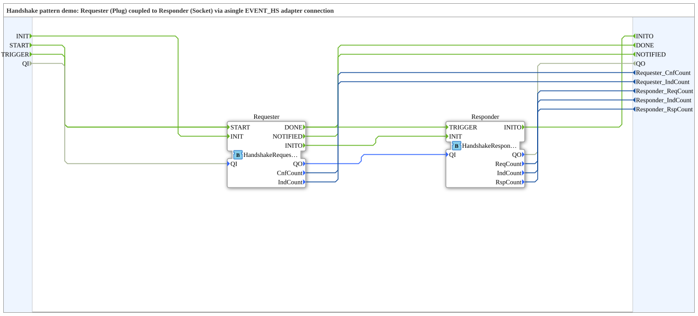

# HandshakePatternDemo: Handshake pattern (Requester/Responder)

* * * * * * * * * *

## Introduction

`HandshakePatternDemo` shows the Handshake pattern: a Requester (Plug) is coupled to a Responder (Socket) via **a single** `EVENT_HS` adapter connection (type comment). This one connection replaces four separate event connections `REQ`/`CNF`/`IND`/`RSP`.

SubApp interface: event inputs `INIT`, `START` (Requester sends a `REQ`) and `TRIGGER` (Responder sends an unsolicited `IND`); event outputs `INITO`, `DONE` (Requester received the `CNF`) and `NOTIFIED` (Requester received an `IND` and answered with `RSP`); input `QI`, output `QO` and the counters `Requester_CnfCount`, `Requester_IndCount`, `Responder_ReqCount`, `Responder_IndCount`, `Responder_RspCount` (all `UINT`).

## Function Blocks (FBs) Used

| Instance | Type | Parameters | Explanation |
|---|---|---|---|
| `Requester` | `Meins::DesingPatterns::HandshakePattern::HandshakeRequester` | - | Plug `HS` (`adapter::types::bidirectional::Handshake::EVENT_HS`): sends `REQ`/`RSP`, receives `CNF`/`IND`; counts `CnfCount` and `IndCount`. |
| `Responder` | `Meins::DesingPatterns::HandshakePattern::HandshakeResponder` | - | Socket `HS`: receives `REQ`/`RSP`, sends `CNF`/`IND`; counts `ReqCount`, `IndCount`, `RspCount`. |

## Program Flow and Connections

**Adapter connection:** `Requester.HS` → `Responder.HS` (Requester = Plug is the source, Responder = Socket is the destination).

**Event connections:**

1. `INIT` → `Requester.INIT`; `Requester.INITO` → `Responder.INIT`; `Responder.INITO` → `INITO` (initialization passes through both blocks).
2. `START` → `Requester.START`; `TRIGGER` → `Responder.TRIGGER`.
3. `Requester.DONE` → `DONE`; `Requester.NOTIFIED` → `NOTIFIED`.

**Data connections:** `QI` → `Requester.QI`; `Requester.QO` → `Responder.QI`; `Responder.QO` → `QO`; the five counters are passed from the two blocks to the outside.

Both blocks are basic FBs in the project folder (`HandshakeRequester.fbt`, `HandshakeResponder.fbt`).

## Summary

The demo shows that the entire request/response dialog between two blocks runs over a single adapter connection; counters make the telegrams sent and received visible.

---

### 🌐 Related topic subpages on ms-muc-docs.de

- [🌐 Eclipse 4diac IDE & color reference on ms-muc-docs.de](https://www.ms-muc-docs.de/iec-61499/eclipse-4diac/)
