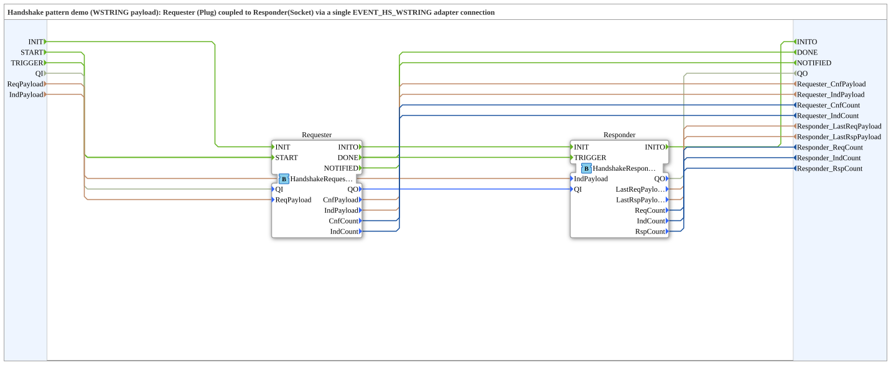

# HandshakePatternDemoWSTRING: Handshake pattern with WSTRING payload

* * * * * * * * * *

## Introduction

`HandshakePatternDemoWSTRING` is the variant of [`HandshakePatternDemo`](./HandshakePatternDemo.md) with payload: Requester (Plug) and Responder (Socket) are coupled via **a single** `EVENT_HS_WSTRING` adapter connection that carries `REQ`/`CNF`/`IND`/`RSP` together with `WSTRING` payload (type comment).

In addition to the interface of the base demo (`INIT`, `START`, `TRIGGER`, `INITO`, `DONE`, `NOTIFIED`, `QI`, `QO`, five `UINT` counters) there are the inputs `ReqPayload` (default `"push,100"`) and `IndPayload` (default `"status,ok"`) and the outputs `Requester_CnfPayload`, `Requester_IndPayload`, `Responder_LastReqPayload` and `Responder_LastRspPayload` (all `WSTRING`).

## Function Blocks (FBs) Used

| Instance | Type | Parameters | Explanation |
|---|---|---|---|
| `Requester` | `Meins::DesingPatterns::HandshakePattern::HandshakeRequesterWSTRING` | - | Plug `HS` (`EVENT_HS_WSTRING`): sends `REQ` with `ReqPayload`, receives `CNF`/`IND` with payload and answers `IND` with `RSP`. |
| `Responder` | `Meins::DesingPatterns::HandshakePattern::HandshakeResponderWSTRING` | - | Socket `HS`: receives `REQ`/`RSP`, sends `CNF` and (on `TRIGGER`) `IND` with `IndPayload`. |

## Program Flow and Connections

**Adapter connection:** `Requester.HS` → `Responder.HS` (Requester = Plug is the source, Responder = Socket is the destination).

**Event connections:** `INIT` → `Requester.INIT` → `Requester.INITO` → `Responder.INIT` → `Responder.INITO` → `INITO`; `START` → `Requester.START`; `TRIGGER` → `Responder.TRIGGER`; `Requester.DONE` → `DONE`; `Requester.NOTIFIED` → `NOTIFIED`.

**Data connections:**

1. `QI` → `Requester.QI`; `Requester.QO` → `Responder.QI`; `Responder.QO` → `QO`.
2. `ReqPayload` → `Requester.ReqPayload`; `IndPayload` → `Responder.IndPayload`.
3. `Requester.CnfPayload`, `Requester.IndPayload`, `Requester.CnfCount`, `Requester.IndCount` → the correspondingly named `Requester_*` outputs.
4. `Responder.LastReqPayload`, `Responder.LastRspPayload`, `Responder.ReqCount`, `Responder.IndCount`, `Responder.RspCount` → the `Responder_*` outputs.

## Summary

Like the base demo, but the same single adapter connection additionally carries text payload (`WSTRING`) in both directions.

---

### 🌐 Related topic subpages on ms-muc-docs.de

- [🌐 Eclipse 4diac IDE & color reference on ms-muc-docs.de](https://www.ms-muc-docs.de/iec-61499/eclipse-4diac/)
