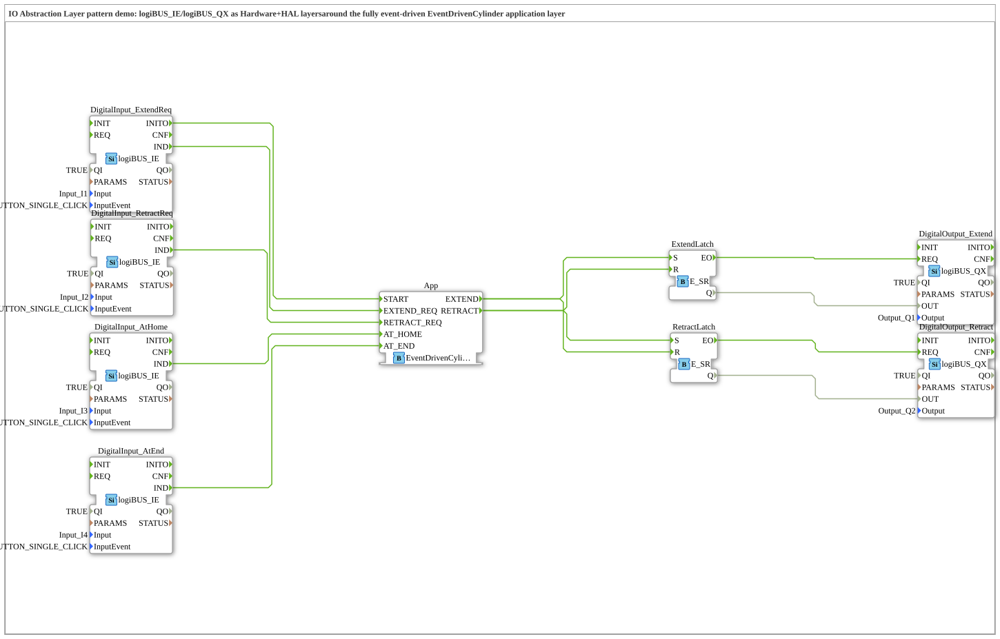

# IOAbstractionDemo: IO abstraction layer pattern

* * * * * * * * * *

## Introduction

`IOAbstractionDemo` shows the IO abstraction layer pattern: `logiBUS_IE` and `logiBUS_QX` form the hardware / HAL layers around the fully event-driven application layer `EventDrivenCylinder` (type comment). The cylinder is controlled by four inputs (extend request, retract request, end positions home/end) and switches two outputs (extend, retract). The SubApp has no interface of its own.

## Function Blocks (FBs) Used

| Instance | Type | Parameters | Explanation |
|---|---|---|---|
| `DigitalInput_ExtendReq` | [`logiBUS::io::DI::logiBUS_IE`](https://meisterschulen-am-ostbahnhof-munchen-docs.readthedocs.io/projects/4diac-library-reference-docs/en/latest/Bibliotheken/ExternalLibraries/logiBUS/io/DI/logiBUS_IE/) | `Input` = `Input_I1`, `InputEvent` = `BUTTON_SINGLE_CLICK`, `QI` = `TRUE` | Extend request. |
| `DigitalInput_RetractReq` | [`logiBUS::io::DI::logiBUS_IE`](https://meisterschulen-am-ostbahnhof-munchen-docs.readthedocs.io/projects/4diac-library-reference-docs/en/latest/Bibliotheken/ExternalLibraries/logiBUS/io/DI/logiBUS_IE/) | `Input` = `Input_I2`, `InputEvent` = `BUTTON_SINGLE_CLICK`, `QI` = `TRUE` | Retract request. |
| `DigitalInput_AtHome` | [`logiBUS::io::DI::logiBUS_IE`](https://meisterschulen-am-ostbahnhof-munchen-docs.readthedocs.io/projects/4diac-library-reference-docs/en/latest/Bibliotheken/ExternalLibraries/logiBUS/io/DI/logiBUS_IE/) | `Input` = `Input_I3`, `InputEvent` = `BUTTON_SINGLE_CLICK`, `QI` = `TRUE` | Home end-position signal. |
| `DigitalInput_AtEnd` | [`logiBUS::io::DI::logiBUS_IE`](https://meisterschulen-am-ostbahnhof-munchen-docs.readthedocs.io/projects/4diac-library-reference-docs/en/latest/Bibliotheken/ExternalLibraries/logiBUS/io/DI/logiBUS_IE/) | `Input` = `Input_I4`, `InputEvent` = `BUTTON_SINGLE_CLICK`, `QI` = `TRUE` | End end-position signal. |
| `App` | `Meins::DesingPatterns::PurelyEventDrivenPattern::EventDrivenCylinder` | - | Event-driven cylinder without BOOL data pins (states HOME, EXTENDING, EXTENDED, RETRACTING, etc.). |
| `ExtendLatch` | [`iec61499::events::E_SR`](https://meisterschulen-am-ostbahnhof-munchen-docs.readthedocs.io/projects/4diac-library-reference-docs/en/latest/Bibliotheken/StandardLibraries/events/E_SR/) | - | Latch for the extend drive. |
| `RetractLatch` | [`iec61499::events::E_SR`](https://meisterschulen-am-ostbahnhof-munchen-docs.readthedocs.io/projects/4diac-library-reference-docs/en/latest/Bibliotheken/StandardLibraries/events/E_SR/) | - | Latch for the retract drive. |
| `DigitalOutput_Extend` | [`logiBUS::io::DQ::logiBUS_QX`](https://meisterschulen-am-ostbahnhof-munchen-docs.readthedocs.io/projects/4diac-library-reference-docs/en/latest/Bibliotheken/ExternalLibraries/logiBUS/io/DO/logiBUS_QX/) | `Output` = `Output_Q1`, `QI` = `TRUE` | Extend output. |
| `DigitalOutput_Retract` | [`logiBUS::io::DQ::logiBUS_QX`](https://meisterschulen-am-ostbahnhof-munchen-docs.readthedocs.io/projects/4diac-library-reference-docs/en/latest/Bibliotheken/ExternalLibraries/logiBUS/io/DO/logiBUS_QX/) | `Output` = `Output_Q2`, `QI` = `TRUE` | Retract output. |

## Program Flow and Connections

**Input side (hardware → application):**

1. `DigitalInput_ExtendReq.INITO` → `App.START` (comment: "Bootstrap: fires once at deployment").
2. `DigitalInput_ExtendReq.IND` → `App.EXTEND_REQ`; `DigitalInput_RetractReq.IND` → `App.RETRACT_REQ`.
3. `DigitalInput_AtHome.IND` → `App.AT_HOME`; `DigitalInput_AtEnd.IND` → `App.AT_END`.

**Output side (application → hardware):**

1. `App.EXTEND` → `ExtendLatch.S` and `RetractLatch.R`.
2. `App.RETRACT` → `RetractLatch.S` and `ExtendLatch.R`.
3. `ExtendLatch.EO` → `DigitalOutput_Extend.REQ`, `ExtendLatch.Q` → `DigitalOutput_Extend.OUT`.
4. `RetractLatch.EO` → `DigitalOutput_Retract.REQ`, `RetractLatch.Q` → `DigitalOutput_Retract.OUT`.

The application only knows events; the two E_SR latches and the `logiBUS_QX` outputs translate them to levels. `EventDrivenCylinder` is a basic FB in the project folder `DesingPatterns/PurelyEventDrivenPattern`.

## Summary

The demo separates hardware access (logiBUS inputs/outputs, latches) from the application logic (`EventDrivenCylinder`), which works exclusively with events.

---

### 🌐 Related topic subpages on ms-muc-docs.de

- [🌐 Eclipse 4diac IDE & color reference on ms-muc-docs.de](https://www.ms-muc-docs.de/iec-61499/eclipse-4diac/)
