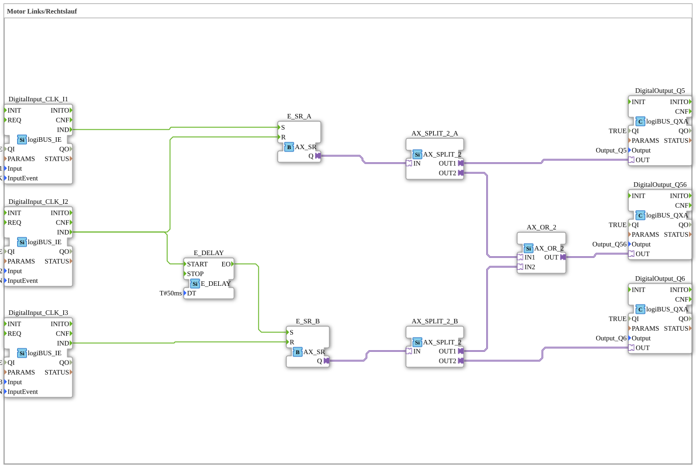

# ErsteAutomatisierung: Motor left/right run

* * * * * * * * * *

## Introduction

`ErsteAutomatisierung` ("first automation") is an early exercise (type comment: "Motor Links/Rechtslauf", i.e. motor left/right run). Three buttons (`Input_I1`...`Input_I3`) drive two set/reset latches that control two outputs (`Output_Q5`, `Output_Q6`) for the two directions of rotation; a third output (`Output_Q56`) is the OR of both directions. The SubApp has no interface of its own.

## Function Blocks (FBs) Used

| Instance | Type | Parameters | Explanation |
|---|---|---|---|
| `DigitalInput_CLK_I1` | [`logiBUS::io::DI::logiBUS_IE`](https://meisterschulen-am-ostbahnhof-munchen-docs.readthedocs.io/projects/4diac-library-reference-docs/en/latest/Bibliotheken/ExternalLibraries/logiBUS/io/DI/logiBUS_IE/) | `Input` = `Input_I1`, `InputEvent` = `BUTTON_SINGLE_CLICK`, `QI` = `TRUE` | Delivers the `IND` event on a single click of button I1. |
| `DigitalInput_CLK_I2` | [`logiBUS::io::DI::logiBUS_IE`](https://meisterschulen-am-ostbahnhof-munchen-docs.readthedocs.io/projects/4diac-library-reference-docs/en/latest/Bibliotheken/ExternalLibraries/logiBUS/io/DI/logiBUS_IE/) | `Input` = `Input_I2`, `InputEvent` = `BUTTON_PRESS_DOWN`, `QI` = `TRUE` | Delivers the `IND` event when button I2 is pressed down. |
| `DigitalInput_CLK_I3` | [`logiBUS::io::DI::logiBUS_IE`](https://meisterschulen-am-ostbahnhof-munchen-docs.readthedocs.io/projects/4diac-library-reference-docs/en/latest/Bibliotheken/ExternalLibraries/logiBUS/io/DI/logiBUS_IE/) | `Input` = `Input_I3`, `InputEvent` = `BUTTON_PRESS_DOWN`, `QI` = `TRUE` | Delivers the `IND` event when button I3 is pressed down. |
| `E_DELAY` | [`iec61499::events::E_DELAY`](https://meisterschulen-am-ostbahnhof-munchen-docs.readthedocs.io/projects/4diac-library-reference-docs/en/latest/Bibliotheken/StandardLibraries/events/E_DELAY/) | `DT` = `T#50ms` | Delays the event from I2 by 50 ms. |
| `E_SR_A` | [`adapter::events::unidirectional::AX_SR`](https://meisterschulen-am-ostbahnhof-munchen-docs.readthedocs.io/projects/4diac-library-reference-docs/en/latest/Bibliotheken/ExternalLibraries/adapter/events/unidirectional/BOOL/AX_SR/) | - | Set/reset latch for direction A (output `Q`). |
| `E_SR_B` | [`adapter::events::unidirectional::AX_SR`](https://meisterschulen-am-ostbahnhof-munchen-docs.readthedocs.io/projects/4diac-library-reference-docs/en/latest/Bibliotheken/ExternalLibraries/adapter/events/unidirectional/BOOL/AX_SR/) | - | Set/reset latch for direction B (output `Q`). |
| `AX_SPLIT_2_A` | [`adapter::events::unidirectional::AX_SPLIT_2`](https://meisterschulen-am-ostbahnhof-munchen-docs.readthedocs.io/projects/4diac-library-reference-docs/en/latest/Bibliotheken/ExternalLibraries/adapter/events/unidirectional/BOOL/AX_SPLIT_2/) | - | Distributes the state of `E_SR_A` to two consumers. |
| `AX_SPLIT_2_B` | [`adapter::events::unidirectional::AX_SPLIT_2`](https://meisterschulen-am-ostbahnhof-munchen-docs.readthedocs.io/projects/4diac-library-reference-docs/en/latest/Bibliotheken/ExternalLibraries/adapter/events/unidirectional/BOOL/AX_SPLIT_2/) | - | Distributes the state of `E_SR_B` to two consumers. |
| `AX_OR_2` | [`adapter::booleanOperators::AX_OR_2`](https://meisterschulen-am-ostbahnhof-munchen-docs.readthedocs.io/projects/4diac-library-reference-docs/en/latest/Bibliotheken/ExternalLibraries/adapter/booleanOperators/AX_OR_2/) | - | OR of the two directions. |
| `DigitalOutput_Q5` | [`logiBUS::io::DQ::logiBUS_QXA`](https://meisterschulen-am-ostbahnhof-munchen-docs.readthedocs.io/projects/4diac-library-reference-docs/en/latest/Bibliotheken/ExternalLibraries/logiBUS/io/DO/logiBUS_QXA/) | `Output` = `Output_Q5`, `QI` = `TRUE` | Output for direction A. |
| `DigitalOutput_Q6` | [`logiBUS::io::DQ::logiBUS_QXA`](https://meisterschulen-am-ostbahnhof-munchen-docs.readthedocs.io/projects/4diac-library-reference-docs/en/latest/Bibliotheken/ExternalLibraries/logiBUS/io/DO/logiBUS_QXA/) | `Output` = `Output_Q6`, `QI` = `TRUE` | Output for direction B. |
| `DigitalOutput_Q56` | [`logiBUS::io::DQ::logiBUS_QXA`](https://meisterschulen-am-ostbahnhof-munchen-docs.readthedocs.io/projects/4diac-library-reference-docs/en/latest/Bibliotheken/ExternalLibraries/logiBUS/io/DO/logiBUS_QXA/) | `Output` = `Output_Q56`, `QI` = `TRUE` | Common output: active when A or B is active. |

## Program Flow and Connections

**Event connections:**

1. `DigitalInput_CLK_I1.IND` → `E_SR_A.S`: a single click on I1 sets direction A.
2. `DigitalInput_CLK_I2.IND` → `E_SR_A.R`: pressing I2 resets direction A.
3. `DigitalInput_CLK_I2.IND` → `E_DELAY.START` and `E_DELAY.EO` → `E_SR_B.S`: the same event sets direction B after 50 ms.
4. `DigitalInput_CLK_I3.IND` → `E_SR_B.R`: pressing I3 resets direction B.

**Adapter connections:**

1. `E_SR_A.Q` → `AX_SPLIT_2_A.IN`; `AX_SPLIT_2_A.OUT1` → `DigitalOutput_Q5.OUT`; `AX_SPLIT_2_A.OUT2` → `AX_OR_2.IN1`.
2. `E_SR_B.Q` → `AX_SPLIT_2_B.IN`; `AX_SPLIT_2_B.OUT2` → `DigitalOutput_Q6.OUT`; `AX_SPLIT_2_B.OUT1` → `AX_OR_2.IN2`.
3. `AX_OR_2.OUT` → `DigitalOutput_Q56.OUT`.

Resetting direction B when A is set (I1) is not wired in the network. When switching over via I2, A is reset and B is set only 50 ms later.

## Summary

`ErsteAutomatisierung` uses three buttons, two set/reset latches, a 50 ms delay and an OR to build two outputs for the directions of rotation of a motor plus one common output.

---

### 🌐 Related topic subpages on ms-muc-docs.de

- [🌐 Eclipse 4diac IDE & color reference on ms-muc-docs.de](https://www.ms-muc-docs.de/iec-61499/eclipse-4diac/)
