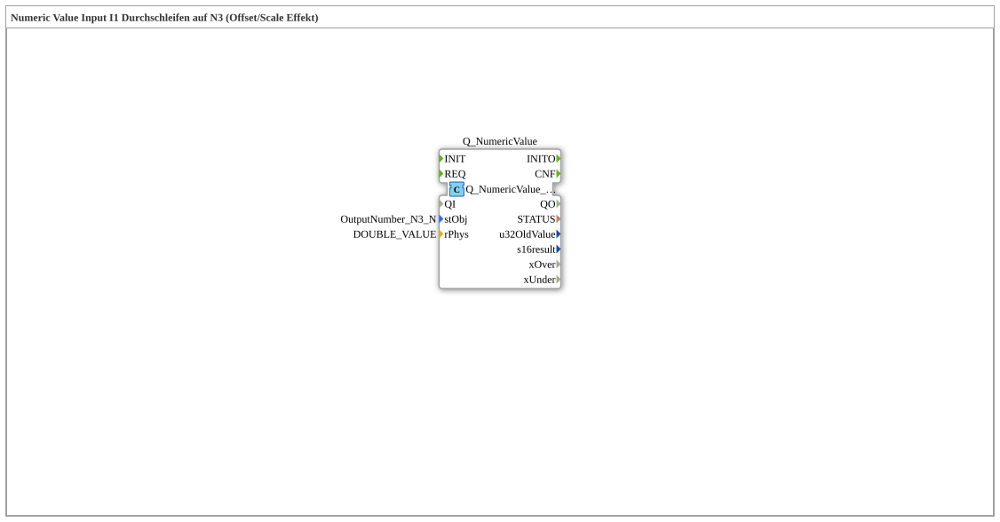

# Uebung_011d_GcfFunc_AX: Showing a Value from a GCF Function in the VT

* * * * * * * * * *

## Introduction

The SubApp `Uebung_011d_GcfFunc_AX` in the package `Meins::GcfFunctionCall` shows the value `DOUBLE_VALUE` from a GlobalConstants file on the Universal Terminal. `DOUBLE_VALUE` is computed in the GCF with the ST function `F_Double` (see [GcfFunctionCall](GcfFunctionCall.md)).

## Function Blocks (FBs) Used

- **Q_NumericValue**: `isobus::UT::Q::Q_NumericValue_PHYS`
    - **Parameters**: `stObj = OutputNumber_N3_N`, `rPhys = DOUBLE_VALUE`
    - **Explanation**: Outputs the physical value to the number field N3 of the Universal Terminal. Offset and scale of the object act on the value.

## Program Flow and Connections

1. The block has no connections. Both values come as imported constants (`DOUBLE_VALUE` from `Meins::GcfFunctionCall::const::FuncConst`, `OutputNumber_N3_N` from `Uebungen::const::UT::DefaultPool_Numeric`) directly as parameters.
2. Expectation: N3 shows 14 (`F_Double(7)`).

## Summary

A single constant from a GCF is enough to show a computed value in the VT. The calculation `F_Double(7)` happens at export time.

---

### 🌐 Related topic subpages on ms-muc-docs.de

- [🌐 Eclipse 4diac IDE & color reference on ms-muc-docs.de](https://www.ms-muc-docs.de/iec-61499/eclipse-4diac/)
