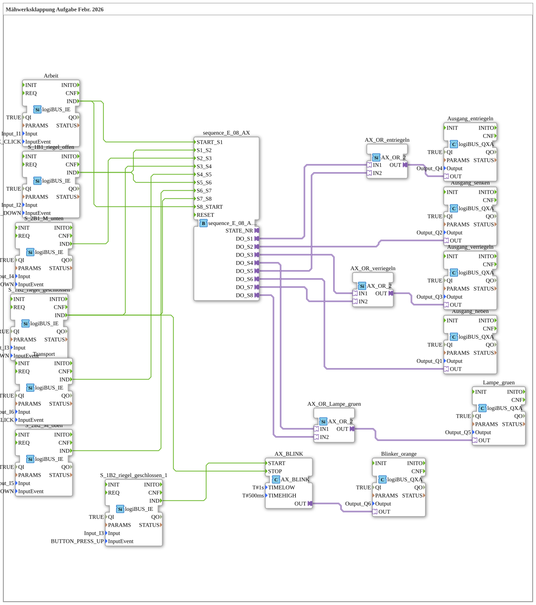

# Maehwerksklappung: Mower Deck Folding (Step Sequence)

* * * * * * * * * *

## Introduction

`Maehwerksklappung` is the training task "mower deck folding" (as of February 2026): a mower deck is folded between the states **Work** (down) and **Transport** (up) using a latch (unlock/lock) and a cylinder (raise/lower). The exercise is built as an **8-step sequence** with `sequence_E_08_AX`; the steps are advanced by button/sensor events (`logiBUS_IE`). The variant with level inputs and pure Boolean logic is described in `Maehwerksklappung_IXA`.

The SubApp interface is empty; all inputs and outputs are wired directly to `Input_I1`…`Input_I6` and `Output_Q1`…`Output_Q6`.

## Function Blocks (FBs) Used

### Inputs (events)

| Instance | Type | Parameters | Explanation |
|---|---|---|---|
| `Arbeit` | [logiBUS_IE](https://meisterschulen-am-ostbahnhof-munchen-docs.readthedocs.io/projects/4diac-library-reference-docs/en/latest/Bibliotheken/ExternalLibraries/logiBUS/io/DI/logiBUS_IE/) | `Input_I1`, `BUTTON_SINGLE_CLICK` | "Work" button (single click) |
| `S_1B1_riegel_offen` | [logiBUS_IE](https://meisterschulen-am-ostbahnhof-munchen-docs.readthedocs.io/projects/4diac-library-reference-docs/en/latest/Bibliotheken/ExternalLibraries/logiBUS/io/DI/logiBUS_IE/) | `Input_I2`, `BUTTON_PRESS_DOWN` | Sensor 1B1: latch open (edge on press) |
| `S_1B2_riegel_geschlossen` | [logiBUS_IE](https://meisterschulen-am-ostbahnhof-munchen-docs.readthedocs.io/projects/4diac-library-reference-docs/en/latest/Bibliotheken/ExternalLibraries/logiBUS/io/DI/logiBUS_IE/) | `Input_I3`, `BUTTON_PRESS_DOWN` | Sensor 1B2: latch closed (edge on press) |
| `S_1B2_riegel_geschlossen_1` | [logiBUS_IE](https://meisterschulen-am-ostbahnhof-munchen-docs.readthedocs.io/projects/4diac-library-reference-docs/en/latest/Bibliotheken/ExternalLibraries/logiBUS/io/DI/logiBUS_IE/) | `Input_I3`, `BUTTON_PRESS_UP` | Same sensor 1B2, but edge on release |
| `S_2B1_M_unten` | [logiBUS_IE](https://meisterschulen-am-ostbahnhof-munchen-docs.readthedocs.io/projects/4diac-library-reference-docs/en/latest/Bibliotheken/ExternalLibraries/logiBUS/io/DI/logiBUS_IE/) | `Input_I4`, `BUTTON_PRESS_DOWN` | Sensor 2B1: mower deck down |
| `S_2B2_M_oben` | [logiBUS_IE](https://meisterschulen-am-ostbahnhof-munchen-docs.readthedocs.io/projects/4diac-library-reference-docs/en/latest/Bibliotheken/ExternalLibraries/logiBUS/io/DI/logiBUS_IE/) | `Input_I5`, `BUTTON_PRESS_DOWN` | Sensor 2B2: mower deck up |
| `Transport` | [logiBUS_IE](https://meisterschulen-am-ostbahnhof-munchen-docs.readthedocs.io/projects/4diac-library-reference-docs/en/latest/Bibliotheken/ExternalLibraries/logiBUS/io/DI/logiBUS_IE/) | `Input_I6`, `BUTTON_SINGLE_CLICK` | "Transport" button (single click) |

### Sequence control and logic

| Instance | Type | Parameters | Explanation |
|---|---|---|---|
| `sequence_E_08_AX` | [sequence_E_08_AX](https://meisterschulen-am-ostbahnhof-munchen-docs.readthedocs.io/projects/4diac-library-reference-docs/en/latest/Bibliotheken/ExternalLibraries/logiBUS/utils/sequence/event/sequence_E_08_AX/) | – | Event-driven step sequence with 8 states; each state activates one adapter output `DO_S1`…`DO_S8` |
| `AX_OR_entriegeln` | [AX_OR_2](https://meisterschulen-am-ostbahnhof-munchen-docs.readthedocs.io/projects/4diac-library-reference-docs/en/latest/Bibliotheken/ExternalLibraries/adapter/booleanOperators/AX_OR_2/) | – | OR of `DO_S1` and `DO_S5` for the "unlock" output |
| `AX_OR_verriegeln` | [AX_OR_2](https://meisterschulen-am-ostbahnhof-munchen-docs.readthedocs.io/projects/4diac-library-reference-docs/en/latest/Bibliotheken/ExternalLibraries/adapter/booleanOperators/AX_OR_2/) | – | OR of `DO_S3` and `DO_S7` for the "lock" output |
| `AX_OR_Lampe_gruen` | [AX_OR_2](https://meisterschulen-am-ostbahnhof-munchen-docs.readthedocs.io/projects/4diac-library-reference-docs/en/latest/Bibliotheken/ExternalLibraries/adapter/booleanOperators/AX_OR_2/) | – | OR of `DO_S4` and `DO_S8` for the green lamp |
| `AX_BLINK` | [AX_BLINK](https://meisterschulen-am-ostbahnhof-munchen-docs.readthedocs.io/projects/4diac-library-reference-docs/en/latest/Bibliotheken/ExternalLibraries/adapter/events/unidirectional/BOOL/signals/AX_BLINK/) | `TIMELOW` = `T#1s`, `TIMEHIGH` = `T#500ms` | Blink generator for the orange warning lamp |

### Outputs

| Instance | Type | Parameters | Explanation |
|---|---|---|---|
| `Ausgang_heben` | [logiBUS_QXA](https://meisterschulen-am-ostbahnhof-munchen-docs.readthedocs.io/projects/4diac-library-reference-docs/en/latest/Bibliotheken/ExternalLibraries/logiBUS/io/DO/logiBUS_QXA/) | `Output_Q1` | Raise mower deck |
| `Ausgang_senken` | [logiBUS_QXA](https://meisterschulen-am-ostbahnhof-munchen-docs.readthedocs.io/projects/4diac-library-reference-docs/en/latest/Bibliotheken/ExternalLibraries/logiBUS/io/DO/logiBUS_QXA/) | `Output_Q2` | Lower mower deck |
| `Ausgang_verriegeln` | [logiBUS_QXA](https://meisterschulen-am-ostbahnhof-munchen-docs.readthedocs.io/projects/4diac-library-reference-docs/en/latest/Bibliotheken/ExternalLibraries/logiBUS/io/DO/logiBUS_QXA/) | `Output_Q3` | Close latch |
| `Ausgang_entriegeln` | [logiBUS_QXA](https://meisterschulen-am-ostbahnhof-munchen-docs.readthedocs.io/projects/4diac-library-reference-docs/en/latest/Bibliotheken/ExternalLibraries/logiBUS/io/DO/logiBUS_QXA/) | `Output_Q4` | Open latch |
| `Lampe_gruen` | [logiBUS_QXA](https://meisterschulen-am-ostbahnhof-munchen-docs.readthedocs.io/projects/4diac-library-reference-docs/en/latest/Bibliotheken/ExternalLibraries/logiBUS/io/DO/logiBUS_QXA/) | `Output_Q5` | Green lamp |
| `Blinker_orange` | [logiBUS_QXA](https://meisterschulen-am-ostbahnhof-munchen-docs.readthedocs.io/projects/4diac-library-reference-docs/en/latest/Bibliotheken/ExternalLibraries/logiBUS/io/DO/logiBUS_QXA/) | `Output_Q6` | Orange flashing lamp |

All instances of `logiBUS_QXA` and `logiBUS_IE` set `QI` to `TRUE`.

## Program Flow and Connections

Two comments are placed in the diagram: "S4 is the state 'Work'" and "S8 is the state 'Transport'". The step sequence runs as follows:

| Step | Advanced by (event) | Active output in the state |
|---|---|---|
| Start → S1 | `Arbeit.IND` (`START_S1`) | S1: `DO_S1` → unlock (Q4) |
| S1 → S2 | `S_1B1_riegel_offen.IND` | S2: `DO_S2` → lower (Q2) |
| S2 → S3 | `S_2B1_M_unten.IND` | S3: `DO_S3` → lock (Q3) |
| S3 → S4 | `S_1B2_riegel_geschlossen.IND` | S4: `DO_S4` → green lamp (Q5), state "Work" |
| S4 → S5 | `Transport.IND` | S5: `DO_S5` → unlock (Q4) |
| S5 → S6 | `S_1B1_riegel_offen.IND` | S6: `DO_S6` → raise (Q1) |
| S6 → S7 | `S_2B2_M_oben.IND` | S7: `DO_S7` → lock (Q3) |
| S7 → S8 | `S_1B2_riegel_geschlossen.IND` | S8: `DO_S8` → green lamp (Q5), state "Transport" |
| S8 → Start | `Arbeit.IND` (`S8_START`) | – |

- Unlock (Q4) and lock (Q3) are each needed in two states and are therefore merged via `AX_OR_entriegeln` (S1, S5) and `AX_OR_verriegeln` (S3, S7). The same applies to the green lamp (S4, S8) via `AX_OR_Lampe_gruen`. Lower (S2) and raise (S6) go directly to their outputs.
- **Warning flasher**: the event `S_1B2_riegel_geschlossen.IND` (sensor 1B2 pressed) stops `AX_BLINK` (`STOP`); releasing 1B2 (`S_1B2_riegel_geschlossen_1.IND`) starts it (`START`). The blink output `AX_BLINK.OUT` drives `Blinker_orange` (Q6). The orange lamp therefore flashes as long as the latch is not reported as closed.

## Summary

`Maehwerksklappung` solves the mower deck task as a classic event-driven step sequence: eight states, advanced by button and sensor events, control the latch, cylinder and lamps; a separate blink generator follows sensor 1B2 alone.

---

### 🌐 Related topic subpages on ms-muc-docs.de

- [🌐 Eclipse 4diac IDE & color reference on ms-muc-docs.de](https://www.ms-muc-docs.de/iec-61499/eclipse-4diac/)
