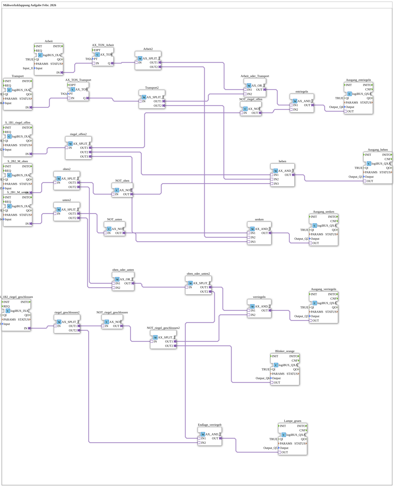

# Maehwerksklappung_IXA: Mower Deck Folding (Boolean Logic)

* * * * * * * * * *

## Introduction

`Maehwerksklappung_IXA` solves the same "mower deck folding" task (as of February 2026) as [`Maehwerksklappung`](./Maehwerksklappung.md), but without a step sequence: the inputs are read as **levels** (`logiBUS_IXA`) and the outputs are formed purely by Boolean operations (AND/OR/NOT) over adapters. The logic equations are given as comments in the network (Y_1 … Y_4, H_1, H_2).

The SubApp interface is empty; inputs `Input_I1`…`Input_I6`, outputs `Output_Q1`…`Output_Q6`.

## Function Blocks (FBs) Used

### Inputs

| Instance | Type | Parameters | Explanation |
|---|---|---|---|
| `Arbeit` | [logiBUS_IXA](https://meisterschulen-am-ostbahnhof-munchen-docs.readthedocs.io/projects/4diac-library-reference-docs/en/latest/Bibliotheken/ExternalLibraries/logiBUS/io/DI/logiBUS_IXA/) | `Input_I1` | "Work" button |
| `S_1B1_riegel_offen` | [logiBUS_IXA](https://meisterschulen-am-ostbahnhof-munchen-docs.readthedocs.io/projects/4diac-library-reference-docs/en/latest/Bibliotheken/ExternalLibraries/logiBUS/io/DI/logiBUS_IXA/) | `Input_I2` | Sensor 1B1: latch open |
| `S_1B2_riegel_geschlossen` | [logiBUS_IXA](https://meisterschulen-am-ostbahnhof-munchen-docs.readthedocs.io/projects/4diac-library-reference-docs/en/latest/Bibliotheken/ExternalLibraries/logiBUS/io/DI/logiBUS_IXA/) | `Input_I3` | Sensor 1B2: latch closed |
| `S_2B1_M_unten` | [logiBUS_IXA](https://meisterschulen-am-ostbahnhof-munchen-docs.readthedocs.io/projects/4diac-library-reference-docs/en/latest/Bibliotheken/ExternalLibraries/logiBUS/io/DI/logiBUS_IXA/) | `Input_I4` | Sensor 2B1: mower deck down |
| `S_2B2_M_oben` | [logiBUS_IXA](https://meisterschulen-am-ostbahnhof-munchen-docs.readthedocs.io/projects/4diac-library-reference-docs/en/latest/Bibliotheken/ExternalLibraries/logiBUS/io/DI/logiBUS_IXA/) | `Input_I5` | Sensor 2B2: mower deck up |
| `Transport` | [logiBUS_IXA](https://meisterschulen-am-ostbahnhof-munchen-docs.readthedocs.io/projects/4diac-library-reference-docs/en/latest/Bibliotheken/ExternalLibraries/logiBUS/io/DI/logiBUS_IXA/) | `Input_I6` | "Transport" button |
| `AX_TON_Arbeit`, `AX_TON_Transport` | [AX_TON](https://meisterschulen-am-ostbahnhof-munchen-docs.readthedocs.io/projects/4diac-library-reference-docs/en/latest/Bibliotheken/ExternalLibraries/adapter/events/unidirectional/BOOL/timers/AX_TON/) | `PT` = `T#2s` | 2 s on-delay for the "Work" and "Transport" buttons respectively |

### Logic

| Instance | Type | Explanation |
|---|---|---|
| `riegel_offen2` | [AX_SPLIT_3](https://meisterschulen-am-ostbahnhof-munchen-docs.readthedocs.io/projects/4diac-library-reference-docs/en/latest/Bibliotheken/ExternalLibraries/adapter/events/unidirectional/BOOL/AX_SPLIT_3/) | Distributes 1B1 to three consumers (unlock, raise, lower) |
| `Arbeit2`, `Transport2`, `oben2`, `unten2`, `riegel_geschlossen2`, `oben_oder_unten2`, `NOT_riegel_geschlossen2` | [AX_SPLIT_2](https://meisterschulen-am-ostbahnhof-munchen-docs.readthedocs.io/projects/4diac-library-reference-docs/en/latest/Bibliotheken/ExternalLibraries/adapter/events/unidirectional/BOOL/AX_SPLIT_2/) | Distribute one signal to two consumers |
| `NOT_riegel_offen`, `NOT_oben`, `NOT_unten`, `NOT_riegel_geschlossen` | [AX_NOT](https://meisterschulen-am-ostbahnhof-munchen-docs.readthedocs.io/projects/4diac-library-reference-docs/en/latest/Bibliotheken/ExternalLibraries/adapter/booleanOperators/AX_NOT/) | Negation of 1B1, 2B2, 2B1 and 1B2 respectively |
| `Arbeit_oder_Transport`, `oben_oder_unten` | [AX_OR_2](https://meisterschulen-am-ostbahnhof-munchen-docs.readthedocs.io/projects/4diac-library-reference-docs/en/latest/Bibliotheken/ExternalLibraries/adapter/booleanOperators/AX_OR_2/) | OR of "Work"/"Transport" and of "up"/"down" respectively |
| `entriegeln`, `verriegeln`, `Endlage_verriegelt` | [AX_AND_2](https://meisterschulen-am-ostbahnhof-munchen-docs.readthedocs.io/projects/4diac-library-reference-docs/en/latest/Bibliotheken/ExternalLibraries/adapter/booleanOperators/AX_AND_2/) | AND operation for unlock, lock and the status lamp |
| `heben`, `senken` | [AX_AND_3](https://meisterschulen-am-ostbahnhof-munchen-docs.readthedocs.io/projects/4diac-library-reference-docs/en/latest/Bibliotheken/ExternalLibraries/adapter/booleanOperators/AX_AND_3/) | Three-input AND for raise and lower |

### Outputs

| Instance | Type | Parameters | Explanation |
|---|---|---|---|
| `Ausgang_heben` | [logiBUS_QXA](https://meisterschulen-am-ostbahnhof-munchen-docs.readthedocs.io/projects/4diac-library-reference-docs/en/latest/Bibliotheken/ExternalLibraries/logiBUS/io/DO/logiBUS_QXA/) | `Output_Q1` | Raise mower deck |
| `Ausgang_senken` | [logiBUS_QXA](https://meisterschulen-am-ostbahnhof-munchen-docs.readthedocs.io/projects/4diac-library-reference-docs/en/latest/Bibliotheken/ExternalLibraries/logiBUS/io/DO/logiBUS_QXA/) | `Output_Q2` | Lower mower deck |
| `Ausgang_verriegeln` | [logiBUS_QXA](https://meisterschulen-am-ostbahnhof-munchen-docs.readthedocs.io/projects/4diac-library-reference-docs/en/latest/Bibliotheken/ExternalLibraries/logiBUS/io/DO/logiBUS_QXA/) | `Output_Q3` | Close latch |
| `Ausgang_entriegeln` | [logiBUS_QXA](https://meisterschulen-am-ostbahnhof-munchen-docs.readthedocs.io/projects/4diac-library-reference-docs/en/latest/Bibliotheken/ExternalLibraries/logiBUS/io/DO/logiBUS_QXA/) | `Output_Q4` | Open latch |
| `Lampe_gruen` | [logiBUS_QXA](https://meisterschulen-am-ostbahnhof-munchen-docs.readthedocs.io/projects/4diac-library-reference-docs/en/latest/Bibliotheken/ExternalLibraries/logiBUS/io/DO/logiBUS_QXA/) | `Output_Q5` | Status lamp H_2 |
| `Blinker_orange` | [logiBUS_QXA](https://meisterschulen-am-ostbahnhof-munchen-docs.readthedocs.io/projects/4diac-library-reference-docs/en/latest/Bibliotheken/ExternalLibraries/logiBUS/io/DO/logiBUS_QXA/) | `Output_Q6` | Warning lamp H_1 |

## Program Flow and Connections

The logic follows the comments in the network (S_1 = "Transport", S_2 = "Work"; 1B1 latch open, 1B2 latch closed, 2B1 down, 2B2 up):

1. **Unlock** (Q4): `Y_1 = (S_1 or S_2) and not 1B1`. If the driver has pressed "Work" or "Transport" and the latch is not yet open, the latch is opened (`Arbeit_oder_Transport` → `entriegeln` with `NOT_riegel_offen`).
2. **Raise** (Q1): `Y_3 = S_1 and 1B1 and not 2B2`. Active while "Transport" is held, the latch is open and the upper end position has not yet been reached (`heben`). On release the output drops and the valve stops the cylinder.
3. **Lower** (Q2): `Y_4 = S_2 and 1B1 and not 2B1`. Analogous to raising, with "Work" and the lower end position (`senken`).
4. **Lock** (Q3): `Y_2 = (2B2 or 2B1) and not 1B2`. As soon as the mower deck is in an end position and the latch is not yet closed, it is locked (`oben_oder_unten` → `verriegeln`).
5. **Warning lamp** (Q6): `H_1 = not 1B2`. On as long as the latch is not completely closed (`NOT_riegel_geschlossen` → `Blinker_orange`).
6. **Status lamp** (Q5): `H_2 = 1B2 and (2B2 or 2B1)`. Signals the safe state "locked in end position" (`Endlage_verriegelt` → `Lampe_gruen`).

The "Work" and "Transport" buttons each pass through a 2 s on-delay (`AX_TON_Arbeit`, `AX_TON_Transport`) before entering the equations for unlock, raise and lower; this delay is not mentioned in the comments of the network.

## Summary

`Maehwerksklappung_IXA` implements the mower deck task without any state memory as pure combinational logic: six inputs are distributed with splitters, combined with AND/OR/NOT and drive the latch, cylinder and both lamps directly from the current sensor picture.

---

### 🌐 Related topic subpages on ms-muc-docs.de

- [🌐 Eclipse 4diac IDE & color reference on ms-muc-docs.de](https://www.ms-muc-docs.de/iec-61499/eclipse-4diac/)
