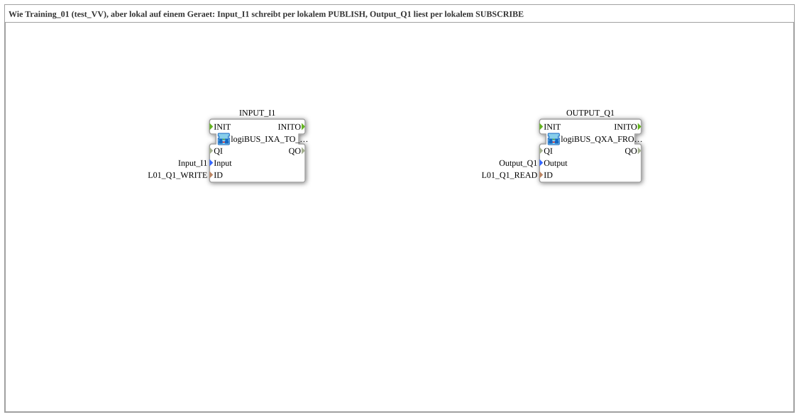

# Uebung_OPC_L01_AX: Local I1→Q1 over OPC-UA (PUBLISH/SUBSCRIBE)

* * * * * * * * * *

## Introduction

`Uebung_OPC_L01_AX` is the local variant of [`Training_01_OPC_UA_SUB`](../../../test_VV/03_OPC_UA/Training_01_OPC_UA_SUB/Training_01_OPC_UA_SUB.md) (test_VV): `Input_I1` writes via OPC-UA, `Output_Q1` reads the same node via OPC-UA. Unlike in test_VV, both sides run on **one** device (`test_AX`, `FORTE_PC_AX`): writing is a local `PUBLISH` (`ACTION=WRITE` without endpoint), reading is a local `SUBSCRIBE` (`ACTION=READ` without endpoint). The interface of the SubApp is empty.

## Function Blocks (FBs) Used

| Instance | Type | Parameters | Explanation |
|---|---|---|---|
| `INPUT_I1` | [`logiBUS_IXA_TO_PUBLISH_OPC`](https://meisterschulen-am-ostbahnhof-munchen-docs.readthedocs.io/projects/4diac-library-reference-docs/en/latest/Bibliotheken/ExternalLibraries/MyLib_AX/sys/logiBUS_IXA_TO_PUBLISH_OPC/) | `Input` = `Input_I1`, `ID` = `L01_Q1_WRITE` | Reads `Input_I1` ([`logiBUS_IXA`](https://meisterschulen-am-ostbahnhof-munchen-docs.readthedocs.io/projects/4diac-library-reference-docs/en/latest/Bibliotheken/ExternalLibraries/logiBUS/io/DI/logiBUS_IXA/)) and writes the state locally to the OPC-UA node via [`AX_PUBLISH_1`](https://meisterschulen-am-ostbahnhof-munchen-docs.readthedocs.io/projects/4diac-library-reference-docs/en/latest/Bibliotheken/ExternalLibraries/adapter/net/AX_PUBLISH_1/) |
| `OUTPUT_Q1` | [`logiBUS_QXA_FROM_SUBSCRIBE_OPC`](https://meisterschulen-am-ostbahnhof-munchen-docs.readthedocs.io/projects/4diac-library-reference-docs/en/latest/Bibliotheken/ExternalLibraries/MyLib_AX/sys/logiBUS_QXA_FROM_SUBSCRIBE_OPC/) | `Output` = `Output_Q1`, `ID` = `L01_Q1_READ` | Reads the node locally via [`AX_SUBSCRIBE_1`](https://meisterschulen-am-ostbahnhof-munchen-docs.readthedocs.io/projects/4diac-library-reference-docs/en/latest/Bibliotheken/ExternalLibraries/adapter/net/AX_SUBSCRIBE_1/) and drives `Output_Q1` ([`logiBUS_QXA`](https://meisterschulen-am-ostbahnhof-munchen-docs.readthedocs.io/projects/4diac-library-reference-docs/en/latest/Bibliotheken/ExternalLibraries/logiBUS/io/DO/logiBUS_QXA/)) with it |

## OPC-UA Address Space

All constants are in `const/OpcUaLokal.gcf` (package `Meins::OPC_UA_Lokal::const`). The IDs are built with [`F_OPC_LOCAL`](https://meisterschulen-am-ostbahnhof-munchen-docs.readthedocs.io/projects/4diac-library-reference-docs/en/latest/Bibliotheken/ExternalLibraries/MyLib_OPC/F_OPC_LOCAL/) (without endpoint) and [`F_OPC_REMOTE`](https://meisterschulen-am-ostbahnhof-munchen-docs.readthedocs.io/projects/4diac-library-reference-docs/en/latest/Bibliotheken/ExternalLibraries/MyLib_OPC/F_OPC_REMOTE/) (with endpoint) from one `*_NODE` each.

| Constant | Value | Used by |
|---|---|---|
| `L01_Q1_NODE` | `"/Objects/Lokal/L01/Q1,1:s=L01_Q1"` | Node (basis of both IDs) |
| `L01_Q1_WRITE` | `MyLib_OPC::F_OPC_LOCAL("WRITE", L01_Q1_NODE)` | `INPUT_I1` (`ID`) |
| `L01_Q1_READ` | `MyLib_OPC::F_OPC_LOCAL("READ", L01_Q1_NODE)` | `OUTPUT_Q1` (`ID`) |

## Program Flow and Connections

1. **Two SubApps without a model connection**: the `.SUB` contains `INPUT_I1` (`x=0`) and `OUTPUT_Q1` (`x=3100`) and no connections; the coupling runs via OPC-UA.
2. **`INPUT_I1`** ([`logiBUS_IXA_TO_PUBLISH_OPC`](https://meisterschulen-am-ostbahnhof-munchen-docs.readthedocs.io/projects/4diac-library-reference-docs/en/latest/Bibliotheken/ExternalLibraries/MyLib_AX/sys/logiBUS_IXA_TO_PUBLISH_OPC/)): `INIT` starts `logiBUS_IXA`; its `INITO` triggers `REQ` and `AX_PUBLISH_1.INIT`. `logiBUS_IXA.IN` is connected to `AX_PUBLISH_1.IN` via an adapter connection.
3. **`OUTPUT_Q1`** ([`logiBUS_QXA_FROM_SUBSCRIBE_OPC`](https://meisterschulen-am-ostbahnhof-munchen-docs.readthedocs.io/projects/4diac-library-reference-docs/en/latest/Bibliotheken/ExternalLibraries/MyLib_AX/sys/logiBUS_QXA_FROM_SUBSCRIBE_OPC/)): `INIT` starts `AX_SUBSCRIBE_1`; its `INITO` starts `logiBUS_QXA`. `AX_SUBSCRIBE_1.OUT` is connected to `logiBUS_QXA.OUT` via an adapter connection.
4. **Runtime**: when `Input_I1` changes, the local `PUBLISH` writes the new value to the node; the local `SUBSCRIBE` reads it and switches `Output_Q1`.

## Result

Tested on FORTE_PC_AX.

## Learning Objectives

- Local `PUBLISH` (`WRITE`) and `SUBSCRIBE` (`READ`) without endpoint on the same device.
- Encapsulating the OPC-UA protocol in one `MyLib::sys` composite per direction.

**Recommended sequence**: [`Training_01_OPC_UA_SUB`](../../../test_VV/03_OPC_UA/Training_01_OPC_UA_SUB/Training_01_OPC_UA_SUB.md)

## Summary

`Uebung_OPC_L01_AX` maps the I1→Q1 pattern of Training_01 onto a single device: local `PUBLISH` on the input side, local `SUBSCRIBE` on the output side, both via the same OPC-UA node.

---

### 🌐 Related topic subpages on ms-muc-docs.de

- [🌐 Eclipse 4diac IDE & color reference on ms-muc-docs.de](https://www.ms-muc-docs.de/iec-61499/eclipse-4diac/)
