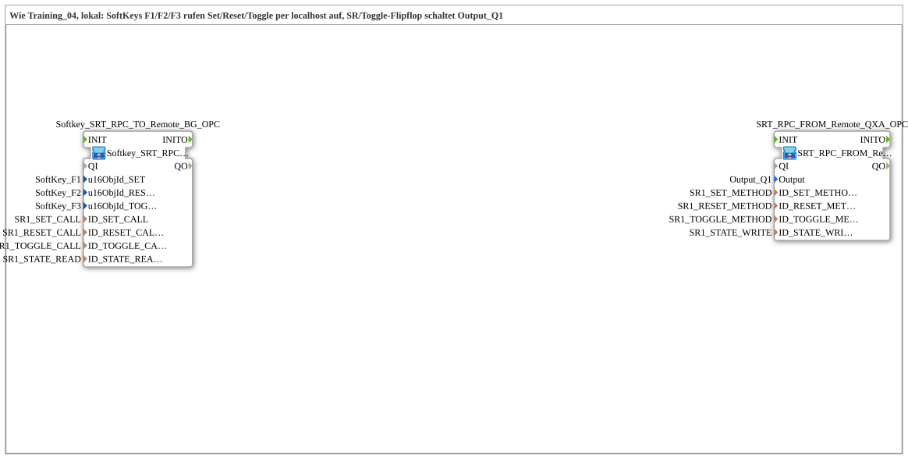

# Uebung_OPC_L04_AX: SoftKeys Set/Reset/Toggle via Local OPC-UA Methods

* * * * * * * * * *

## Introduction

`Uebung_OPC_L04_AX` corresponds to [`Training_04_OPC_UA_RES`](../../../test_VV/03_OPC_UA/Training_04_OPC_UA_RES/Training_04_OPC_UA_RES.md) (test_VV), but local: the SoftKeys `SoftKey_F1`, `SoftKey_F2` and `SoftKey_F3` each call their own OPC-UA method (Set, Reset, Toggle) via localhost. An SR/toggle flip-flop drives `Output_Q1` and reports its state back locally via `PUBLISH`; `GreenWhiteBackground` at the Toggle SoftKey displays it. The interface of the SubApp is empty.

`LOCAL_OPC` is `"opc.tcp://localhost:4840"` (own server) and is only needed for `CALL_METHOD`: a `CALL_METHOD` is not allowed locally and therefore runs as a remote call with an endpoint to the own station (localhost or own IP; both count as remote).

## Function Blocks (FBs) Used

| Instance | Type | Parameters | Explanation |
|---|---|---|---|
| `Softkey_SRT_RPC_TO_Remote_BG_OPC` | [`Softkey_SRT_RPC_TO_Remote_BG_OPC`](https://meisterschulen-am-ostbahnhof-munchen-docs.readthedocs.io/projects/4diac-library-reference-docs/en/latest/Bibliotheken/ExternalLibraries/MyLib_AX/sys/Softkey_SRT_RPC_TO_Remote_BG_OPC/) | `u16ObjId_SET` = `SoftKey_F1`, `u16ObjId_RESET` = `SoftKey_F2`, `u16ObjId_TOGGLE` = `SoftKey_F3`, `ID_SET_CALL` = `SR1_SET_CALL`, `ID_RESET_CALL` = `SR1_RESET_CALL`, `ID_TOGGLE_CALL` = `SR1_TOGGLE_CALL`, `ID_STATE_READ` = `SR1_STATE_READ` | Three [`Softkey_IE`](https://meisterschulen-am-ostbahnhof-munchen-docs.readthedocs.io/projects/4diac-library-reference-docs/en/latest/Bibliotheken/ExternalLibraries/isobus/UT/io/Softkey/Softkey_IE/) (`SK_RELEASED`) each trigger a [`CLIENT_0`](https://meisterschulen-am-ostbahnhof-munchen-docs.readthedocs.io/projects/4diac-library-reference-docs/en/latest/Bibliotheken/StandardLibraries/net/CLIENT_0/); [`AX_SUBSCRIBE_1`](https://meisterschulen-am-ostbahnhof-munchen-docs.readthedocs.io/projects/4diac-library-reference-docs/en/latest/Bibliotheken/ExternalLibraries/adapter/net/AX_SUBSCRIBE_1/) reads the state and feeds [`GreenWhiteBackground1_AX`](https://meisterschulen-am-ostbahnhof-munchen-docs.readthedocs.io/projects/4diac-library-reference-docs/en/latest/Bibliotheken/ExternalLibraries/MyLib_AX/sys/GreenWhiteBackground1_AX/) at the Toggle SoftKey |
| `SRT_RPC_FROM_Remote_QXA_OPC` | [`SRT_RPC_FROM_Remote_QXA_OPC_LOC`](https://meisterschulen-am-ostbahnhof-munchen-docs.readthedocs.io/projects/4diac-library-reference-docs/en/latest/Bibliotheken/ExternalLibraries/MyLib_AX/sys/SRT_RPC_FROM_Remote_QXA_OPC_LOC/) | `Output` = `Output_Q1`, `ID_SET_METHOD` = `SR1_SET_METHOD`, `ID_RESET_METHOD` = `SR1_RESET_METHOD`, `ID_TOGGLE_METHOD` = `SR1_TOGGLE_METHOD`, `ID_STATE_WRITE` = `SR1_STATE_WRITE` | Three [`SERVER_0`](https://meisterschulen-am-ostbahnhof-munchen-docs.readthedocs.io/projects/4diac-library-reference-docs/en/latest/Bibliotheken/StandardLibraries/net/SERVER_0/) (Set/Reset/Toggle) feed [`AX_T_FF_SR`](https://meisterschulen-am-ostbahnhof-munchen-docs.readthedocs.io/projects/4diac-library-reference-docs/en/latest/Bibliotheken/ExternalLibraries/adapter/events/unidirectional/BOOL/AX_T_FF_SR/); [`AX_SPLIT_2`](https://meisterschulen-am-ostbahnhof-munchen-docs.readthedocs.io/projects/4diac-library-reference-docs/en/latest/Bibliotheken/ExternalLibraries/adapter/events/unidirectional/BOOL/AX_SPLIT_2/) fans the state out to [`logiBUS_QXA`](https://meisterschulen-am-ostbahnhof-munchen-docs.readthedocs.io/projects/4diac-library-reference-docs/en/latest/Bibliotheken/ExternalLibraries/logiBUS/io/DO/logiBUS_QXA/) (`Output_Q1`) and [`AX_PUBLISH_1`](https://meisterschulen-am-ostbahnhof-munchen-docs.readthedocs.io/projects/4diac-library-reference-docs/en/latest/Bibliotheken/ExternalLibraries/adapter/net/AX_PUBLISH_1/) (local `PUBLISH`). The type is `…_LOC` |

## OPC-UA Address Space

All constants are in `const/OpcUaLokal.gcf` (package `Meins::OPC_UA_Lokal::const`). The IDs are built with [`F_OPC_LOCAL`](https://meisterschulen-am-ostbahnhof-munchen-docs.readthedocs.io/projects/4diac-library-reference-docs/en/latest/Bibliotheken/ExternalLibraries/MyLib_OPC/F_OPC_LOCAL/) (without endpoint) and [`F_OPC_REMOTE`](https://meisterschulen-am-ostbahnhof-munchen-docs.readthedocs.io/projects/4diac-library-reference-docs/en/latest/Bibliotheken/ExternalLibraries/MyLib_OPC/F_OPC_REMOTE/) (with endpoint) from one `*_NODE` each.

`LOCAL_OPC` is `"opc.tcp://localhost:4840"` (own server) and is only needed for `CALL_METHOD`: a `CALL_METHOD` is not allowed locally and therefore runs as a remote call with an endpoint to the own station (localhost or own IP; both count as remote).

| Constant | Value | Used by |
|---|---|---|
| `SR1_SET_NODE` / `SR1_RESET_NODE` / `SR1_TOGGLE_NODE` | `"/Objects/SRFlipflop/SR1_Set"` / `…/SR1_Reset` / `…/SR1_Toggle` | Method nodes |
| `SR1_SET_METHOD` / `SR1_RESET_METHOD` / `SR1_TOGGLE_METHOD` | `MyLib_OPC::F_OPC_LOCAL("CREATE_METHOD", SR1_…_NODE)` | `SRT_RPC_FROM_Remote_QXA_OPC` (`SERVER_0`, created locally) |
| `SR1_SET_CALL` / `SR1_RESET_CALL` / `SR1_TOGGLE_CALL` | `MyLib_OPC::F_OPC_REMOTE("CALL_METHOD", LOCAL_OPC, SR1_…_NODE)` | `Softkey_SRT_RPC_TO_Remote_BG_OPC` (`CLIENT_0`, call via localhost) |
| `SR1_STATE_NODE` | `"/Objects/SRFlipflop/SR1_State,1:s=SR1_State"` | State node |
| `SR1_STATE_WRITE` | `MyLib_OPC::F_OPC_LOCAL("WRITE", SR1_STATE_NODE)` | `SRT_RPC_FROM_Remote_QXA_OPC` (`ID_STATE_WRITE`) |
| `SR1_STATE_READ` | `MyLib_OPC::F_OPC_LOCAL("READ", SR1_STATE_NODE)` | `Softkey_SRT_RPC_TO_Remote_BG_OPC` (`ID_STATE_READ`) |

## Program Flow and Connections

1. **Two SubApps without a model connection**: the `.SUB` contains `Softkey_SRT_RPC_TO_Remote_BG_OPC` (`x=0`) and `SRT_RPC_FROM_Remote_QXA_OPC` (`x=6000`) and no connections; the coupling runs via OPC-UA.
2. **`Softkey_SRT_RPC_TO_Remote_BG_OPC`**: `SoftKey_SET.IND`, `SoftKey_RESET.IND` and `SoftKey_TOGGLE.IND` trigger `TRIGGER_SET_CLIENT.REQ`, `TRIGGER_RESET_CLIENT.REQ` and `TRIGGER_TOGGLE_CLIENT.REQ` respectively; the `CLIENT_0` blocks call the `SR1_*_CALL` methods at localhost. `STATE_SUBSCRIBE.OUT` goes via adapter connection to `GreenWhiteBackground_AX.DI1`.
3. **`SRT_RPC_FROM_Remote_QXA_OPC`**: `TRIGGER_SET_SERVER.IND` → `AX_T_FF_SR.S`, `TRIGGER_RESET_SERVER.IND` → `AX_T_FF_SR.R`, `TRIGGER_TOGGLE_SERVER.IND` → `AX_T_FF_SR.CLK`; each `IND` is additionally answered with `RSP` of its own server. `AX_T_FF_SR.Q` → `AX_SPLIT_2.IN`; `OUT1` → `DigitalOutput_Q1.OUT`, `OUT2` → `STATE_PUBLISH.IN`.
4. **Runtime**: F1 sets, F2 resets, F3 toggles. The state acts on `Output_Q1` and returns via local `PUBLISH`/`SUBSCRIBE`.

## Result

Not tested on the device.
Note: Every `SERVER_0` needs `IND` → `RSP` directly on its own block, otherwise all OPC-UA publishes of the station stall for up to 4 s (rule see [overview](OPC_UA_Lokal.md)).

## Learning Objectives

- Three separate OPC-UA methods (Set/Reset/Toggle) instead of one string parameter.
- `CALL_METHOD` via localhost and `CREATE_METHOD` locally on the same device.
- State return path locally via `PUBLISH`/`SUBSCRIBE`.

**Recommended sequence**: `Uebung_OPC_L03_AX`, [`Training_04_OPC_UA_RES`](../../../test_VV/03_OPC_UA/Training_04_OPC_UA_RES/Training_04_OPC_UA_RES.md)

## Summary

`Uebung_OPC_L04_AX` implements the Set/Reset/Toggle pattern of Training_04 locally: three SoftKeys call three methods via localhost, an SR/toggle flip-flop drives `Output_Q1`.

---

### 🌐 Related topic subpages on ms-muc-docs.de

- [🌐 Eclipse 4diac IDE & color reference on ms-muc-docs.de](https://www.ms-muc-docs.de/iec-61499/eclipse-4diac/)
