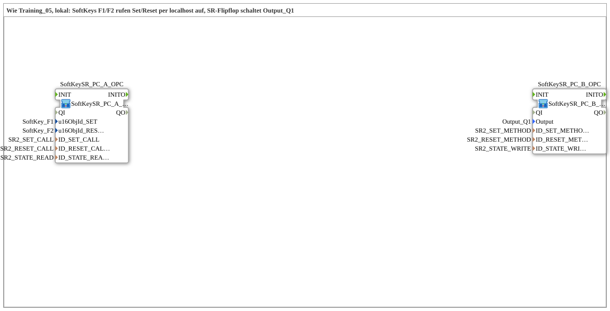

# Uebung_OPC_L05_AX: SoftKeys Set/Reset via Local OPC-UA Methods

* * * * * * * * * *

## Introduction

`Uebung_OPC_L05_AX` corresponds to [`Training_05_OPC_UA_RES`](../../../test_VV/03_OPC_UA/Training_05_OPC_UA_RES/Training_05_OPC_UA_RES.md) (test_VV), but local: the SoftKeys `SoftKey_F1` and `SoftKey_F2` each call their own OPC-UA method (Set, Reset) via localhost. An SR flip-flop drives `Output_Q1` and reports its state back locally via `PUBLISH`; `GreenWhiteBackground` at the Set SoftKey displays it. The interface of the SubApp is empty.

`LOCAL_OPC` is `"opc.tcp://localhost:4840"` (own server) and is only needed for `CALL_METHOD`: a `CALL_METHOD` is not allowed locally and therefore runs as a remote call with an endpoint to the own station (localhost or own IP; both count as remote).

## Function Blocks (FBs) Used

| Instance | Type | Parameters | Explanation |
|---|---|---|---|
| `SoftKeySR_PC_A_OPC` | [`SoftKeySR_PC_A_OPC`](https://meisterschulen-am-ostbahnhof-munchen-docs.readthedocs.io/projects/4diac-library-reference-docs/en/latest/Bibliotheken/ExternalLibraries/MyLib_AX/sys/SoftKeySR_PC_A_OPC/) | `u16ObjId_SET` = `SoftKey_F1`, `u16ObjId_RESET` = `SoftKey_F2`, `ID_SET_CALL` = `SR2_SET_CALL`, `ID_RESET_CALL` = `SR2_RESET_CALL`, `ID_STATE_READ` = `SR2_STATE_READ` | Two [`Softkey_IE`](https://meisterschulen-am-ostbahnhof-munchen-docs.readthedocs.io/projects/4diac-library-reference-docs/en/latest/Bibliotheken/ExternalLibraries/isobus/UT/io/Softkey/Softkey_IE/) (`SK_RELEASED`) each trigger a [`CLIENT_0`](https://meisterschulen-am-ostbahnhof-munchen-docs.readthedocs.io/projects/4diac-library-reference-docs/en/latest/Bibliotheken/StandardLibraries/net/CLIENT_0/); [`AX_SUBSCRIBE_1`](https://meisterschulen-am-ostbahnhof-munchen-docs.readthedocs.io/projects/4diac-library-reference-docs/en/latest/Bibliotheken/ExternalLibraries/adapter/net/AX_SUBSCRIBE_1/) reads the state and feeds [`GreenWhiteBackground1_AX`](https://meisterschulen-am-ostbahnhof-munchen-docs.readthedocs.io/projects/4diac-library-reference-docs/en/latest/Bibliotheken/ExternalLibraries/MyLib_AX/sys/GreenWhiteBackground1_AX/) at the Set SoftKey |
| `SoftKeySR_PC_B_OPC` | [`SoftKeySR_PC_B_OPC_LOC`](https://meisterschulen-am-ostbahnhof-munchen-docs.readthedocs.io/projects/4diac-library-reference-docs/en/latest/Bibliotheken/ExternalLibraries/MyLib_AX/sys/SoftKeySR_PC_B_OPC_LOC/) | `Output` = `Output_Q1`, `ID_SET_METHOD` = `SR2_SET_METHOD`, `ID_RESET_METHOD` = `SR2_RESET_METHOD`, `ID_STATE_WRITE` = `SR2_STATE_WRITE` | Two [`SERVER_0`](https://meisterschulen-am-ostbahnhof-munchen-docs.readthedocs.io/projects/4diac-library-reference-docs/en/latest/Bibliotheken/StandardLibraries/net/SERVER_0/) (Set/Reset) feed [`AX_SR`](https://meisterschulen-am-ostbahnhof-munchen-docs.readthedocs.io/projects/4diac-library-reference-docs/en/latest/Bibliotheken/ExternalLibraries/adapter/events/unidirectional/BOOL/AX_SR/); [`AX_SPLIT_2`](https://meisterschulen-am-ostbahnhof-munchen-docs.readthedocs.io/projects/4diac-library-reference-docs/en/latest/Bibliotheken/ExternalLibraries/adapter/events/unidirectional/BOOL/AX_SPLIT_2/) fans the state out to [`logiBUS_QXA`](https://meisterschulen-am-ostbahnhof-munchen-docs.readthedocs.io/projects/4diac-library-reference-docs/en/latest/Bibliotheken/ExternalLibraries/logiBUS/io/DO/logiBUS_QXA/) (`Output_Q1`) and [`AX_PUBLISH_1`](https://meisterschulen-am-ostbahnhof-munchen-docs.readthedocs.io/projects/4diac-library-reference-docs/en/latest/Bibliotheken/ExternalLibraries/adapter/net/AX_PUBLISH_1/) (local `PUBLISH`). The type is `SoftKeySR_PC_B_OPC_LOC` |

## OPC-UA Address Space

All constants are in `const/OpcUaLokal.gcf` (package `Meins::OPC_UA_Lokal::const`). The IDs are built with [`F_OPC_LOCAL`](https://meisterschulen-am-ostbahnhof-munchen-docs.readthedocs.io/projects/4diac-library-reference-docs/en/latest/Bibliotheken/ExternalLibraries/MyLib_OPC/F_OPC_LOCAL/) (without endpoint) and [`F_OPC_REMOTE`](https://meisterschulen-am-ostbahnhof-munchen-docs.readthedocs.io/projects/4diac-library-reference-docs/en/latest/Bibliotheken/ExternalLibraries/MyLib_OPC/F_OPC_REMOTE/) (with endpoint) from one `*_NODE` each.

`LOCAL_OPC` is `"opc.tcp://localhost:4840"` (own server) and is only needed for `CALL_METHOD`: a `CALL_METHOD` is not allowed locally and therefore runs as a remote call with an endpoint to the own station (localhost or own IP; both count as remote).

| Constant | Value | Used by |
|---|---|---|
| `SR2_SET_NODE` / `SR2_RESET_NODE` | `"/Objects/SRFlipflop/SR2_Set"` / `…/SR2_Reset` | Method nodes |
| `SR2_SET_METHOD` / `SR2_RESET_METHOD` | `MyLib_OPC::F_OPC_LOCAL("CREATE_METHOD", SR2_…_NODE)` | `SoftKeySR_PC_B_OPC` (`SERVER_0`, created locally) |
| `SR2_SET_CALL` / `SR2_RESET_CALL` | `MyLib_OPC::F_OPC_REMOTE("CALL_METHOD", LOCAL_OPC, SR2_…_NODE)` | `SoftKeySR_PC_A_OPC` (`CLIENT_0`, call via localhost) |
| `SR2_STATE_NODE` | `"/Objects/SRFlipflop/SR2_State,1:s=SR2_State"` | State node |
| `SR2_STATE_WRITE` | `MyLib_OPC::F_OPC_LOCAL("WRITE", SR2_STATE_NODE)` | `SoftKeySR_PC_B_OPC` (`ID_STATE_WRITE`) |
| `SR2_STATE_READ` | `MyLib_OPC::F_OPC_LOCAL("READ", SR2_STATE_NODE)` | `SoftKeySR_PC_A_OPC` (`ID_STATE_READ`) |

## Program Flow and Connections

1. **Two SubApps without a model connection**: the `.SUB` contains `SoftKeySR_PC_A_OPC` (`x=0`) and `SoftKeySR_PC_B_OPC` (`x=6000`) and no connections; the coupling runs via OPC-UA.
2. **`SoftKeySR_PC_A_OPC`**: `SoftKey_SET.IND` and `SoftKey_RESET.IND` trigger `TRIGGER_SET_CLIENT.REQ` and `TRIGGER_RESET_CLIENT.REQ` respectively; the `CLIENT_0` blocks call `SR2_SET_CALL` and `SR2_RESET_CALL` at localhost. `STATE_SUBSCRIBE.OUT` goes via adapter connection to `GreenWhiteBackground_AX.DI1`.
3. **`SoftKeySR_PC_B_OPC`**: `TRIGGER_SET_SERVER.IND` → `AX_SR.S`, `TRIGGER_RESET_SERVER.IND` → `AX_SR.R`; each `IND` is additionally answered with `RSP` of its own server. `AX_SR.Q` → `AX_SPLIT_2.IN`; `OUT1` → `DigitalOutput_Q1.OUT`, `OUT2` → `STATE_PUBLISH.IN`.
4. **Runtime**: F1 sets, F2 resets. The state acts on `Output_Q1` and returns via local `PUBLISH`/`SUBSCRIBE`.

## Result

Not tested on the device.
Note: Every `SERVER_0` needs `IND` → `RSP` directly on its own block, otherwise all OPC-UA publishes of the station stall for up to 4 s (rule see [overview](OPC_UA_Lokal.md)).

## Learning Objectives

- Two separate OPC-UA methods (Set/Reset) with an SR flip-flop as counterpart.
- `CALL_METHOD` via localhost and `CREATE_METHOD` locally on the same device.
- State return path locally via `PUBLISH`/`SUBSCRIBE`.

**Recommended sequence**: `Uebung_OPC_L04_AX`, [`Training_05_OPC_UA_RES`](../../../test_VV/03_OPC_UA/Training_05_OPC_UA_RES/Training_05_OPC_UA_RES.md)

## Summary

`Uebung_OPC_L05_AX` is the Set/Reset variant of L04: two SoftKeys, two methods via localhost, an SR flip-flop at `Output_Q1`.

---

### 🌐 Related topic subpages on ms-muc-docs.de

- [🌐 Eclipse 4diac IDE & color reference on ms-muc-docs.de](https://www.ms-muc-docs.de/iec-61499/eclipse-4diac/)
