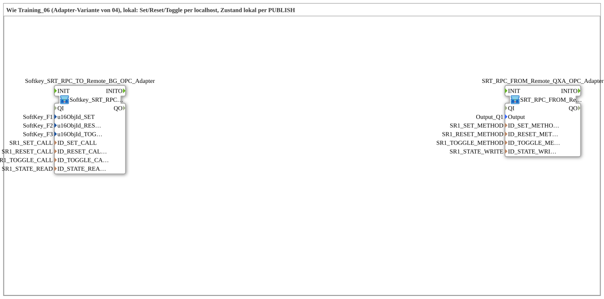

# Uebung_OPC_L06_AX: Adapter Variant of L04: Set/Reset/Toggle via Local OPC-UA Methods

* * * * * * * * * *

## Introduction

`Uebung_OPC_L06_AX` corresponds to [`Training_06_OPC_UA_RES`](../../../test_VV/03_OPC_UA/Training_06_OPC_UA_RES/Training_06_OPC_UA_RES.md) (test_VV, adapter variant of Training_04), but local. Functionally it equals L04 (Set/Reset/Toggle via localhost, state locally via `PUBLISH`), with the same `SR1_*` IDs. The difference lies in the bundling: HMI and OPC-UA trigger are separated and connected via an `ASRT_AX` adapter. The interface of the SubApp is empty.

`LOCAL_OPC` is `"opc.tcp://localhost:4840"` (own server) and is only needed for `CALL_METHOD`: a `CALL_METHOD` is not allowed locally and therefore runs as a remote call with an endpoint to the own station (localhost or own IP; both count as remote).

## Function Blocks (FBs) Used

| Instance | Type | Parameters | Explanation |
|---|---|---|---|
| `Softkey_SRT_RPC_TO_Remote_BG_OPC_Adapter` | [`Softkey_SRT_RPC_TO_Remote_BG_OPC_Adapter`](https://meisterschulen-am-ostbahnhof-munchen-docs.readthedocs.io/projects/4diac-library-reference-docs/en/latest/Bibliotheken/ExternalLibraries/MyLib_AX/sys/Softkey_SRT_RPC_TO_Remote_BG_OPC_Adapter/) | `u16ObjId_SET` = `SoftKey_F1`, `u16ObjId_RESET` = `SoftKey_F2`, `u16ObjId_TOGGLE` = `SoftKey_F3`, `ID_SET_CALL` = `SR1_SET_CALL`, `ID_RESET_CALL` = `SR1_RESET_CALL`, `ID_TOGGLE_CALL` = `SR1_TOGGLE_CALL`, `ID_STATE_READ` = `SR1_STATE_READ` | [`SoftKeySRT_ASRT_AX`](https://meisterschulen-am-ostbahnhof-munchen-docs.readthedocs.io/projects/4diac-library-reference-docs/en/latest/Bibliotheken/ExternalLibraries/MyLib_AX/sys/SoftKeySRT_ASRT_AX/) bundles the HMI (3 SoftKeys + `GreenWhiteBackground`) behind an `ASRT_AX` plug; [`ASRT_AX_CLIENT_0_SUBSCRIBE_1`](https://meisterschulen-am-ostbahnhof-munchen-docs.readthedocs.io/projects/4diac-library-reference-docs/en/latest/Bibliotheken/ExternalLibraries/adapter/net/ASRT_AX_CLIENT_0_SUBSCRIBE_1/) bundles the three `CLIENT_0` + `AX_SUBSCRIBE_1` behind an `ASRT_AX` socket |
| `SRT_RPC_FROM_Remote_QXA_OPC_Adapter` | [`SRT_RPC_FROM_Remote_QXA_OPC_Adapter_LOC`](https://meisterschulen-am-ostbahnhof-munchen-docs.readthedocs.io/projects/4diac-library-reference-docs/en/latest/Bibliotheken/ExternalLibraries/MyLib_AX/sys/SRT_RPC_FROM_Remote_QXA_OPC_Adapter_LOC/) | `Output` = `Output_Q1`, `ID_SET_METHOD` = `SR1_SET_METHOD`, `ID_RESET_METHOD` = `SR1_RESET_METHOD`, `ID_TOGGLE_METHOD` = `SR1_TOGGLE_METHOD`, `ID_STATE_WRITE` = `SR1_STATE_WRITE` | [`ASRT_AX_SERVER_0_PUBLISH_1`](https://meisterschulen-am-ostbahnhof-munchen-docs.readthedocs.io/projects/4diac-library-reference-docs/en/latest/Bibliotheken/ExternalLibraries/MyLib_AX/net/ASRT_AX_SERVER_0_PUBLISH_1/) bundles the three `SERVER_0` + `AX_PUBLISH_1`; [`ASRT_AX_AX_SPLIT`](https://meisterschulen-am-ostbahnhof-munchen-docs.readthedocs.io/projects/4diac-library-reference-docs/en/latest/Bibliotheken/ExternalLibraries/adapter/events/bidirectional/ASRT_AX_AX_SPLIT/) fans out to [`ASRT_AX_T_FF_SR_2`](https://meisterschulen-am-ostbahnhof-munchen-docs.readthedocs.io/projects/4diac-library-reference-docs/en/latest/Bibliotheken/ExternalLibraries/adapter/events/bidirectional/ASRT_AX_T_FF_SR_2/) and [`logiBUS_QXA`](https://meisterschulen-am-ostbahnhof-munchen-docs.readthedocs.io/projects/4diac-library-reference-docs/en/latest/Bibliotheken/ExternalLibraries/logiBUS/io/DO/logiBUS_QXA/) (`Output_Q1`). The type is `…_Adapter_LOC` |

## OPC-UA Address Space

The constants are the same as in L04 (`SR1_*`).

`LOCAL_OPC` is `"opc.tcp://localhost:4840"` (own server) and is only needed for `CALL_METHOD`: a `CALL_METHOD` is not allowed locally and therefore runs as a remote call with an endpoint to the own station (localhost or own IP; both count as remote).

| Constant | Value | Used by |
|---|---|---|
| `SR1_SET_NODE` / `SR1_RESET_NODE` / `SR1_TOGGLE_NODE` | `"/Objects/SRFlipflop/SR1_Set"` / `…/SR1_Reset` / `…/SR1_Toggle` | Method nodes |
| `SR1_SET_METHOD` / `SR1_RESET_METHOD` / `SR1_TOGGLE_METHOD` | `MyLib_OPC::F_OPC_LOCAL("CREATE_METHOD", SR1_…_NODE)` | `SRT_RPC_FROM_Remote_QXA_OPC_Adapter` (`ID_*_METHOD`, `SERVER_0`, created locally) |
| `SR1_SET_CALL` / `SR1_RESET_CALL` / `SR1_TOGGLE_CALL` | `MyLib_OPC::F_OPC_REMOTE("CALL_METHOD", LOCAL_OPC, SR1_…_NODE)` | `Softkey_SRT_RPC_TO_Remote_BG_OPC_Adapter` (`ID_*_CALL`, `CLIENT_0`, call via localhost) |
| `SR1_STATE_NODE` | `"/Objects/SRFlipflop/SR1_State,1:s=SR1_State"` | State node |
| `SR1_STATE_WRITE` | `MyLib_OPC::F_OPC_LOCAL("WRITE", SR1_STATE_NODE)` | `SRT_RPC_FROM_Remote_QXA_OPC_Adapter` (`ID_STATE_WRITE`) |
| `SR1_STATE_READ` | `MyLib_OPC::F_OPC_LOCAL("READ", SR1_STATE_NODE)` | `Softkey_SRT_RPC_TO_Remote_BG_OPC_Adapter` (`ID_STATE_READ`) |

## Program Flow and Connections

1. **Two SubApps without a model connection**: the `.SUB` contains `Softkey_SRT_RPC_TO_Remote_BG_OPC_Adapter` (`x=0`) and `SRT_RPC_FROM_Remote_QXA_OPC_Adapter` (`x=6000`) and no connections; the coupling runs via OPC-UA.
2. **`Softkey_SRT_RPC_TO_Remote_BG_OPC_Adapter`**: `INIT` first starts `TRIGGER` (`ASRT_AX_CLIENT_0_SUBSCRIBE_1`), whose `INITO` starts `SoftKeySRT_ASRT_AX`. The `ASRT_AX` plug `SoftKeySRT_ASRT_AX.OUT` is connected to the socket `TRIGGER.S_R_T`; the IDs `ID_SET_CALL`, `ID_RESET_CALL`, `ID_TOGGLE_CALL` and `ID_STATE_READ` go to `TRIGGER.ID_SET`, `.ID_RESET`, `.ID_TOGGLE` and `.ID_STATE` respectively.
3. **`SRT_RPC_FROM_Remote_QXA_OPC_Adapter`**: `INIT` starts `TRIGGER` (`ASRT_AX_SERVER_0_PUBLISH_1`), whose `INITO` starts `DigitalOutput_Q1`. `TRIGGER.S_R_T` → `SPLIT.IN` (`ASRT_AX_AX_SPLIT`); `SPLIT.OUT` → `FLIPFLOP.S_R_T` (`ASRT_AX_T_FF_SR_2`); `SPLIT.AX_OUT` → `DigitalOutput_Q1.OUT`. The IDs `ID_SET_METHOD`, `ID_RESET_METHOD`, `ID_TOGGLE_METHOD` and `ID_STATE_WRITE` go to `TRIGGER.ID_SET`, `.ID_RESET`, `.ID_TOGGLE` and `.ID_STATE` respectively.
4. **Runtime**: as in L04. F1 sets, F2 resets, F3 toggles; the state acts on `Output_Q1` and is reported locally via `PUBLISH`.

## Result

Not tested on the device.
Note: Every `SERVER_0` needs `IND` → `RSP` directly on its own block, otherwise all OPC-UA publishes of the station stall for up to 4 s (rule see [overview](OPC_UA_Lokal.md)). The SubApp `MyLib::net::ASRT_AX_SERVER_0_PUBLISH_1` contains the self-loop.

## Learning Objectives

- Bundling via `ASRT_AX` adapter: HMI and OPC-UA trigger separated, one adapter instead of many single connections.
- Same function as L04 with a different structure (manually wired versus adapter).
- `CALL_METHOD` via localhost and `CREATE_METHOD` locally on the same device.

**Recommended sequence**: `Uebung_OPC_L04_AX`, [`Training_06_OPC_UA_RES`](../../../test_VV/03_OPC_UA/Training_06_OPC_UA_RES/Training_06_OPC_UA_RES.md)

## Summary

`Uebung_OPC_L06_AX` is functionally identical to L04 but uses the `ASRT_AX` adapter composites: HMI and OPC-UA trigger are separated and connected via an adapter, the state report runs locally via `PUBLISH`.

---

### 🌐 Related topic subpages on ms-muc-docs.de

- [🌐 Eclipse 4diac IDE & color reference on ms-muc-docs.de](https://www.ms-muc-docs.de/iec-61499/eclipse-4diac/)
