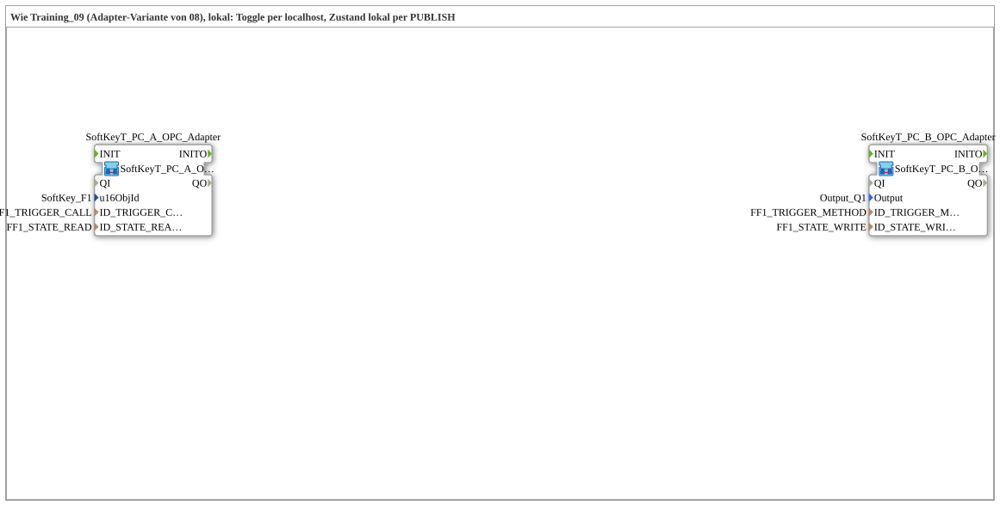

# Uebung_OPC_L09_AX: Toggle Flip-Flop Locally via Method Call (Adapter Variant)

* * * * * * * * * *

## Introduction

`Uebung_OPC_L09_AX` is the local variant of `Training_09_OPC_UA_RES` (adapter variant of Training_08): functionally identical to L08, but with the single-valued `AE_AX_*` adapter blocks (`AE` = Adapter Event, a single trigger without Set/Reset distinction). Both halves of the template run on **one** device; the OPC-UA addresses are the same as in L08 (`FF1_*`).

The network consists of two SubApps without connections between them; coupling runs exclusively via the OPC-UA addresses.

Overview of all local exercises: [`OPC_UA_Lokal.md`](./OPC_UA_Lokal.md).

## Function Blocks (FBs) Used

| Name | Type | Parameters | Explanation |
|---|---|---|---|
| `SoftKeyT_PC_A_OPC_Adapter` | [`SoftKeyT_PC_A_OPC_Adapter`](https://meisterschulen-am-ostbahnhof-munchen-docs.readthedocs.io/projects/4diac-library-reference-docs/en/latest/Bibliotheken/ExternalLibraries/MyLib_AX/sys/SoftKeyT_PC_A_OPC_Adapter/) | `u16ObjId` = `SoftKey_F1`, `ID_TRIGGER_CALL` = `FF1_TRIGGER_CALL`, `ID_STATE_READ` = `FF1_STATE_READ` | Client side: `SoftKeyT_AE_AX` bundles SoftKey and `GreenWhiteBackground` behind an `AE_AX` plug; `AE_AX_CLIENT_0_SUBSCRIBE_1` (`TRIGGER`) calls the method via `CALL_METHOD` and reads the state via `SUBSCRIBE`. |
| `SoftKeyT_PC_B_OPC_Adapter` | [`SoftKeyT_PC_B_OPC_Adapter_LOC`](https://meisterschulen-am-ostbahnhof-munchen-docs.readthedocs.io/projects/4diac-library-reference-docs/en/latest/Bibliotheken/ExternalLibraries/MyLib_AX/sys/SoftKeyT_PC_B_OPC_Adapter_LOC/) | `Output` = `Output_Q1`, `ID_TRIGGER_METHOD` = `FF1_TRIGGER_METHOD`, `ID_STATE_WRITE` = `FF1_STATE_WRITE` | Server side (local variant `_LOC`): `AE_AX_SERVER_0_PUBLISH_1` creates the method locally and writes the state locally via `PUBLISH`; `AE_AX_AX_SPLIT` distributes to `AE_AX_T_FF` (`FLIPFLOP`) and to `DigitalOutput_Q1`. |

## OPC-UA Address Space

The IDs come from `const\OpcUaLokal.gcf` (package `Meins::OPC_UA_Lokal::const`) and are computed with the functions of the `MyLib_OPC` lib (`F_OPC_LOCAL`, `F_OPC_REMOTE`).

| Constant | Action | Node / method | Meaning |
|---|---|---|---|
| `FF1_TRIGGER_METHOD` | `CREATE_METHOD` | `/Objects/ToggleFF/FF1_Trigger` | Create toggle method locally |
| `FF1_TRIGGER_CALL` | `CALL_METHOD` | `/Objects/ToggleFF/FF1_Trigger` @ `opc.tcp://localhost:4840` | Call method via localhost |
| `FF1_STATE_WRITE` | `WRITE` | `/Objects/ToggleFF/FF1_State,1:s=FF1_State` | Write state locally (PUBLISH) |
| `FF1_STATE_READ` | `READ` | `/Objects/ToggleFF/FF1_State,1:s=FF1_State` | Read state locally (SUBSCRIBE) |

## Program Flow and Connections

1. **`SoftKeyT_PC_A_OPC_Adapter`**: no connections in the exercise network (the wiring is inside the composite).
2. **`SoftKeyT_PC_B_OPC_Adapter`**: no connections in the exercise network (the wiring is inside the composite).

## Technical Notes

- **`AE_AX_*` as single-valued base combo**: a single `TRIGGER` pin instead of `S_R` (L07), since a pure toggle trigger needs no action distinction.
- **No network between client and server**: coupling runs only via the OPC-UA nodes; `FF1_TRIGGER_CALL` targets the own station via `LOCAL_OPC` (`opc.tcp://localhost:4840`).

## Learning Objectives

- Build a toggle flip-flop with a method call on one device.
- Combine local block variants (`_LOC`) and `CALL_METHOD` via `localhost`.
- Feed the state feedback locally via `PUBLISH`/`SUBSCRIBE` to the SoftKey background.

**Difficulty**: Advanced  
**Recommended sequence**: `Uebung_OPC_L08_AX`, `Training_09_OPC_UA_RES` (template, two devices)

## Note / Result

- **Not tested on the device.** So far only L01, L03 and L19 have been tested on `FORTE_PC_AX`; `Uebung_OPC_L09_AX` has not yet been run on the device.
- Locally (without endpoint) `READ`/`SUBSCRIBE`, `WRITE`/`PUBLISH`, `CREATE_METHOD`/`SERVER` and `PUBLISH_0` work. `CALL_METHOD` and the client subscription, in contrast, run with an endpoint to the own station (`localhost` or own IP; both count as remote).
Note: Every `SERVER_0` needs `IND` → `RSP` directly on its own block, otherwise all OPC-UA publishes of the station stall for up to 4 s (rule see [overview](OPC_UA_Lokal.md)). The SubApp `MyLib::net::AE_AX_SERVER_0_PUBLISH_1` contains the self-loop.

## Summary

`Uebung_OPC_L09_AX` is the `AE_AX_*` adapter variant of L08: same function and same OPC-UA addresses, on one device with method call via `localhost`.

---

### 🌐 Related Topic Subpages on ms-muc-docs.de

- [🌐 Eclipse 4diac IDE & Color Reference on ms-muc-docs.de](https://www.ms-muc-docs.de/iec-61499/eclipse-4diac/)
