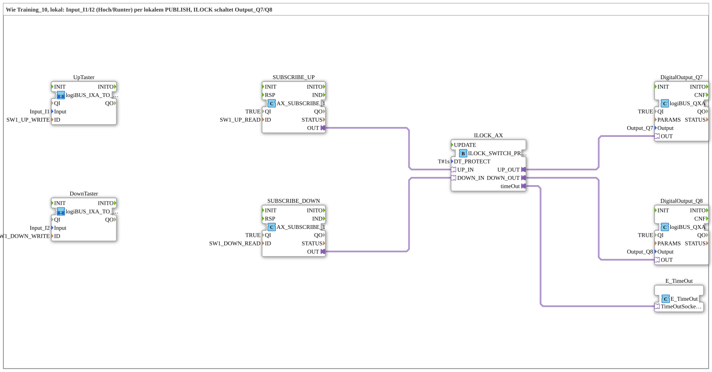

# Uebung_OPC_L10_AX: Up/Down Buttons with Interlock Locally via PUBLISH/SUBSCRIBE

* * * * * * * * * *

## Introduction

`Uebung_OPC_L10_AX` is the local variant of `Training_10_OPC_UA_RES`: the buttons `Input_I1` (up) and `Input_I2` (down) are written to OPC-UA nodes via local `PUBLISH`, read back via local `SUBSCRIBE` and switched to `Output_Q7` and `Output_Q8` through an interlock with protection time (`ILOCK_SWITCH_PROTECT_AX`, `DT_PROTECT` = `T#1s`). Both halves of the template run on **one** device; there is no method call, hence no endpoint.

Overview of all local exercises: [`OPC_UA_Lokal.md`](./OPC_UA_Lokal.md).

## Function Blocks (FBs) Used

| Name | Type | Parameters | Explanation |
|---|---|---|---|
| `UpTaster` | [`logiBUS_IXA_TO_PUBLISH_OPC`](https://meisterschulen-am-ostbahnhof-munchen-docs.readthedocs.io/projects/4diac-library-reference-docs/en/latest/Bibliotheken/ExternalLibraries/MyLib_AX/sys/logiBUS_IXA_TO_PUBLISH_OPC/) | `Input` = `Input_I1`, `ID` = `SW1_UP_WRITE` | Reads `Input_I1` and writes the value locally via `PUBLISH` (action `WRITE`, no endpoint) to the up node. |
| `DownTaster` | [`logiBUS_IXA_TO_PUBLISH_OPC`](https://meisterschulen-am-ostbahnhof-munchen-docs.readthedocs.io/projects/4diac-library-reference-docs/en/latest/Bibliotheken/ExternalLibraries/MyLib_AX/sys/logiBUS_IXA_TO_PUBLISH_OPC/) | `Input` = `Input_I2`, `ID` = `SW1_DOWN_WRITE` | Like `UpTaster`, for `Input_I2` and the down node. |
| `SUBSCRIBE_UP` | [`adapter::net::AX_SUBSCRIBE_1`](https://meisterschulen-am-ostbahnhof-munchen-docs.readthedocs.io/projects/4diac-library-reference-docs/en/latest/Bibliotheken/ExternalLibraries/adapter/net/AX_SUBSCRIBE_1/) | `QI` = `TRUE`, `ID` = `SW1_UP_READ` | Reads the up node locally via `SUBSCRIBE` and outputs the value via an `AX` adapter. |
| `SUBSCRIBE_DOWN` | [`adapter::net::AX_SUBSCRIBE_1`](https://meisterschulen-am-ostbahnhof-munchen-docs.readthedocs.io/projects/4diac-library-reference-docs/en/latest/Bibliotheken/ExternalLibraries/adapter/net/AX_SUBSCRIBE_1/) | `QI` = `TRUE`, `ID` = `SW1_DOWN_READ` | Like `SUBSCRIBE_UP`, for the down node. |
| `ILOCK_AX` | [`logiBUS::signalprocessing::interlock::ILOCK_SWITCH_PROTECT_AX`](https://meisterschulen-am-ostbahnhof-munchen-docs.readthedocs.io/projects/4diac-library-reference-docs/en/latest/Bibliotheken/ExternalLibraries/logiBUS/signalprocessing/interlock/ILOCK_SWITCH_PROTECT_AX/) | `DT_PROTECT` = `T#1s` | Up/down interlock with protection dead time before a change of direction; outputs `UP_OUT`/`DOWN_OUT`, timing via the socket `timeOut`. |
| `E_TimeOut` | [`iec61499::events::E_TimeOut`](https://meisterschulen-am-ostbahnhof-munchen-docs.readthedocs.io/projects/4diac-library-reference-docs/en/latest/Bibliotheken/StandardLibraries/events/E_TimeOut/) | - | Timer for the protection dead time, connected to `ILOCK_AX.timeOut` via `TimeOutSocket`. |
| `DigitalOutput_Q7` | [`logiBUS::io::DQ::logiBUS_QXA`](https://meisterschulen-am-ostbahnhof-munchen-docs.readthedocs.io/projects/4diac-library-reference-docs/en/latest/Bibliotheken/ExternalLibraries/logiBUS/io/DO/logiBUS_QXA/) | `QI` = `TRUE`, `Output` = `Output_Q7` | Physical output for up. |
| `DigitalOutput_Q8` | [`logiBUS::io::DQ::logiBUS_QXA`](https://meisterschulen-am-ostbahnhof-munchen-docs.readthedocs.io/projects/4diac-library-reference-docs/en/latest/Bibliotheken/ExternalLibraries/logiBUS/io/DO/logiBUS_QXA/) | `QI` = `TRUE`, `Output` = `Output_Q8` | Physical output for down. |

## OPC-UA Address Space

The IDs come from `const\OpcUaLokal.gcf` (package `Meins::OPC_UA_Lokal::const`) and are computed with the functions of the `MyLib_OPC` lib (`F_OPC_LOCAL`, `F_OPC_REMOTE`).

| Constant | Action | Node / method | Meaning |
|---|---|---|---|
| `SW1_UP_WRITE` | `WRITE` | `/Objects/Switch1/Up,1:s=Switch1_Up` | Write up button locally (PUBLISH) |
| `SW1_UP_READ` | `READ` | `/Objects/Switch1/Up,1:s=Switch1_Up` | Read up button locally (SUBSCRIBE) |
| `SW1_DOWN_WRITE` | `WRITE` | `/Objects/Switch1/Down,1:s=Switch1_Down` | Write down button locally (PUBLISH) |
| `SW1_DOWN_READ` | `READ` | `/Objects/Switch1/Down,1:s=Switch1_Down` | Read down button locally (SUBSCRIBE) |

## Program Flow and Connections

The SubApps `UpTaster` and `DownTaster` are not wired; their value reaches `SUBSCRIBE_UP`/`SUBSCRIBE_DOWN` only via the OPC-UA nodes. Adapter connections:

1. `SUBSCRIBE_UP.OUT` → `ILOCK_AX.UP_IN`
2. `SUBSCRIBE_DOWN.OUT` → `ILOCK_AX.DOWN_IN`
3. `ILOCK_AX.timeOut` → `E_TimeOut.TimeOutSocket`
4. `ILOCK_AX.UP_OUT` → `DigitalOutput_Q7.OUT`
5. `ILOCK_AX.DOWN_OUT` → `DigitalOutput_Q8.OUT`

## Technical Notes

- **Local round trip without endpoint**: `WRITE` and `READ` on the same node, both without endpoint; no `CALL_METHOD` needed.
- **Protection dead time**: `DT_PROTECT` = `T#1s` limits the change of direction in the interlock.

## Learning Objectives

- Write buttons locally to OPC-UA nodes via `PUBLISH` and read them back via `SUBSCRIBE`.
- Use an interlock with protection dead time (`ILOCK_SWITCH_PROTECT_AX`) and `E_TimeOut`.
- Interlock two outputs (`Output_Q7`, `Output_Q8`) against each other.

**Difficulty**: Advanced  
**Recommended sequence**: `Training_10_OPC_UA_RES` (template, two devices), `Uebung_OPC_L01_AX`

## Note / Result

- **Not tested on the device.** So far only L01, L03 and L19 have been tested on `FORTE_PC_AX`; `Uebung_OPC_L10_AX` has not yet been run on the device.
- Locally (without endpoint) `READ`/`SUBSCRIBE`, `WRITE`/`PUBLISH`, `CREATE_METHOD`/`SERVER` and `PUBLISH_0` work. `CALL_METHOD` and the client subscription, in contrast, run with an endpoint to the own station (`localhost` or own IP; both count as remote).

## Summary

`Uebung_OPC_L10_AX` routes up/down buttons through local OPC-UA nodes (`PUBLISH` and `SUBSCRIBE`) into an interlock with protection time that drives `Output_Q7`/`Output_Q8`.

---

### 🌐 Related Topic Subpages on ms-muc-docs.de

- [🌐 Eclipse 4diac IDE & Color Reference on ms-muc-docs.de](https://www.ms-muc-docs.de/iec-61499/eclipse-4diac/)
