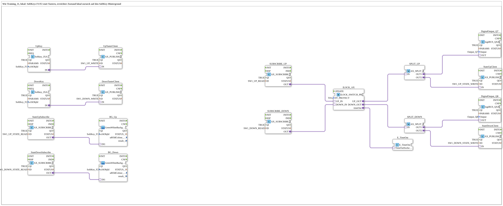

# Uebung_OPC_L11_AX: Up/Down SoftKeys with Interlock and State Feedback Locally

* * * * * * * * * *

## Introduction

`Uebung_OPC_L11_AX` is the local variant of `Training_11_OPC_UA_RES`: instead of the buttons, the SoftKeys `SoftKey_F1` (up) and `SoftKey_F2` (down) are used. Their actuation goes locally via `PUBLISH` to OPC-UA nodes, is read via `SUBSCRIBE` and switched through the interlock (`ILOCK_SWITCH_PROTECT_AX`) to `Output_Q7`/`Output_Q8`. The reached state is written locally via `PUBLISH`, read via `SUBSCRIBE` and colours the SoftKey background. Everything runs on **one** device without endpoint.

Overview of all local exercises: [`OPC_UA_Lokal.md`](./OPC_UA_Lokal.md).

## Function Blocks (FBs) Used

| Name | Type | Parameters | Explanation |
|---|---|---|---|
| `UpKey` | [`isobus::UT::io::Softkey::Softkey_IXA`](https://meisterschulen-am-ostbahnhof-munchen-docs.readthedocs.io/projects/4diac-library-reference-docs/en/latest/Bibliotheken/ExternalLibraries/isobus/UT/io/Softkey/Softkey_IXA/) | `QI` = `TRUE`, `u16ObjId` = `SoftKey_F1` | SoftKey up; the `IN` adapter delivers the actuation. |
| `DownKey` | [`isobus::UT::io::Softkey::Softkey_IXA`](https://meisterschulen-am-ostbahnhof-munchen-docs.readthedocs.io/projects/4diac-library-reference-docs/en/latest/Bibliotheken/ExternalLibraries/isobus/UT/io/Softkey/Softkey_IXA/) | `QI` = `TRUE`, `u16ObjId` = `SoftKey_F2` | SoftKey down. |
| `UpTasterClient` | [`adapter::net::AX_PUBLISH_1`](https://meisterschulen-am-ostbahnhof-munchen-docs.readthedocs.io/projects/4diac-library-reference-docs/en/latest/Bibliotheken/ExternalLibraries/adapter/net/AX_PUBLISH_1/) | `QI` = `TRUE`, `ID` = `SW1_UP_WRITE` | Writes the up actuation locally via `PUBLISH`. |
| `DownTasterClient` | [`adapter::net::AX_PUBLISH_1`](https://meisterschulen-am-ostbahnhof-munchen-docs.readthedocs.io/projects/4diac-library-reference-docs/en/latest/Bibliotheken/ExternalLibraries/adapter/net/AX_PUBLISH_1/) | `QI` = `TRUE`, `ID` = `SW1_DOWN_WRITE` | Writes the down actuation locally via `PUBLISH`. |
| `StateUpSubscribe` | [`adapter::net::AX_SUBSCRIBE_1`](https://meisterschulen-am-ostbahnhof-munchen-docs.readthedocs.io/projects/4diac-library-reference-docs/en/latest/Bibliotheken/ExternalLibraries/adapter/net/AX_SUBSCRIBE_1/) | `QI` = `TRUE`, `ID` = `SW1_UP_STATE_READ` | Reads the state “up reached” locally via `SUBSCRIBE`. |
| `StateDownSubscribe` | [`adapter::net::AX_SUBSCRIBE_1`](https://meisterschulen-am-ostbahnhof-munchen-docs.readthedocs.io/projects/4diac-library-reference-docs/en/latest/Bibliotheken/ExternalLibraries/adapter/net/AX_SUBSCRIBE_1/) | `QI` = `TRUE`, `ID` = `SW1_DOWN_STATE_READ` | Reads the state “down reached” locally via `SUBSCRIBE`. |
| `BG_Up` | [`GreenWhiteBackground1_AX`](https://meisterschulen-am-ostbahnhof-munchen-docs.readthedocs.io/projects/4diac-library-reference-docs/en/latest/Bibliotheken/ExternalLibraries/MyLib_AX/sys/GreenWhiteBackground1_AX/) | `u16ObjId` = `SoftKey_F1` | Background colour of the up SoftKey (TRUE = green, FALSE = white). |
| `BG_Down` | [`GreenWhiteBackground1_AX`](https://meisterschulen-am-ostbahnhof-munchen-docs.readthedocs.io/projects/4diac-library-reference-docs/en/latest/Bibliotheken/ExternalLibraries/MyLib_AX/sys/GreenWhiteBackground1_AX/) | `u16ObjId` = `SoftKey_F2` | Background colour of the down SoftKey. |
| `SUBSCRIBE_UP` | [`adapter::net::AX_SUBSCRIBE_1`](https://meisterschulen-am-ostbahnhof-munchen-docs.readthedocs.io/projects/4diac-library-reference-docs/en/latest/Bibliotheken/ExternalLibraries/adapter/net/AX_SUBSCRIBE_1/) | `QI` = `TRUE`, `ID` = `SW1_UP_READ` | Reads the up actuation locally via `SUBSCRIBE`. |
| `SUBSCRIBE_DOWN` | [`adapter::net::AX_SUBSCRIBE_1`](https://meisterschulen-am-ostbahnhof-munchen-docs.readthedocs.io/projects/4diac-library-reference-docs/en/latest/Bibliotheken/ExternalLibraries/adapter/net/AX_SUBSCRIBE_1/) | `QI` = `TRUE`, `ID` = `SW1_DOWN_READ` | Reads the down actuation locally via `SUBSCRIBE`. |
| `ILOCK_AX` | [`logiBUS::signalprocessing::interlock::ILOCK_SWITCH_PROTECT_AX`](https://meisterschulen-am-ostbahnhof-munchen-docs.readthedocs.io/projects/4diac-library-reference-docs/en/latest/Bibliotheken/ExternalLibraries/logiBUS/signalprocessing/interlock/ILOCK_SWITCH_PROTECT_AX/) | `DT_PROTECT` = `T#1s` | Up/down interlock with protection dead time. |
| `E_TimeOut` | [`iec61499::events::E_TimeOut`](https://meisterschulen-am-ostbahnhof-munchen-docs.readthedocs.io/projects/4diac-library-reference-docs/en/latest/Bibliotheken/StandardLibraries/events/E_TimeOut/) | - | Timer for the protection dead time (`ILOCK_AX.timeOut`). |
| `SPLIT_UP` | [`adapter::events::unidirectional::AX_SPLIT_2`](https://meisterschulen-am-ostbahnhof-munchen-docs.readthedocs.io/projects/4diac-library-reference-docs/en/latest/Bibliotheken/ExternalLibraries/adapter/events/unidirectional/BOOL/AX_SPLIT_2/) | - | Distributes the interlocked up state to output and feedback. |
| `SPLIT_DOWN` | [`adapter::events::unidirectional::AX_SPLIT_2`](https://meisterschulen-am-ostbahnhof-munchen-docs.readthedocs.io/projects/4diac-library-reference-docs/en/latest/Bibliotheken/ExternalLibraries/adapter/events/unidirectional/BOOL/AX_SPLIT_2/) | - | Distributes the interlocked down state to output and feedback. |
| `DigitalOutput_Q7` | [`logiBUS::io::DQ::logiBUS_QXA`](https://meisterschulen-am-ostbahnhof-munchen-docs.readthedocs.io/projects/4diac-library-reference-docs/en/latest/Bibliotheken/ExternalLibraries/logiBUS/io/DO/logiBUS_QXA/) | `QI` = `TRUE`, `Output` = `Output_Q7` | Physical output for up. |
| `DigitalOutput_Q8` | [`logiBUS::io::DQ::logiBUS_QXA`](https://meisterschulen-am-ostbahnhof-munchen-docs.readthedocs.io/projects/4diac-library-reference-docs/en/latest/Bibliotheken/ExternalLibraries/logiBUS/io/DO/logiBUS_QXA/) | `QI` = `TRUE`, `Output` = `Output_Q8` | Physical output for down. |
| `StateUpClient` | [`adapter::net::AX_PUBLISH_1`](https://meisterschulen-am-ostbahnhof-munchen-docs.readthedocs.io/projects/4diac-library-reference-docs/en/latest/Bibliotheken/ExternalLibraries/adapter/net/AX_PUBLISH_1/) | `QI` = `TRUE`, `ID` = `SW1_UP_STATE_WRITE` | Writes the reached up state locally via `PUBLISH`. |
| `StateDownClient` | [`adapter::net::AX_PUBLISH_1`](https://meisterschulen-am-ostbahnhof-munchen-docs.readthedocs.io/projects/4diac-library-reference-docs/en/latest/Bibliotheken/ExternalLibraries/adapter/net/AX_PUBLISH_1/) | `QI` = `TRUE`, `ID` = `SW1_DOWN_STATE_WRITE` | Writes the reached down state locally via `PUBLISH`. |

## OPC-UA Address Space

The IDs come from `const\OpcUaLokal.gcf` (package `Meins::OPC_UA_Lokal::const`) and are computed with the functions of the `MyLib_OPC` lib (`F_OPC_LOCAL`, `F_OPC_REMOTE`).

| Constant | Action | Node / method | Meaning |
|---|---|---|---|
| `SW1_UP_WRITE` / `SW1_UP_READ` | `WRITE` / `READ` | `/Objects/Switch1/Up,1:s=Switch1_Up` | Up actuation (PUBLISH / SUBSCRIBE) |
| `SW1_DOWN_WRITE` / `SW1_DOWN_READ` | `WRITE` / `READ` | `/Objects/Switch1/Down,1:s=Switch1_Down` | Down actuation (PUBLISH / SUBSCRIBE) |
| `SW1_UP_STATE_WRITE` / `SW1_UP_STATE_READ` | `WRITE` / `READ` | `/Objects/Switch1/UpState,1:s=Switch1_UpState` | Up reached (PUBLISH / SUBSCRIBE) |
| `SW1_DOWN_STATE_WRITE` / `SW1_DOWN_STATE_READ` | `WRITE` / `READ` | `/Objects/Switch1/DownState,1:s=Switch1_DownState` | Down reached (PUBLISH / SUBSCRIBE) |

## Program Flow and Connections

Adapter connections:

1. `UpKey.IN` → `UpTasterClient.IN`
2. `DownKey.IN` → `DownTasterClient.IN`
3. `StateUpSubscribe.OUT` → `BG_Up.DI1`
4. `StateDownSubscribe.OUT` → `BG_Down.DI1`
5. `SUBSCRIBE_UP.OUT` → `ILOCK_AX.UP_IN`
6. `SUBSCRIBE_DOWN.OUT` → `ILOCK_AX.DOWN_IN`
7. `ILOCK_AX.timeOut` → `E_TimeOut.TimeOutSocket`
8. `ILOCK_AX.UP_OUT` → `SPLIT_UP.IN`
9. `SPLIT_UP.OUT1` → `DigitalOutput_Q7.OUT`
10. `SPLIT_UP.OUT2` → `StateUpClient.IN`
11. `ILOCK_AX.DOWN_OUT` → `SPLIT_DOWN.IN`
12. `SPLIT_DOWN.OUT1` → `DigitalOutput_Q8.OUT`
13. `SPLIT_DOWN.OUT2` → `StateDownClient.IN`

## Technical Notes

- **Local round trip without endpoint**: all four node pairs are served locally with `WRITE`/`READ`; no `CALL_METHOD`.
- **Feedback after the interlock**: `SPLIT_UP`/`SPLIT_DOWN` write back the actually switched state; the SoftKey background thus shows the output state after the interlock.

## Learning Objectives

- Use SoftKeys instead of buttons as source and route them locally via OPC-UA nodes.
- Distribute the state after the interlock with `AX_SPLIT_2` to output and feedback.
- Feed the feedback via `SUBSCRIBE` to the SoftKey background (`GreenWhiteBackground1_AX`).

**Difficulty**: Advanced  
**Recommended sequence**: `Uebung_OPC_L10_AX`, `Training_11_OPC_UA_RES` (template, two devices)

## Note / Result

- **Not tested on the device.** So far only L01, L03 and L19 have been tested on `FORTE_PC_AX`; `Uebung_OPC_L11_AX` has not yet been run on the device.
- Locally (without endpoint) `READ`/`SUBSCRIBE`, `WRITE`/`PUBLISH`, `CREATE_METHOD`/`SERVER` and `PUBLISH_0` work. `CALL_METHOD` and the client subscription, in contrast, run with an endpoint to the own station (`localhost` or own IP; both count as remote).

## Summary

`Uebung_OPC_L11_AX` replaces the buttons from L10 with SoftKeys and reports the reached state locally via `PUBLISH`/`SUBSCRIBE` back to the SoftKey background.

---

### 🌐 Related Topic Subpages on ms-muc-docs.de

- [🌐 Eclipse 4diac IDE & Color Reference on ms-muc-docs.de](https://www.ms-muc-docs.de/iec-61499/eclipse-4diac/)
