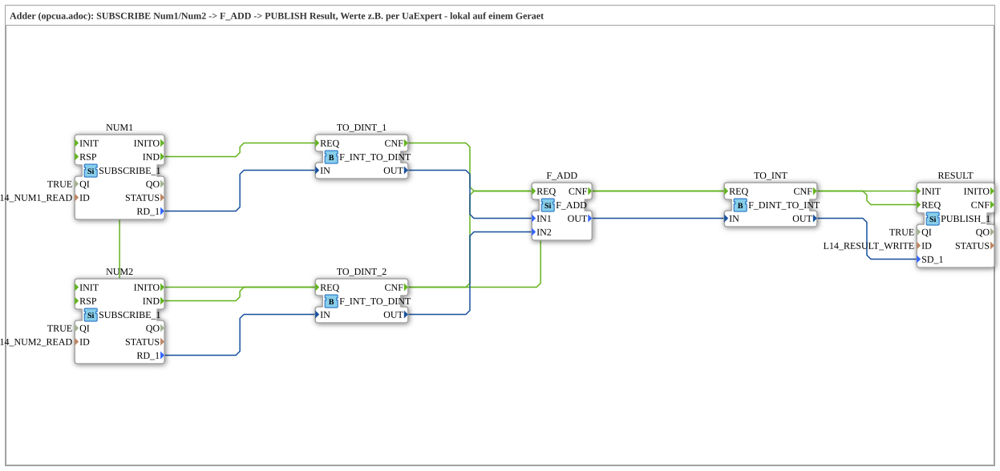

# Uebung_OPC_L14_AX: Local adder: SUBSCRIBE Num1/Num2, F_ADD, PUBLISH Result

* * * * * * * * * *

## Introduction

`Uebung_OPC_L14_AX` is the adder example from `opcua.adoc`, fully local on one device: two OPC-UA variables (Num1, Num2) are read with `SUBSCRIBE_1`, added with `F_ADD`, and the result is written to the variable Result with `PUBLISH_1`. The values for Num1 and Num2 are set e.g. with UaExpert. All three accesses run without an endpoint (local).

Series overview: [`OPC_UA_Lokal.md`](./OPC_UA_Lokal.md).

Comment in the `.SUB` (German original): "Adder (opcua.adoc): SUBSCRIBE Num1/Num2 -> F_ADD -> PUBLISH Result, Werte z.B. per UaExpert - lokal auf einem Geraet"

## Function Blocks (FBs) Used

### `NUM1`

- Type: `iec61499::net::SUBSCRIBE_1`
- Parameters:

    - `QI` = `TRUE`
    - `ID` = `L14_NUM1_READ`

- Explanation: Subscribes locally (no endpoint) to the node Num1; the value (INT) arrives at `RD_1`, every change fires `IND`. The value is set e.g. with UaExpert.

### `NUM2`

- Type: `iec61499::net::SUBSCRIBE_1`
- Parameters:

    - `QI` = `TRUE`
    - `ID` = `L14_NUM2_READ`

- Explanation: Like `NUM1`, but for the node Num2.

### `TO_DINT_1`

- Type: `iec61131::conversion::F_INT_TO_DINT`
- Parameters: none set

- Explanation: Converts the INT value from `NUM1` to DINT because `F_ADD` works on DINT.

### `TO_DINT_2`

- Type: `iec61131::conversion::F_INT_TO_DINT`
- Parameters: none set

- Explanation: Like `TO_DINT_1`, for `NUM2`.

### `F_ADD`

- Type: `iec61131::arithmetic::F_ADD`
- Parameters: none set

- Explanation: Adds `IN1` and `IN2` to `OUT` (Num1 + Num2). Both converters trigger the same `REQ` input.

### `TO_INT`

- Type: `iec61131::conversion::F_DINT_TO_INT`
- Parameters: none set

- Explanation: Converts the DINT sum back to INT for the node Result.

### `RESULT`

- Type: `iec61499::net::PUBLISH_1`
- Parameters:

    - `QI` = `TRUE`
    - `ID` = `L14_RESULT_WRITE`

- Explanation: Writes the sum locally (no endpoint) to the node Result (`SD_1`); it can be read with UaExpert.

## OPC-UA Addresses (`OpcUaLokal.gcf`)

The IDs come from `const/OpcUaLokal.gcf` (package `Meins::OPC_UA_Lokal::const`).

| Constant | Action | Node / ID |
|---|---|---|
| `L14_NUM1_READ` | READ | `/Objects/Lokal/L14/Num1,1:s=L14_Num1` |
| `L14_NUM2_READ` | READ | `/Objects/Lokal/L14/Num2,1:s=L14_Num2` |
| `L14_RESULT_WRITE` | WRITE | `/Objects/Lokal/L14/Result,1:s=L14_Result` |

## Program Flow and Connections

### Event connections

1. `NUM1.IND` → `TO_DINT_1.REQ`
2. `NUM2.IND` → `TO_DINT_2.REQ`
3. `TO_DINT_1.CNF` → `F_ADD.REQ`
4. `TO_DINT_2.CNF` → `F_ADD.REQ`
5. `F_ADD.CNF` → `TO_INT.REQ`
6. `TO_INT.CNF` → `RESULT.REQ`
7. `NUM1.INITO` → `NUM2.INIT`
8. `NUM2.INITO` → `RESULT.INIT`

### Data connections

1. `NUM1.RD_1` → `TO_DINT_1.IN`
2. `NUM2.RD_1` → `TO_DINT_2.IN`
3. `TO_DINT_1.OUT` → `F_ADD.IN1`
4. `TO_DINT_2.OUT` → `F_ADD.IN2`
5. `F_ADD.OUT` → `TO_INT.IN`
6. `TO_INT.OUT` → `RESULT.SD_1`

## Note / Result

Not tested on the device. Expected: Result = Num1 + Num2 as soon as Num1 and Num2 are set with UaExpert.

The same example on two devices: [Training_14_OPC_UA_RES](https://meisterschulen-am-ostbahnhof-munchen-docs.readthedocs.io/projects/4diac-exercises-docs/en/latest/Uebungen/test_VV/03_OPC_UA/Training_14_OPC_UA_RES/Training_14_OPC_UA_RES/).

## Learning Objectives

- Local reading (`SUBSCRIBE_1`) and writing (`PUBLISH_1`) of OPC-UA variables without an endpoint
- Type adaptation INT ↔ DINT with `F_INT_TO_DINT` / `F_DINT_TO_INT` before and after `F_ADD`
- Initialisation chain: `INITO` of one block starts `INIT` of the next

## Summary

The exercise shows a small calculation (addition) between locally subscribed and locally published OPC-UA variables.

---

### 🌐 Related Topic Subpages on ms-muc-docs.de

- [🌐 Eclipse 4diac IDE & Color Reference on ms-muc-docs.de](https://www.ms-muc-docs.de/iec-61499/eclipse-4diac/)
