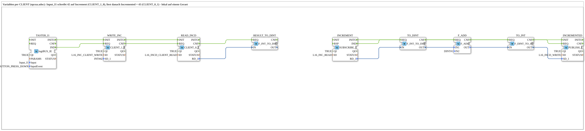

# Uebung_OPC_L16_AX: Reading and writing variables via CLIENT (Increment/Incremented)

* * * * * * * * * *

## Introduction

`Uebung_OPC_L16_AX` is the variable example from `opcua.adoc` locally on one device: `Input_I1` writes the value 42 to the variable Increment with `CLIENT_1_0` and then reads the variable Incremented with `CLIENT_0_1`, which should contain 43. Locally, `SUBSCRIBE_1` subscribes to the variable Increment, adds 1 and writes the result to Incremented with `PUBLISH_1`. The CLIENT blocks use the endpoint of the station itself (`LOCAL_OPC`); the SUBSCRIBE/PUBLISH blocks run locally without an endpoint.

Series overview: [`OPC_UA_Lokal.md`](./OPC_UA_Lokal.md).

Comment in the `.SUB` (German original): "Variablen per CLIENT (opcua.adoc): Input_I1 schreibt 42 auf Increment (CLIENT_1_0), liest danach Incremented = 43 (CLIENT_0_1) - lokal auf einem Geraet"

## Function Blocks (FBs) Used

### `TASTER_I1`

- Type: [`logiBUS::io::DI::logiBUS_IE`](https://meisterschulen-am-ostbahnhof-munchen-docs.readthedocs.io/projects/4diac-library-reference-docs/en/latest/Bibliotheken/ExternalLibraries/logiBUS/io/DI/logiBUS_IE/)
- Parameters:

    - `QI` = `TRUE`
    - `Input` = `Input_I1`
    - `InputEvent` = `BUTTON_PRESS_DOWN`

- Explanation: Button `Input_I1` (event `BUTTON_PRESS_DOWN`, i.e. on press). Starts writing and the subsequent reading.

### `WRITE_INC`

- Type: `iec61499::net::CLIENT_1_0`
- Parameters:

    - `QI` = `TRUE`
    - `ID` = `L16_INC_CLIENT_WRITE`
    - `SD_1` = `INT#42`

- Explanation: Writes the value `INT#42` to the node Increment via an endpoint (`LOCAL_OPC`, the station itself) (`SD_1`).

### `READ_INCD`

- Type: `iec61499::net::CLIENT_0_1`
- Parameters:

    - `QI` = `TRUE`
    - `ID` = `L16_INCD_CLIENT_READ`

- Explanation: Reads the node Incremented via an endpoint; the value (expected 43) arrives at `RD_1`.

### `RESULT_TO_DINT`

- Type: `iec61131::conversion::F_INT_TO_DINT`
- Parameters: none set

- Explanation: Converts the value read from INT to DINT.

### `INCREMENT`

- Type: `iec61499::net::SUBSCRIBE_1`
- Parameters:

    - `QI` = `TRUE`
    - `ID` = `L16_INC_READ`

- Explanation: Subscribes locally (no endpoint) to the node Increment; every change (here the 42) fires `IND`.

### `TO_DINT`

- Type: `iec61131::conversion::F_INT_TO_DINT`
- Parameters: none set

- Explanation: Converts the value from `INCREMENT` to DINT.

### `F_ADD`

- Type: `iec61131::arithmetic::F_ADD`
- Parameters:

    - `IN2` = `DINT#1`

- Explanation: Adds the constant `IN2` = `DINT#1` to `IN1` (42 + 1 = 43).

### `TO_INT`

- Type: `iec61131::conversion::F_DINT_TO_INT`
- Parameters: none set

- Explanation: Converts the sum back to INT.

### `INCREMENTED`

- Type: `iec61499::net::PUBLISH_1`
- Parameters:

    - `QI` = `TRUE`
    - `ID` = `L16_INCD_WRITE`

- Explanation: Writes the result locally (no endpoint) to the node Incremented (`SD_1`).

## OPC-UA Addresses (`OpcUaLokal.gcf`)

The IDs come from `const/OpcUaLokal.gcf` (package `Meins::OPC_UA_Lokal::const`).

| Constant | Action | Node / ID |
|---|---|---|
| `L16_INC_CLIENT_WRITE` | WRITE (endpoint `LOCAL_OPC`) | `/Objects/Lokal/L16/Increment,1:s=L16_Increment` |
| `L16_INCD_CLIENT_READ` | READ (endpoint `LOCAL_OPC`) | `/Objects/Lokal/L16/Incremented,1:s=L16_Incremented` |
| `L16_INC_READ` | READ (local) | `/Objects/Lokal/L16/Increment,1:s=L16_Increment` |
| `L16_INCD_WRITE` | WRITE (local) | `/Objects/Lokal/L16/Incremented,1:s=L16_Incremented` |

## Program Flow and Connections

### Event connections

1. `TASTER_I1.IND` → `WRITE_INC.REQ`
2. `WRITE_INC.CNF` → `READ_INCD.REQ`
3. `TASTER_I1.INITO` → `WRITE_INC.INIT`
4. `WRITE_INC.INITO` → `READ_INCD.INIT`
5. `READ_INCD.CNF` → `RESULT_TO_DINT.REQ`
6. `INCREMENT.IND` → `TO_DINT.REQ`
7. `TO_DINT.CNF` → `F_ADD.REQ`
8. `F_ADD.CNF` → `TO_INT.REQ`
9. `TO_INT.CNF` → `INCREMENTED.REQ`
10. `INCREMENT.INITO` → `INCREMENTED.INIT`

### Data connections

1. `READ_INCD.RD_1` → `RESULT_TO_DINT.IN`
2. `INCREMENT.RD_1` → `TO_DINT.IN`
3. `TO_DINT.OUT` → `F_ADD.IN1`
4. `F_ADD.OUT` → `TO_INT.IN`
5. `TO_INT.OUT` → `INCREMENTED.SD_1`

## Note / Result

Not tested on the device. Expected: after `Input_I1`, `READ_INCD` returns the value 43 (42 + 1). **Note:** `READ_INCD.REQ` is wired directly to `WRITE_INC.CNF`, not to an acknowledgement from `INCREMENTED`. That the calculation (`INCREMENT.IND` → `F_ADD` → `INCREMENTED.REQ`) has finished by then follows only from execution order and is not guaranteed. The first read may therefore still return the old value (42).

The same example on two devices: [Training_16_OPC_UA_RES](https://meisterschulen-am-ostbahnhof-munchen-docs.readthedocs.io/projects/4diac-exercises-docs/en/latest/Uebungen/test_VV/03_OPC_UA/Training_16_OPC_UA_RES/Training_16_OPC_UA_RES/).

## Learning Objectives

- Write variables with `CLIENT_1_0` and read them with `CLIENT_0_1`
- Combination of client access (with endpoint) and local `SUBSCRIBE_1`/`PUBLISH_1` (no endpoint) on two nodes
- Chaining of events: `WRITE_INC.CNF` starts `READ_INCD.REQ`

## Summary

The exercise shows writing and reading OPC-UA variables via client within the device itself, with a local calculation path (+1) in between.

---

### 🌐 Related Topic Subpages on ms-muc-docs.de

- [🌐 Eclipse 4diac IDE & Color Reference on ms-muc-docs.de](https://www.ms-muc-docs.de/iec-61499/eclipse-4diac/)
