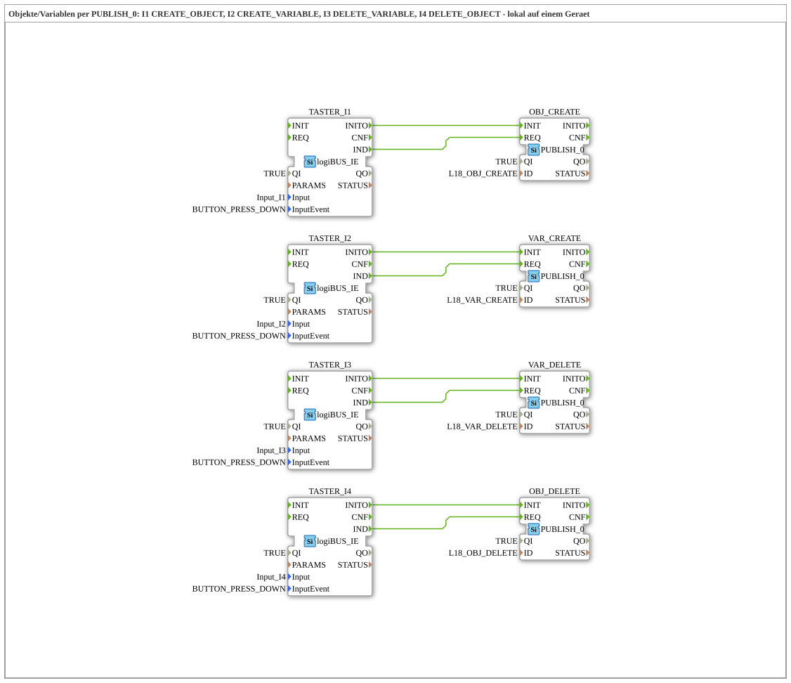

# Uebung_OPC_L18_AX: Creating and deleting objects and variables with PUBLISH_0

* * * * * * * * * *

## Introduction

`Uebung_OPC_L18_AX` uses four `PUBLISH_0` blocks locally (no endpoint) to create an object and a variable in the own OPC-UA server and to delete them again: `Input_I1` creates the object, `Input_I2` the variable, `Input_I3` deletes the variable, `Input_I4` deletes the object. The ID of each `PUBLISH_0` block is directly an `opc_ua[...]` string.

Series overview: [`OPC_UA_Lokal.md`](./OPC_UA_Lokal.md).

Comment in the `.SUB` (German original): "Objekte/Variablen per PUBLISH_0: I1 CREATE_OBJECT, I2 CREATE_VARIABLE, I3 DELETE_VARIABLE, I4 DELETE_OBJECT - lokal auf einem Geraet"

## Function Blocks (FBs) Used

### `TASTER_I1`

- Type: [`logiBUS::io::DI::logiBUS_IE`](https://meisterschulen-am-ostbahnhof-munchen-docs.readthedocs.io/projects/4diac-library-reference-docs/en/latest/Bibliotheken/ExternalLibraries/logiBUS/io/DI/logiBUS_IE/)
- Parameters:

    - `QI` = `TRUE`
    - `Input` = `Input_I1`
    - `InputEvent` = `BUTTON_PRESS_DOWN`

- Explanation: Button `Input_I1` (event `BUTTON_PRESS_DOWN`, i.e. on press). Triggers `OBJ_CREATE`.

### `OBJ_CREATE`

- Type: `iec61499::net::PUBLISH_0`
- Parameters:

    - `QI` = `TRUE`
    - `ID` = `L18_OBJ_CREATE`

- Explanation: `PUBLISH_0` without data, local (no endpoint): creates the object `L18_MyObject` under `/Objects` (`CREATE_OBJECT`, type `BaseObjectType` = `i=58`). Here the ID is directly an `opc_ua[...]` string.

### `TASTER_I2`

- Type: [`logiBUS::io::DI::logiBUS_IE`](https://meisterschulen-am-ostbahnhof-munchen-docs.readthedocs.io/projects/4diac-library-reference-docs/en/latest/Bibliotheken/ExternalLibraries/logiBUS/io/DI/logiBUS_IE/)
- Parameters:

    - `QI` = `TRUE`
    - `Input` = `Input_I2`
    - `InputEvent` = `BUTTON_PRESS_DOWN`

- Explanation: Button `Input_I2` (event `BUTTON_PRESS_DOWN`, i.e. on press). Triggers `VAR_CREATE`.

### `VAR_CREATE`

- Type: `iec61499::net::PUBLISH_0`
- Parameters:

    - `QI` = `TRUE`
    - `ID` = `L18_VAR_CREATE`

- Explanation: `PUBLISH_0` without data, local (no endpoint): creates the variable `L18_MyVariable` under `/Objects` (`CREATE_VARIABLE`, `BaseDataVariableType` = `i=63`, data type Int32 = `i=6`). Here the ID is directly an `opc_ua[...]` string.

### `TASTER_I3`

- Type: [`logiBUS::io::DI::logiBUS_IE`](https://meisterschulen-am-ostbahnhof-munchen-docs.readthedocs.io/projects/4diac-library-reference-docs/en/latest/Bibliotheken/ExternalLibraries/logiBUS/io/DI/logiBUS_IE/)
- Parameters:

    - `QI` = `TRUE`
    - `Input` = `Input_I3`
    - `InputEvent` = `BUTTON_PRESS_DOWN`

- Explanation: Button `Input_I3` (event `BUTTON_PRESS_DOWN`, i.e. on press). Triggers `VAR_DELETE`.

### `VAR_DELETE`

- Type: `iec61499::net::PUBLISH_0`
- Parameters:

    - `QI` = `TRUE`
    - `ID` = `L18_VAR_DELETE`

- Explanation: `PUBLISH_0` without data, local (no endpoint): deletes the variable `L18_MyVariable` (`DELETE_VARIABLE`). Here the ID is directly an `opc_ua[...]` string.

### `TASTER_I4`

- Type: [`logiBUS::io::DI::logiBUS_IE`](https://meisterschulen-am-ostbahnhof-munchen-docs.readthedocs.io/projects/4diac-library-reference-docs/en/latest/Bibliotheken/ExternalLibraries/logiBUS/io/DI/logiBUS_IE/)
- Parameters:

    - `QI` = `TRUE`
    - `Input` = `Input_I4`
    - `InputEvent` = `BUTTON_PRESS_DOWN`

- Explanation: Button `Input_I4` (event `BUTTON_PRESS_DOWN`, i.e. on press). Triggers `OBJ_DELETE`.

### `OBJ_DELETE`

- Type: `iec61499::net::PUBLISH_0`
- Parameters:

    - `QI` = `TRUE`
    - `ID` = `L18_OBJ_DELETE`

- Explanation: `PUBLISH_0` without data, local (no endpoint): deletes the object `L18_MyObject` (`DELETE_OBJECT`). Here the ID is directly an `opc_ua[...]` string.

## OPC-UA Addresses (`OpcUaLokal.gcf`)

The IDs come from `const/OpcUaLokal.gcf` (package `Meins::OPC_UA_Lokal::const`).

| Constant | Action | Node / ID |
|---|---|---|
| `L18_OBJ_CREATE` | CREATE_OBJECT | `opc_ua[CREATE_OBJECT;,i=58;/Objects/1:L18_MyObject]` |
| `L18_VAR_CREATE` | CREATE_VARIABLE | `opc_ua[CREATE_VARIABLE;,i=63;,i=6;/Objects/1:L18_MyVariable]` |
| `L18_VAR_DELETE` | DELETE_VARIABLE | `opc_ua[DELETE_VARIABLE;/Objects/1:L18_MyVariable]` |
| `L18_OBJ_DELETE` | DELETE_OBJECT | `opc_ua[DELETE_OBJECT;/Objects/1:L18_MyObject]` |

## Program Flow and Connections

### Event connections

1. `TASTER_I1.IND` → `OBJ_CREATE.REQ`
2. `TASTER_I1.INITO` → `OBJ_CREATE.INIT`
3. `TASTER_I2.IND` → `VAR_CREATE.REQ`
4. `TASTER_I2.INITO` → `VAR_CREATE.INIT`
5. `TASTER_I3.IND` → `VAR_DELETE.REQ`
6. `TASTER_I3.INITO` → `VAR_DELETE.INIT`
7. `TASTER_I4.IND` → `OBJ_DELETE.REQ`
8. `TASTER_I4.INITO` → `OBJ_DELETE.INIT`

## Note / Result

Not tested on the device. Expected: after `Input_I1`/`Input_I2` the object and the variable are visible e.g. in UaExpert, after `Input_I3`/`Input_I4` they are gone again.

The same example on two devices: [Training_18_OPC_UA_RES](https://meisterschulen-am-ostbahnhof-munchen-docs.readthedocs.io/projects/4diac-exercises-docs/en/latest/Uebungen/test_VV/03_OPC_UA/Training_18_OPC_UA_RES/Training_18_OPC_UA_RES/).

## Learning Objectives

- Create (`CREATE_OBJECT`, `CREATE_VARIABLE`) and delete (`DELETE_VARIABLE`, `DELETE_OBJECT`) objects and variables in the address space with `PUBLISH_0`
- Structure of an `opc_ua[...]` ID from action, type nodes (`i=58`, `i=63`, `i=6`) and path
- One button per action: `IND` triggers `REQ`, `INITO` starts `INIT`

## Summary

The exercise shows managing the own address space with `PUBLISH_0`: one button each for creating/deleting.

---

### 🌐 Related Topic Subpages on ms-muc-docs.de

- [🌐 Eclipse 4diac IDE & Color Reference on ms-muc-docs.de](https://www.ms-muc-docs.de/iec-61499/eclipse-4diac/)
