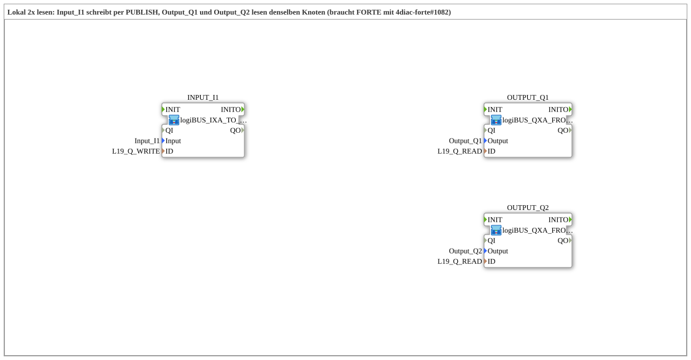

# Uebung_OPC_L19_AX: Reading locally twice: two SUBSCRIBE on one node

* * * * * * * * * *

## Introduction

`Uebung_OPC_L19_AX` shows that two local readers can read the same OPC-UA node: `Input_I1` writes the node `Q` via PUBLISH (no endpoint), `Output_Q1` and `Output_Q2` both read it via SUBSCRIBE (same ID `L19_Q_READ`). The exercise contains no event or data connections; the coupling runs solely through the OPC-UA node.

Series overview: [`OPC_UA_Lokal.md`](./OPC_UA_Lokal.md).

Comment in the `.SUB` (German original): "Lokal 2x lesen: Input_I1 schreibt per PUBLISH, Output_Q1 und Output_Q2 lesen denselben Knoten (braucht FORTE mit 4diac-forte#1082)"

## Function Blocks (FBs) Used

### `INPUT_I1`

- Type: [`MyLib::sys::logiBUS_IXA_TO_PUBLISH_OPC`](https://meisterschulen-am-ostbahnhof-munchen-docs.readthedocs.io/projects/4diac-library-reference-docs/en/latest/Bibliotheken/ExternalLibraries/MyLib_AX/sys/logiBUS_IXA_TO_PUBLISH_OPC/)
- Parameters:

    - `Input` = `Input_I1`
    - `ID` = `L19_Q_WRITE`

- Explanation: Writes the state of `Input_I1` locally (no endpoint, `WRITE`) via PUBLISH to the node `Q` (BOOL).

### `OUTPUT_Q1`

- Type: [`MyLib::sys::logiBUS_QXA_FROM_SUBSCRIBE_OPC`](https://meisterschulen-am-ostbahnhof-munchen-docs.readthedocs.io/projects/4diac-library-reference-docs/en/latest/Bibliotheken/ExternalLibraries/MyLib_AX/sys/logiBUS_QXA_FROM_SUBSCRIBE_OPC/)
- Parameters:

    - `Output` = `Output_Q1`
    - `ID` = `L19_Q_READ`

- Explanation: Reads the node `Q` locally (`READ`, SUBSCRIBE) and drives `Output_Q1` with it.

### `OUTPUT_Q2`

- Type: [`MyLib::sys::logiBUS_QXA_FROM_SUBSCRIBE_OPC`](https://meisterschulen-am-ostbahnhof-munchen-docs.readthedocs.io/projects/4diac-library-reference-docs/en/latest/Bibliotheken/ExternalLibraries/MyLib_AX/sys/logiBUS_QXA_FROM_SUBSCRIBE_OPC/)
- Parameters:

    - `Output` = `Output_Q2`
    - `ID` = `L19_Q_READ`

- Explanation: Reads the same node `Q` a second time (same ID `L19_Q_READ`) and drives `Output_Q2` with it.

## OPC-UA Addresses (`OpcUaLokal.gcf`)

The IDs come from `const/OpcUaLokal.gcf` (package `Meins::OPC_UA_Lokal::const`).

| Constant | Action | Node / ID |
|---|---|---|
| `L19_Q_WRITE` | WRITE (local) | `/Objects/Lokal/L19/Q,1:s=L19_Q` |
| `L19_Q_READ` | READ (local) | `/Objects/Lokal/L19/Q,1:s=L19_Q` |

## Program Flow and Connections

The `.SUB` contains no event or data connections.

1. `INPUT_I1` (`logiBUS_IXA_TO_PUBLISH_OPC`) writes the state of `Input_I1` with `ID` = `L19_Q_WRITE` to the node `Q`.
2. `OUTPUT_Q1` (`logiBUS_QXA_FROM_SUBSCRIBE_OPC`) reads `Q` with `ID` = `L19_Q_READ` and drives `Output_Q1`.
3. `OUTPUT_Q2` (`logiBUS_QXA_FROM_SUBSCRIBE_OPC`) reads `Q` with the same `ID` = `L19_Q_READ` and drives `Output_Q2`.

## Note / Result

Tested on FORTE_PC_AX. Prerequisite: the FORTE needs [eclipse-4diac/4diac-forte#1082](https://github.com/eclipse-4diac/4diac-forte/pull/1082) (several local readers per node). Without this change the second SUBSCRIBE reports "Cannot add another one" (see [4diac-documentation#123](https://github.com/eclipse-4diac/4diac-documentation/issues/123)).

## Learning Objectives

- Local writing (`WRITE`) and multiple local reading (`READ`) of the same node
- Reuse of the library SubApps `logiBUS_IXA_TO_PUBLISH_OPC` and `logiBUS_QXA_FROM_SUBSCRIBE_OPC`
- Coupling two outputs through a shared OPC-UA node instead of connections

## Summary

The exercise shows that, with a suitable FORTE, a node can be read locally by several SUBSCRIBEs.

---

### 🌐 Related Topic Subpages on ms-muc-docs.de

- [🌐 Eclipse 4diac IDE & Color Reference on ms-muc-docs.de](https://www.ms-muc-docs.de/iec-61499/eclipse-4diac/)
