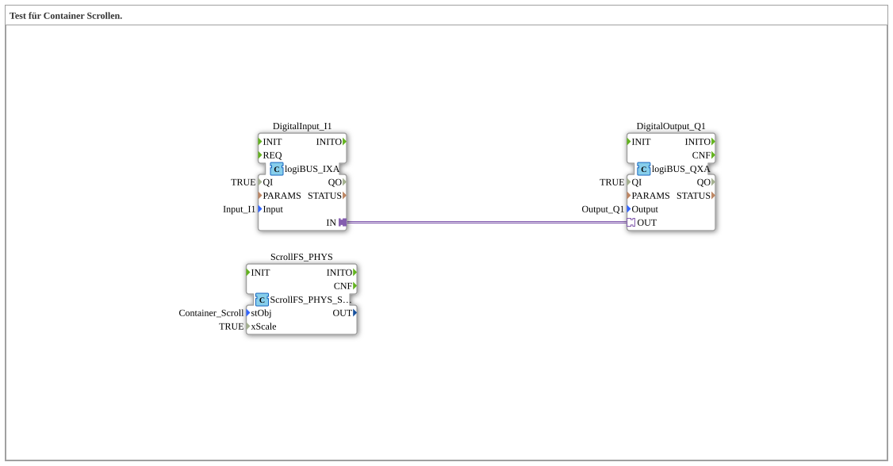

# ScrollContainerTest: Container scrolling test

* * * * * * * * * *

## Introduction

`ScrollContainerTest` is a test for scrolling a VT container (type comment: "Test für Container Scrollen."). It imports the pool constant `Container_Scroll` from `DefaultPool_Scroll`. The SubApp contains a scroll block for softkey operation and a direct pass-through from input I1 to output Q1.

## Function Blocks (FBs) Used

| Instance | Type | Parameters | Explanation |
|---|---|---|---|
| `DigitalInput_I1` | [`logiBUS::io::DI::logiBUS_IXA`](https://meisterschulen-am-ostbahnhof-munchen-docs.readthedocs.io/projects/4diac-library-reference-docs/en/latest/Bibliotheken/ExternalLibraries/logiBUS/io/DI/logiBUS_IXA/) | `Input` = `Input_I1`, `QI` = `TRUE` | Reads digital input I1. |
| `DigitalOutput_Q1` | [`logiBUS::io::DQ::logiBUS_QXA`](https://meisterschulen-am-ostbahnhof-munchen-docs.readthedocs.io/projects/4diac-library-reference-docs/en/latest/Bibliotheken/ExternalLibraries/logiBUS/io/DO/logiBUS_QXA/) | `Output` = `Output_Q1`, `QI` = `TRUE` | Writes digital output Q1. |
| `ScrollFS_PHYS` | [`isobus::UT::Q::ScrollFS_PHYS_Softkey`](https://meisterschulen-am-ostbahnhof-munchen-docs.readthedocs.io/projects/4diac-library-reference-docs/en/latest/Bibliotheken/ExternalLibraries/isobus/UT/Q/ScrollFS_PHYS_Softkey/) | `stObj` = `Container_Scroll`, `xScale` = `TRUE` | Scrollable VT list with softkey operation for the container `Container_Scroll`. |

## Program Flow and Connections

The network contains exactly one connection:

1. `DigitalInput_I1.IN` → `DigitalOutput_Q1.OUT` (adapter): input I1 is routed directly to output Q1.

`ScrollFS_PHYS` is not wired in the network; it is configured only through its parameters (`stObj`, `xScale`).

## Summary

`ScrollContainerTest` is a small test setup: a scroll block for the container `Container_Scroll` plus a one-to-one pass-through from I1 to Q1.

---

### 🌐 Related topic subpages on ms-muc-docs.de

- [🌐 Eclipse 4diac IDE & color reference on ms-muc-docs.de](https://www.ms-muc-docs.de/iec-61499/eclipse-4diac/)
