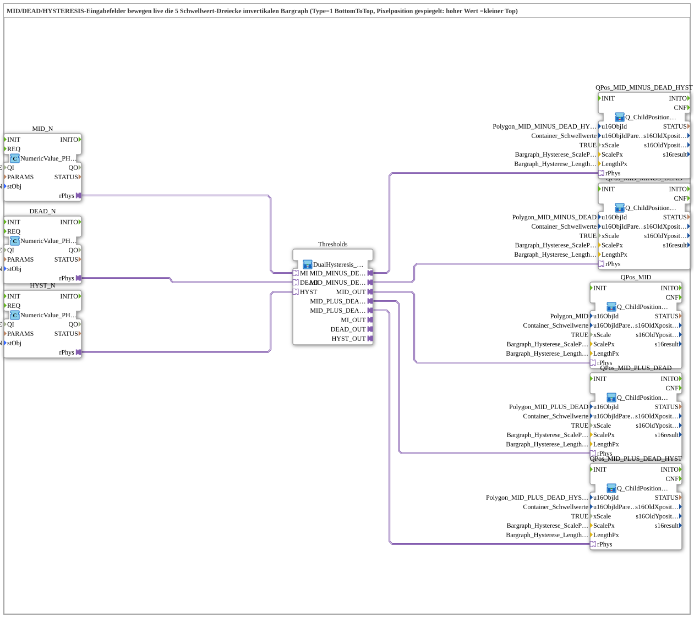

# Uebung_HystereseVertikal_AX_simple: Hysteresis thresholds in the vertical bargraph

* * * * * * * * * *

## Introduction

`Uebung_HystereseVertikal_AX_simple` is an exercise in which the three VT input fields `MID`, `DEAD` and `HYSTERESIS` move five threshold triangles live in the **vertical** bargraph (type 1, BottomToTop). According to the type comment the pixel position is mirrored: a high value gives a small top. The SubApp has no interface of its own and no event connections.

## Function Blocks (FBs) Used

| Instance | Type | Parameters | Explanation |
|---|---|---|---|
| `MID_N` | [`isobus::UT::io::NumericValue::NumericValue_PHYSA`](https://meisterschulen-am-ostbahnhof-munchen-docs.readthedocs.io/projects/4diac-library-reference-docs/en/latest/Bibliotheken/ExternalLibraries/isobus/UT/io/NumericValue/NumericValue_PHYSA/) | `QI` = `TRUE`, `stObj` = `InputNumber_MID_N` | VT input field MID; delivers the physical value on the `rPhys` adapter. |
| `DEAD_N` | [`isobus::UT::io::NumericValue::NumericValue_PHYSA`](https://meisterschulen-am-ostbahnhof-munchen-docs.readthedocs.io/projects/4diac-library-reference-docs/en/latest/Bibliotheken/ExternalLibraries/isobus/UT/io/NumericValue/NumericValue_PHYSA/) | `QI` = `TRUE`, `stObj` = `InputNumber_DEAD_N` | VT input field DEAD; delivers the physical value on the `rPhys` adapter. |
| `HYST_N` | [`isobus::UT::io::NumericValue::NumericValue_PHYSA`](https://meisterschulen-am-ostbahnhof-munchen-docs.readthedocs.io/projects/4diac-library-reference-docs/en/latest/Bibliotheken/ExternalLibraries/isobus/UT/io/NumericValue/NumericValue_PHYSA/) | `QI` = `TRUE`, `stObj` = `InputNumber_HYSTERESIS_N` | VT input field HYSTERESIS; delivers the physical value on the `rPhys` adapter. |
| `Thresholds` | [`MyLib::sys::DualHysteresis_Thresholds_AR`](https://meisterschulen-am-ostbahnhof-munchen-docs.readthedocs.io/projects/4diac-library-reference-docs/en/latest/Bibliotheken/ExternalLibraries/MyLib_AX/sys/DualHysteresis_Thresholds_AR/) | - | Computes the five thresholds from `MI`, `DEAD` and `HYST`. |
| `QPos_MID` | [`MyLib::sys::Q_ChildPosition_AR_Bargraph_BottomToTop`](https://meisterschulen-am-ostbahnhof-munchen-docs.readthedocs.io/projects/4diac-library-reference-docs/en/latest/Bibliotheken/ExternalLibraries/MyLib_AX/sys/Q_ChildPosition_AR_Bargraph_BottomToTop/) | `u16ObjId` = `Polygon_MID`, `u16ObjIdParent` = `Container_Schwellwerte`, `xScale` = `TRUE`, `ScalePx` = `Bargraph_Hysterese_ScalePx`, `LengthPx` = `Bargraph_Hysterese_LengthPx` | Positions the triangle `Polygon_MID` for the threshold Center (`MID`). |
| `QPos_MID_PLUS_DEAD` | [`MyLib::sys::Q_ChildPosition_AR_Bargraph_BottomToTop`](https://meisterschulen-am-ostbahnhof-munchen-docs.readthedocs.io/projects/4diac-library-reference-docs/en/latest/Bibliotheken/ExternalLibraries/MyLib_AX/sys/Q_ChildPosition_AR_Bargraph_BottomToTop/) | `u16ObjId` = `Polygon_MID_PLUS_DEAD`, `u16ObjIdParent` = `Container_Schwellwerte`, `xScale` = `TRUE`, `ScalePx` = `Bargraph_Hysterese_ScalePx`, `LengthPx` = `Bargraph_Hysterese_LengthPx` | Positions the triangle `Polygon_MID_PLUS_DEAD` for the threshold `MID + DEAD`. |
| `QPos_MID_MINUS_DEAD` | [`MyLib::sys::Q_ChildPosition_AR_Bargraph_BottomToTop`](https://meisterschulen-am-ostbahnhof-munchen-docs.readthedocs.io/projects/4diac-library-reference-docs/en/latest/Bibliotheken/ExternalLibraries/MyLib_AX/sys/Q_ChildPosition_AR_Bargraph_BottomToTop/) | `u16ObjId` = `Polygon_MID_MINUS_DEAD`, `u16ObjIdParent` = `Container_Schwellwerte`, `xScale` = `TRUE`, `ScalePx` = `Bargraph_Hysterese_ScalePx`, `LengthPx` = `Bargraph_Hysterese_LengthPx` | Positions the triangle `Polygon_MID_MINUS_DEAD` for the threshold `MID - DEAD`. |
| `QPos_MID_PLUS_DEAD_HYST` | [`MyLib::sys::Q_ChildPosition_AR_Bargraph_BottomToTop`](https://meisterschulen-am-ostbahnhof-munchen-docs.readthedocs.io/projects/4diac-library-reference-docs/en/latest/Bibliotheken/ExternalLibraries/MyLib_AX/sys/Q_ChildPosition_AR_Bargraph_BottomToTop/) | `u16ObjId` = `Polygon_MID_PLUS_DEAD_HYST`, `u16ObjIdParent` = `Container_Schwellwerte`, `xScale` = `TRUE`, `ScalePx` = `Bargraph_Hysterese_ScalePx`, `LengthPx` = `Bargraph_Hysterese_LengthPx` | Positions the triangle `Polygon_MID_PLUS_DEAD_HYST` for the threshold `MID + DEAD + HYST`. |
| `QPos_MID_MINUS_DEAD_HYST` | [`MyLib::sys::Q_ChildPosition_AR_Bargraph_BottomToTop`](https://meisterschulen-am-ostbahnhof-munchen-docs.readthedocs.io/projects/4diac-library-reference-docs/en/latest/Bibliotheken/ExternalLibraries/MyLib_AX/sys/Q_ChildPosition_AR_Bargraph_BottomToTop/) | `u16ObjId` = `Polygon_MID_MINUS_DEAD_HYST`, `u16ObjIdParent` = `Container_Schwellwerte`, `xScale` = `TRUE`, `ScalePx` = `Bargraph_Hysterese_ScalePx`, `LengthPx` = `Bargraph_Hysterese_LengthPx` | Positions the triangle `Polygon_MID_MINUS_DEAD_HYST` for the threshold `MID - DEAD - HYST`. |

## Program Flow and Connections

All connections are adapter connections (AR, `REAL` values):

1. `MID_N.rPhys` → `Thresholds.MI`
2. `DEAD_N.rPhys` → `Thresholds.DEAD`
3. `HYST_N.rPhys` → `Thresholds.HYST`
4. `Thresholds.MID_OUT` → `QPos_MID.rPhys`
5. `Thresholds.MID_PLUS_DEAD` → `QPos_MID_PLUS_DEAD.rPhys`
6. `Thresholds.MID_MINUS_DEAD` → `QPos_MID_MINUS_DEAD.rPhys`
7. `Thresholds.MID_PLUS_DEAD_HYST` → `QPos_MID_PLUS_DEAD_HYST.rPhys`
8. `Thresholds.MID_MINUS_DEAD_HYST` → `QPos_MID_MINUS_DEAD_HYST.rPhys`

`Thresholds` computes the thresholds from center, deadband and hysteresis; `MID_PLUS_DEAD_HYST` is `MI + (DEAD + HYST)`, `MID_MINUS_DEAD_HYST` is `MI - (DEAD + HYST)`. `Q_ChildPosition_AR_Bargraph_BottomToTop` scales the value with `ScalePx` and mirrors it at `LengthPx` (Y = `LengthPx` − value × `ScalePx`, X = 0); a larger value moves the triangle up.

## Summary

`Uebung_HystereseVertikal_AX_simple` connects three input fields via the threshold calculation to five bargraph position blocks so that the markers follow the entered values live.

---

### 🌐 Related topic subpages on ms-muc-docs.de

- [🌐 Eclipse 4diac IDE & color reference on ms-muc-docs.de](https://www.ms-muc-docs.de/iec-61499/eclipse-4diac/)
