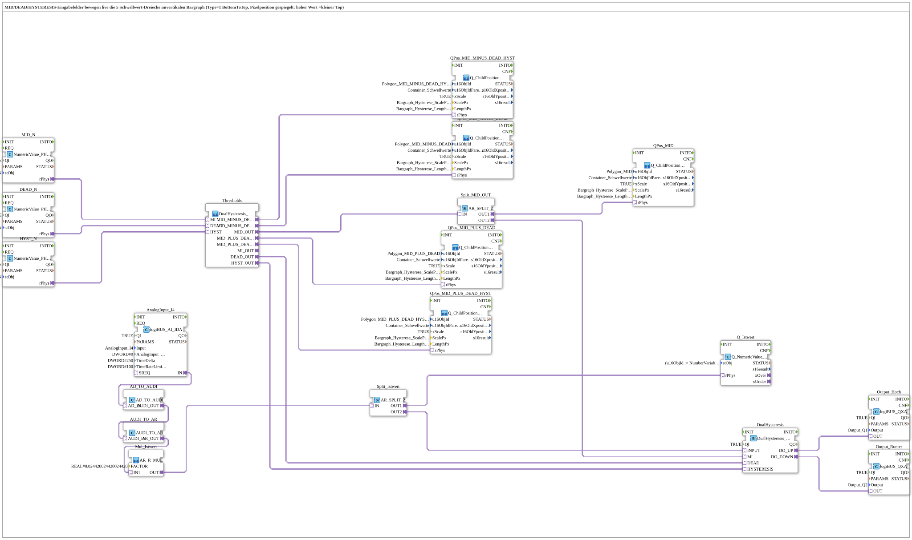

# Uebung_HystereseVertikal_AX_withAnalog: Hysteresis Thresholds in a Vertical Bargraph

* * * * * * * * * *

## Introduction

`Uebung_HystereseVertikal_AX_withAnalog` shows a **two-way hysteresis** (up/down) with an analog actual value, operated from the ISOBUS terminal: the input fields **MID**, **DEAD** and **HYSTERESIS** specify the mid value, dead band and hysteresis. From these, five threshold values are calculated, which move live as five triangles (polygons) in the vertical bar graph (bottom to top). The actual value from the analog input `AnalogInput_I4` is displayed as a number and drives the outputs `Output_Q1` (up) and `Output_Q2` (down) through the hysteresis. For the vertical bar graph (type "BottomToTop") the pixel position is mirrored: a high value gives a smaller `Top` value; therefore `Q_ChildPosition_AR_Bargraph_BottomToTop` additionally receives the bar graph length (`LengthPx`).

The SubApp interface is empty. The pool objects come from `Uebungen::const::UT::HystereseVertikal` (`DefaultPool`, `DefaultPool_Numeric`, `DefaultPool_Bargraph`).

## Function Blocks (FBs) Used

### Input fields and actual value

| Instance | Type | Parameters | Explanation |
|---|---|---|---|
| `MID_N` | [NumericValue_PHYSA](https://meisterschulen-am-ostbahnhof-munchen-docs.readthedocs.io/projects/4diac-library-reference-docs/en/latest/Bibliotheken/ExternalLibraries/isobus/UT/io/NumericValue/NumericValue_PHYSA/) | `stObj` = `InputNumber_MID_N` | Input field mid value (MID), delivers `rPhys` |
| `DEAD_N` | [NumericValue_PHYSA](https://meisterschulen-am-ostbahnhof-munchen-docs.readthedocs.io/projects/4diac-library-reference-docs/en/latest/Bibliotheken/ExternalLibraries/isobus/UT/io/NumericValue/NumericValue_PHYSA/) | `stObj` = `InputNumber_DEAD_N` | Input field dead band (DEAD) |
| `HYST_N` | [NumericValue_PHYSA](https://meisterschulen-am-ostbahnhof-munchen-docs.readthedocs.io/projects/4diac-library-reference-docs/en/latest/Bibliotheken/ExternalLibraries/isobus/UT/io/NumericValue/NumericValue_PHYSA/) | `stObj` = `InputNumber_HYSTERESIS_N` | Input field hysteresis |
| `AnalogInput_I4` | [logiBUS_AI_IDA](https://meisterschulen-am-ostbahnhof-munchen-docs.readthedocs.io/projects/4diac-library-reference-docs/en/latest/Bibliotheken/ExternalLibraries/logiBUS/io/AI/logiBUS_AI_IDA/) | `Input` = `AnalogInput_I4`, `AnalogInput_hysteresis` = `DWORD#0`, `TimeDelta` = `DWORD#250`, `TimeRateLimit` = `DWORD#100` | Analog input I4 |
| `AD_TO_AUDI` | [AD_TO_AUDI](https://meisterschulen-am-ostbahnhof-munchen-docs.readthedocs.io/projects/4diac-library-reference-docs/en/latest/Bibliotheken/ExternalLibraries/adapter/conversion/unidirectional/AD_AUDI/AD_TO_AUDI/) | – | Adapter conversion `AD` → `AUDI` |
| `AUDI_TO_AR` | [AUDI_TO_AR](https://meisterschulen-am-ostbahnhof-munchen-docs.readthedocs.io/projects/4diac-library-reference-docs/en/latest/Bibliotheken/ExternalLibraries/adapter/conversion/unidirectional/AR_AUDI/AUDI_TO_AR/) | – | Adapter conversion `AUDI` → `AR` (REAL) |
| `Mul_Istwert` | [AR_R_MUL](https://meisterschulen-am-ostbahnhof-munchen-docs.readthedocs.io/projects/4diac-library-reference-docs/en/latest/Bibliotheken/ExternalLibraries/MyLib_AX/sys/AR_R_MUL/) | `FACTOR` = `REAL#0.024420024420024420` | Scales the raw value (factor = 100/4095) |
| `Split_Istwert` | [AR_SPLIT_2](https://meisterschulen-am-ostbahnhof-munchen-docs.readthedocs.io/projects/4diac-library-reference-docs/en/latest/Bibliotheken/ExternalLibraries/adapter/events/unidirectional/REAL/AR_SPLIT_2/) | – | Distributes the actual value to the display and the hysteresis |
| `Q_Istwert` | [Q_NumericValue_PHYSA](https://meisterschulen-am-ostbahnhof-munchen-docs.readthedocs.io/projects/4diac-library-reference-docs/en/latest/Bibliotheken/ExternalLibraries/isobus/UT/Q/Q_NumericValue_PHYSA/) | `stObj` = `(u16ObjId := NumberVariable_Istwert, r32Scale := 1.0, i32Offset := 0, u8Decimals := 0)` | Shows the actual value in the terminal |

### Thresholds and hysteresis

| Instance | Type | Parameters | Explanation |
|---|---|---|---|
| `Thresholds` | [DualHysteresis_Thresholds_AR](https://meisterschulen-am-ostbahnhof-munchen-docs.readthedocs.io/projects/4diac-library-reference-docs/en/latest/Bibliotheken/ExternalLibraries/MyLib_AX/sys/DualHysteresis_Thresholds_AR/) | – | Calculates the five thresholds (MID, MID±DEAD, MID±(DEAD+HYST)) from MID, DEAD and HYST |
| `Split_MID_OUT` | [AR_SPLIT_2](https://meisterschulen-am-ostbahnhof-munchen-docs.readthedocs.io/projects/4diac-library-reference-docs/en/latest/Bibliotheken/ExternalLibraries/adapter/events/unidirectional/REAL/AR_SPLIT_2/) | – | Distributes `MID_OUT` to the mid-value marker and the hysteresis |
| `DualHysteresis` | [DualHysteresis_AR_AX](https://meisterschulen-am-ostbahnhof-munchen-docs.readthedocs.io/projects/4diac-library-reference-docs/en/latest/Bibliotheken/ExternalLibraries/adapter/signalprocessing/hysteresis/DualHysteresis_AR_AX/) | `QI` = `TRUE` | Two-way hysteresis with `INPUT`, `MI`, `DEAD`, `HYSTERESIS`; outputs `DO_UP`, `DO_DOWN` |
| `Output_Hoch` | [logiBUS_QXA](https://meisterschulen-am-ostbahnhof-munchen-docs.readthedocs.io/projects/4diac-library-reference-docs/en/latest/Bibliotheken/ExternalLibraries/logiBUS/io/DO/logiBUS_QXA/) | `QI` = `TRUE`, `Output` = `Output_Q1` | "Up" output |
| `Output_Runter` | [logiBUS_QXA](https://meisterschulen-am-ostbahnhof-munchen-docs.readthedocs.io/projects/4diac-library-reference-docs/en/latest/Bibliotheken/ExternalLibraries/logiBUS/io/DO/logiBUS_QXA/) | `QI` = `TRUE`, `Output` = `Output_Q2` | "Down" output |

### Threshold triangles in the bar graph

| Instance | Type | Parameter (`u16ObjId`) | Explanation |
|---|---|---|---|
| `QPos_MID` | [Q_ChildPosition_AR_Bargraph_BottomToTop](https://meisterschulen-am-ostbahnhof-munchen-docs.readthedocs.io/projects/4diac-library-reference-docs/en/latest/Bibliotheken/ExternalLibraries/MyLib_AX/sys/Q_ChildPosition_AR_Bargraph_BottomToTop/) | `Polygon_MID` | Marker for MID |
| `QPos_MID_PLUS_DEAD` | [Q_ChildPosition_AR_Bargraph_BottomToTop](https://meisterschulen-am-ostbahnhof-munchen-docs.readthedocs.io/projects/4diac-library-reference-docs/en/latest/Bibliotheken/ExternalLibraries/MyLib_AX/sys/Q_ChildPosition_AR_Bargraph_BottomToTop/) | `Polygon_MID_PLUS_DEAD` | Marker for MID + DEAD |
| `QPos_MID_MINUS_DEAD` | [Q_ChildPosition_AR_Bargraph_BottomToTop](https://meisterschulen-am-ostbahnhof-munchen-docs.readthedocs.io/projects/4diac-library-reference-docs/en/latest/Bibliotheken/ExternalLibraries/MyLib_AX/sys/Q_ChildPosition_AR_Bargraph_BottomToTop/) | `Polygon_MID_MINUS_DEAD` | Marker for MID − DEAD |
| `QPos_MID_PLUS_DEAD_HYST` | [Q_ChildPosition_AR_Bargraph_BottomToTop](https://meisterschulen-am-ostbahnhof-munchen-docs.readthedocs.io/projects/4diac-library-reference-docs/en/latest/Bibliotheken/ExternalLibraries/MyLib_AX/sys/Q_ChildPosition_AR_Bargraph_BottomToTop/) | `Polygon_MID_PLUS_DEAD_HYST` | Marker for MID + (DEAD + HYST) |
| `QPos_MID_MINUS_DEAD_HYST` | [Q_ChildPosition_AR_Bargraph_BottomToTop](https://meisterschulen-am-ostbahnhof-munchen-docs.readthedocs.io/projects/4diac-library-reference-docs/en/latest/Bibliotheken/ExternalLibraries/MyLib_AX/sys/Q_ChildPosition_AR_Bargraph_BottomToTop/) | `Polygon_MID_MINUS_DEAD_HYST` | Marker for MID − (DEAD + HYST) |

Common parameters of all five `QPos_*` instances: `u16ObjId`, `u16ObjIdParent` = `Container_Schwellwerte`, `xScale` = `TRUE`, `ScalePx` = `Bargraph_Hysterese_ScalePx`, `LengthPx` = `Bargraph_Hysterese_LengthPx`.

## Program Flow and Connections

1. **Input**: `MID_N.rPhys`, `DEAD_N.rPhys` and `HYST_N.rPhys` go to `Thresholds.MI`, `.DEAD` and `.HYST`.
2. **Thresholds → display**: the four derived thresholds (`MID_PLUS_DEAD`, `MID_MINUS_DEAD`, `MID_PLUS_DEAD_HYST`, `MID_MINUS_DEAD_HYST`) each go to `rPhys` of the matching `QPos_*`; `MID_OUT` runs via `Split_MID_OUT` (`OUT1` → `QPos_MID.rPhys`, `OUT2` → `DualHysteresis.MI`). When the operator changes an input field, the triangles move live.
3. **Hysteresis parameters**: `Thresholds.DEAD_OUT` → `DualHysteresis.DEAD`, `Thresholds.HYST_OUT` → `DualHysteresis.HYSTERESIS`.
4. **Actual value**: `AnalogInput_I4.IN` → `AD_TO_AUDI` → `AUDI_TO_AR` → `Mul_Istwert` → `Split_Istwert`; `OUT1` → `Q_Istwert.rPhys` (display), `OUT2` → `DualHysteresis.INPUT`.
5. **Outputs**: `DualHysteresis.DO_UP` → `Output_Hoch` (Q1), `DualHysteresis.DO_DOWN` → `Output_Runter` (Q2).

Version history according to the source: V1.1 – AR_TO_AI, Zero and QPos moved into the SubApp `Q_ChildPosition_AR_*`; V1.2 – threshold calculation moved into `DualHysteresis_Thresholds_AR`.

## Summary

`Uebung_HystereseVertikal_AX_withAnalog` combines three input fields, an analog measurement, a two-way hysteresis and the live positioning of five threshold triangles in a vertical bargraph - entirely via adapter connections, without event wiring.

---

### 🌐 Related topic subpages on ms-muc-docs.de

- [🌐 Eclipse 4diac IDE & color reference on ms-muc-docs.de](https://www.ms-muc-docs.de/iec-61499/eclipse-4diac/)
