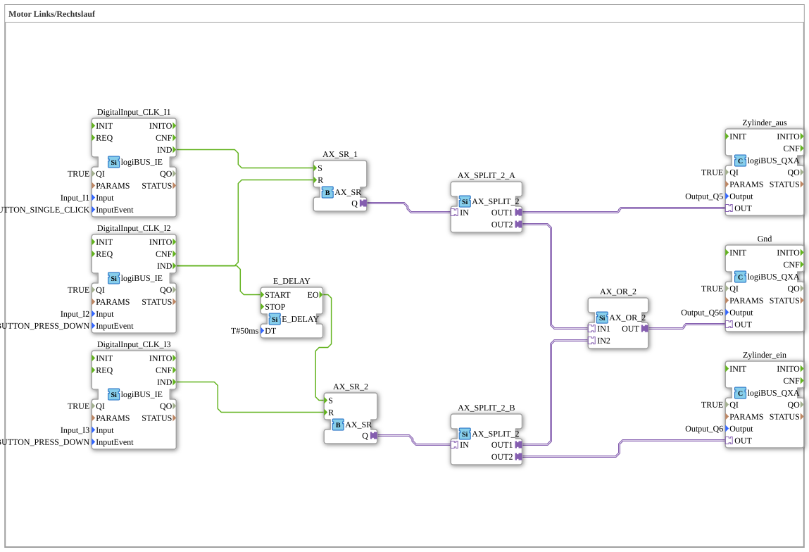

# ZylinderAusEinAutomatik: Cylinder Extend/Retract via Buttons

* * * * * * * * * *

## Introduction

`ZylinderAusEinAutomatik` controls a cylinder connected via two outputs (`Output_Q5` = extend, `Output_Q6` = retract) and a common ground output (`Output_Q56`). Three buttons control the movement: one starts extending, one stops it and starts retracting after a short delay, one ends the retraction. The SubApp interface is empty. (The SubApp `Comment` still reads "Motor Links/Rechtslauf" (motor left/right rotation), apparently inherited from a template.)

A comment in the network notes: "The cylinder makes a humming noise when extending."

## Function Blocks (FBs) Used

| Instance | Type | Parameters | Explanation |
|---|---|---|---|
| `DigitalInput_CLK_I1` | [logiBUS_IE](https://meisterschulen-am-ostbahnhof-munchen-docs.readthedocs.io/projects/4diac-library-reference-docs/en/latest/Bibliotheken/ExternalLibraries/logiBUS/io/DI/logiBUS_IE/) | `Input_I1`, `BUTTON_SINGLE_CLICK`, `QI` = `TRUE` | "Extend" button (single click) |
| `DigitalInput_CLK_I2` | [logiBUS_IE](https://meisterschulen-am-ostbahnhof-munchen-docs.readthedocs.io/projects/4diac-library-reference-docs/en/latest/Bibliotheken/ExternalLibraries/logiBUS/io/DI/logiBUS_IE/) | `Input_I2`, `BUTTON_PRESS_DOWN`, `QI` = `TRUE` | "Start retracting" button (on press) |
| `DigitalInput_CLK_I3` | [logiBUS_IE](https://meisterschulen-am-ostbahnhof-munchen-docs.readthedocs.io/projects/4diac-library-reference-docs/en/latest/Bibliotheken/ExternalLibraries/logiBUS/io/DI/logiBUS_IE/) | `Input_I3`, `BUTTON_PRESS_DOWN`, `QI` = `TRUE` | "End retracting" button (on press) |
| `AX_SR_1` | [AX_SR](https://meisterschulen-am-ostbahnhof-munchen-docs.readthedocs.io/projects/4diac-library-reference-docs/en/latest/Bibliotheken/ExternalLibraries/adapter/events/unidirectional/BOOL/AX_SR/) | – | Latch (set/reset) for "extend cylinder" |
| `AX_SR_2` | [AX_SR](https://meisterschulen-am-ostbahnhof-munchen-docs.readthedocs.io/projects/4diac-library-reference-docs/en/latest/Bibliotheken/ExternalLibraries/adapter/events/unidirectional/BOOL/AX_SR/) | – | Latch (set/reset) for "retract cylinder" |
| `E_DELAY` | [E_DELAY](https://meisterschulen-am-ostbahnhof-munchen-docs.readthedocs.io/projects/4diac-library-reference-docs/en/latest/Bibliotheken/StandardLibraries/events/E_DELAY/) | `DT` = `T#50ms` | Delays the start of retraction by 50 ms |
| `AX_SPLIT_2_A`, `AX_SPLIT_2_B` | [AX_SPLIT_2](https://meisterschulen-am-ostbahnhof-munchen-docs.readthedocs.io/projects/4diac-library-reference-docs/en/latest/Bibliotheken/ExternalLibraries/adapter/events/unidirectional/BOOL/AX_SPLIT_2/) | – | Each distributes one latch state to the cylinder output and the OR |
| `AX_OR_2` | [AX_OR_2](https://meisterschulen-am-ostbahnhof-munchen-docs.readthedocs.io/projects/4diac-library-reference-docs/en/latest/Bibliotheken/ExternalLibraries/adapter/booleanOperators/AX_OR_2/) | – | OR of both movements for the common output |
| `Zylinder_aus` | [logiBUS_QXA](https://meisterschulen-am-ostbahnhof-munchen-docs.readthedocs.io/projects/4diac-library-reference-docs/en/latest/Bibliotheken/ExternalLibraries/logiBUS/io/DO/logiBUS_QXA/) | `Output_Q5`, `QI` = `TRUE` | Extend cylinder |
| `Zylinder_ein` | [logiBUS_QXA](https://meisterschulen-am-ostbahnhof-munchen-docs.readthedocs.io/projects/4diac-library-reference-docs/en/latest/Bibliotheken/ExternalLibraries/logiBUS/io/DO/logiBUS_QXA/) | `Output_Q6`, `QI` = `TRUE` | Retract cylinder |
| `Gnd` | [logiBUS_QXA](https://meisterschulen-am-ostbahnhof-munchen-docs.readthedocs.io/projects/4diac-library-reference-docs/en/latest/Bibliotheken/ExternalLibraries/logiBUS/io/DO/logiBUS_QXA/) | `Output_Q56`, `QI` = `TRUE` | Common output, active while either movement is running |

## Program Flow and Connections

1. **Start extending**: `DigitalInput_CLK_I1.IND` sets `AX_SR_1` (`S`). `AX_SR_1.Q` goes via `AX_SPLIT_2_A` to `Zylinder_aus` (Q5) and to `AX_OR_2.IN1`.
2. **Stop extending, start retracting**: `DigitalInput_CLK_I2.IND` resets `AX_SR_1` (`R`) and starts `E_DELAY`. After 50 ms `E_DELAY.EO` sets the latch `AX_SR_2` (`S`). `AX_SR_2.Q` goes via `AX_SPLIT_2_B` to `Zylinder_ein` (Q6) and to `AX_OR_2.IN2`.
3. **End retracting**: `DigitalInput_CLK_I3.IND` resets `AX_SR_2` (`R`).
4. **Common output**: `AX_OR_2.OUT` drives `Gnd` (Q56); it is active as soon as either extending or retracting is active.

The 50 ms delay (`E_DELAY`) lies between resetting `AX_SR_1` and setting `AX_SR_2`.

## Summary

`ZylinderAusEinAutomatik` shows a cylinder control with two set/reset latches, a short changeover delay and a commonly driven ground output.

---

### 🌐 Related topic subpages on ms-muc-docs.de

- [🌐 Eclipse 4diac IDE & color reference on ms-muc-docs.de](https://www.ms-muc-docs.de/iec-61499/eclipse-4diac/)
