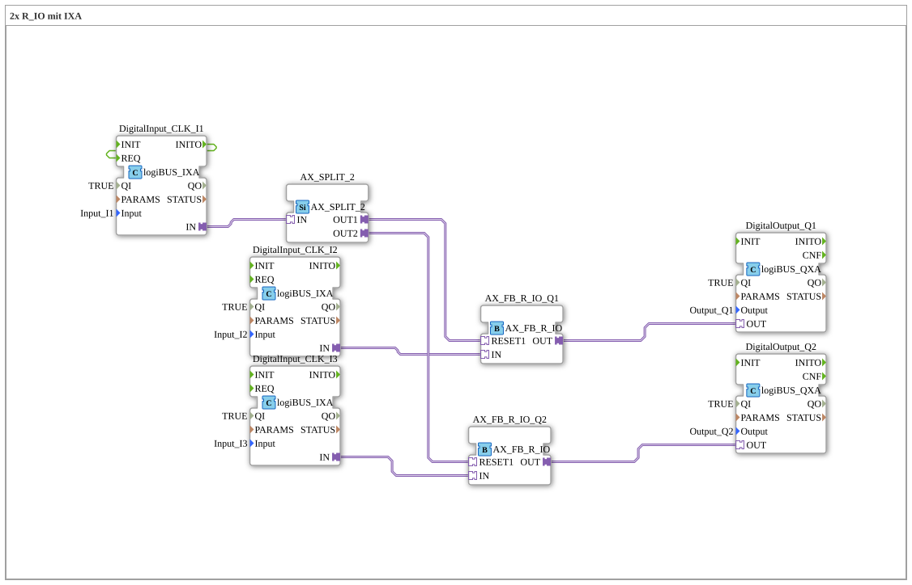

# Exercise_003a2b_AX: 2x R_IO with IXA

* * * * * * * * * *

## Introduction

This exercise demonstrates the control of two digital outputs (Q1 and Q2), each via a reset-set function block (`AX_FB_R_IO`). The reset inputs of both blocks are controlled jointly by the first digital input (I1), which acts as a "caretaker off" switch (everything off with one switch). An `AX_SPLIT_2` distributes the reset signal to both channels. The outputs are set via I2 (for Q1) and I3 (for Q2).

The goal is to understand the interaction of monostable elements (R_IO) with hardware inputs and outputs, as well as the implementation of a common reset function.

## Function Blocks (FBs) Used

- **DigitalInput_CLK_I1**: logiBUS digital input for the common reset ("caretaker off")
    - **Type**: `logiBUS::io::DI::logiBUS_IXA`
    - **Parameters**: `QI = TRUE`, `PARAMS = ""` (both hidden in the diagram), `Input = Input_I1`
    - **Explanation**: Connects the physical input `I1` to the adapter interface `IN`. In addition, `INITO` is connected to `REQ` (EventConnection).
- **DigitalInput_CLK_I2**: logiBUS digital input for setting Q1
    - **Type**: `logiBUS::io::DI::logiBUS_IXA`
    - **Parameters**: `QI = TRUE`, `PARAMS = ""` (both hidden), `Input = Input_I2`
    - **Explanation**: Connects the physical input `I2` to the adapter interface `IN`.
- **DigitalInput_CLK_I3**: logiBUS digital input for setting Q2
    - **Type**: `logiBUS::io::DI::logiBUS_IXA`
    - **Parameters**: `QI = TRUE`, `PARAMS = ""` (both hidden), `Input = Input_I3`
    - **Explanation**: Connects the physical input `I3` to the adapter interface `IN`.
- **AX_SPLIT_2**: signal splitter
    - **Type**: `adapter::events::unidirectional::AX_SPLIT_2`
    - **Parameters**: none
    - **Explanation**: Distributes the signal from `I1` unchanged to the two outputs `OUT1` and `OUT2`.
- **AX_FB_R_IO_Q1**: reset-set element for Q1
    - **Type**: `adapter::monostableElements::AX_FB_R_IO`
    - **Parameters**: none
    - **Explanation**: `IN` (from `I2`) sets the output, `RESET1` (from `AX_SPLIT_2.OUT1`) resets it. The output `OUT` leads to `DigitalOutput_Q1`.
- **AX_FB_R_IO_Q2**: reset-set element for Q2
    - **Type**: `adapter::monostableElements::AX_FB_R_IO`
    - **Parameters**: none
    - **Explanation**: `IN` (from `I3`) sets the output, `RESET1` (from `AX_SPLIT_2.OUT2`) resets it. The output `OUT` leads to `DigitalOutput_Q2`.
- **DigitalOutput_Q1**: logiBUS digital output for Q1
    - **Type**: `logiBUS::io::DQ::logiBUS_QXA`
    - **Parameters**: `QI = TRUE`, `Output = Output_Q1`
    - **Explanation**: Passes the state of `AX_FB_R_IO_Q1.OUT` to the physical output `Q1`.
- **DigitalOutput_Q2**: logiBUS digital output for Q2
    - **Type**: `logiBUS::io::DQ::logiBUS_QXA`
    - **Parameters**: `QI = TRUE`, `Output = Output_Q2`
    - **Explanation**: Passes the state of `AX_FB_R_IO_Q2.OUT` to the physical output `Q2`.

## Program Flow and Connections

1. `DigitalInput_CLK_I1.INITO` → `DigitalInput_CLK_I1.REQ` (EventConnection): After initialization, the block itself requests the input value.
2. `DigitalInput_CLK_I1.IN` → `AX_SPLIT_2.IN` (AdapterConnection): The signal from `I1` is fed to the splitter.
3. `AX_SPLIT_2.OUT1` → `AX_FB_R_IO_Q1.RESET1` and `AX_SPLIT_2.OUT2` → `AX_FB_R_IO_Q2.RESET1`: `I1` acts as the common reset for both channels.
4. `DigitalInput_CLK_I2.IN` → `AX_FB_R_IO_Q1.IN`: `I2` sets Q1.
5. `DigitalInput_CLK_I3.IN` → `AX_FB_R_IO_Q2.IN`: `I3` sets Q2.
6. `AX_FB_R_IO_Q1.OUT` → `DigitalOutput_Q1.OUT` and `AX_FB_R_IO_Q2.OUT` → `DigitalOutput_Q2.OUT`: The states are applied to the physical outputs `Q1` and `Q2`.

**Notes from the comments in the network**:

- Caretaker off (everything off with one switch): The switch would have to be LATCHING. Otherwise the outputs are only off for as long as the button is held.
- Advantage of this solution: If nothing is connected to `RESET1`, the block is still functional. The principle is the same as `FB_RS`.
- An AND would also be possible; the caretaker would then be an enabling switch.

## Summary

The exercise shows a circuit for controlling two outputs with a common reset signal: `I2` sets `Q1`, `I3` sets `Q2`, and `I1` resets both `AX_FB_R_IO` blocks via `AX_SPLIT_2` ("caretaker off"). Splitting the reset signal via `AX_SPLIT_2` keeps the circuit clear and easy to extend.

---

### 🌐 Related topic subpages on ms-muc-docs.de

- [🌐 Eclipse 4diac IDE & Color Reference on ms-muc-docs.de](https://www.ms-muc-docs.de/iec-61499/eclipse-4diac/)
