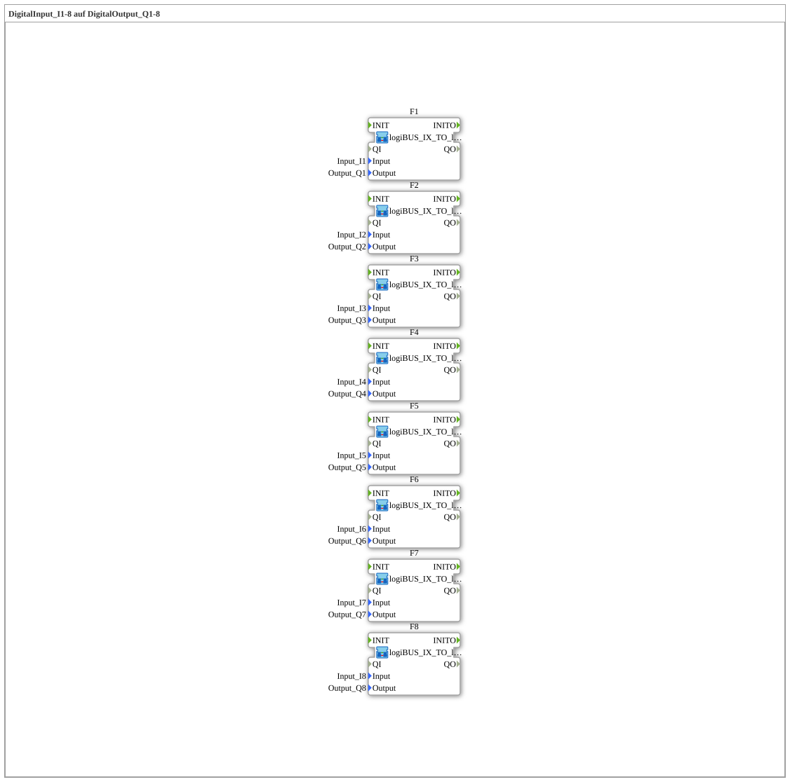

# Exercise_003f_AX: DigitalInput_I1-8 to DigitalOutput_Q1-8

* * * * * * * * * *

## Introduction

This exercise routes all eight digital inputs `Input_I1` to `Input_I8` directly to the eight digital outputs `Output_Q1` to `Output_Q8`. It corresponds to [Uebung_003b_AX](./Uebung_003b_AX.md), but uses all 8 channels instead of only 4. Each channel consists of one instance of the reusable block `logiBUS_IX_TO_logiBUS_QX`; the instances are not connected to each other.

## Function Blocks (FBs) Used

- **F1 ... F8**: one input → output channel each
    - **Type**: [`MyLib::sys::logiBUS_IX_TO_logiBUS_QX`](https://meisterschulen-am-ostbahnhof-munchen-docs.readthedocs.io/projects/4diac-library-reference-docs/en/latest/Bibliotheken/ExternalLibraries/MyLib_B/sys/logiBUS_IX_TO_logiBUS_QX/) (SubApp instance)
    - **Parameters** (per instance):

        | Instance | `Input` | `Output` |
        | -------- | ------- | -------- |
        | F1 | `Input_I1` | `Output_Q1` |
        | F2 | `Input_I2` | `Output_Q2` |
        | F3 | `Input_I3` | `Output_Q3` |
        | F4 | `Input_I4` | `Output_Q4` |
        | F5 | `Input_I5` | `Output_Q5` |
        | F6 | `Input_I6` | `Output_Q6` |
        | F7 | `Input_I7` | `Output_Q7` |
        | F8 | `Input_I8` | `Output_Q8` |

    - **Explanation**: Internally the block contains a [`logiBUS_IX`](https://meisterschulen-am-ostbahnhof-munchen-docs.readthedocs.io/projects/4diac-library-reference-docs/en/latest/Bibliotheken/ExternalLibraries/logiBUS/io/DI/logiBUS_IX/) (`QI = TRUE`) and a [`logiBUS_QX`](https://meisterschulen-am-ostbahnhof-munchen-docs.readthedocs.io/projects/4diac-library-reference-docs/en/latest/Bibliotheken/ExternalLibraries/logiBUS/io/DO/logiBUS_QX/) (`QI = TRUE`). The input's `IND` event triggers `REQ` on the output, and the state is additionally transferred from `IN` to `OUT` via a data connection. The parameters `Input` and `Output` select the physical channel.

## Program Flow and Connections

1. At the top level there are no connections between the instances `F1` to `F8`; the subapplication has no interface of its own.
2. In each instance, `Input` is passed to the internal `logiBUS_IX` and `Output` to the internal `logiBUS_QX`.
3. Internally, `logiBUS_IX.IND` → `logiBUS_QX.REQ` (event) and `logiBUS_IX.IN` → `logiBUS_QX.OUT` (data) are connected.

**Behavior**: Each output `Q1` ... `Q8` follows the state of the input `I1` ... `I8` with the same number.

## Summary

The exercise shows how instantiating a parameterizable block several times, with only two parameters per channel, routes eight inputs to eight outputs without needing any connections at the top level.

---

### 🌐 Related topic subpages on ms-muc-docs.de

- [🌐 Eclipse 4diac IDE & Color Reference on ms-muc-docs.de](https://www.ms-muc-docs.de/iec-61499/eclipse-4diac/)
