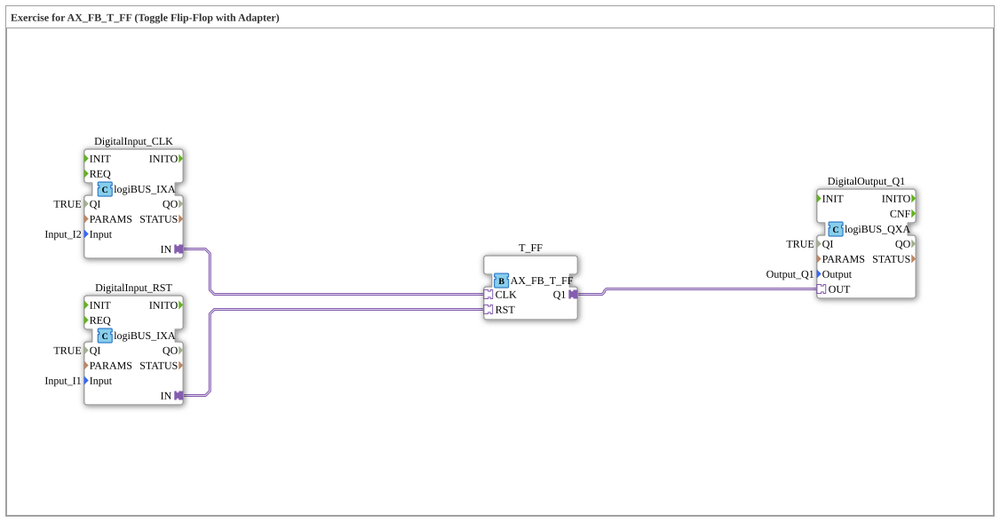

# Exercise_004a4_AX_T: Exercise for AX_FB_T_FF (Toggle Flip-Flop with Adapter)

* * * * * * * * * *

## Introduction

This exercise demonstrates the use of a **toggle flip-flop (AX_FB_T_FF)** with the help of adapters.
A toggle flip-flop changes its output state (Q1) on each positive clock pulse (CLK) and can be set to `FALSE` via the reset input (RST).

The inputs are implemented via two logiBUS digital input blocks (Input_I2 for RST and Input_I1 for CLK), and the output via a logiBUS digital output block (Output_Q1).

## Function Blocks (FBs) Used

The SubApp contains the following function blocks:

- **DigitalInput_RST**
    - Type: `logiBUS::io::DI::logiBUS_IXA`
    - Parameters: `QI = TRUE`, `Input = Input_I2`
    - *Connects the physical input Input_I2 to the RST signal of the flip-flop.*

- **DigitalInput_CLK**
    - Type: `logiBUS::io::DI::logiBUS_IXA`
    - Parameters: `QI = TRUE`, `Input = Input_I1`
    - *Connects the physical input Input_I1 to the clock signal (CLK) of the flip-flop.*

- **T_FF**
    - Type: `adapter::bistableElements::AX_FB_T_FF`
    - No further parameters.
    - *Core of the exercise: A toggle flip-flop that switches the output on each clock pulse.*

- **DigitalOutput_Q1**
    - Type: `logiBUS::io::DQ::logiBUS_QXA`
    - Parameters: `QI = TRUE`, `Output = Output_Q1`
    - *Connects the flip-flop output to the physical output Output_Q1.*

### Sub-Blocks

No further SubApp blocks are used within this exercise.

## Program Flow and Connections

The function blocks are linked via **adapter connections** (no classic event/data connections):

1. **Reset signal (RST):**
   `DigitalInput_RST.IN` → `T_FF.RST`
   *A signal on input Input_I2 resets the flip-flop (Q1 = FALSE).*

2. **Clock signal (CLK):**
   `DigitalInput_CLK.IN` → `T_FF.CLK`
   *Each rising edge on Input_I1 toggles the output Q1 (from TRUE to FALSE or vice versa).*

3. **Output (Q1):**
   `T_FF.Q1` → `DigitalOutput_Q1.OUT`
   *The current state of the flip-flop is passed to the physical output Output_Q1.*

**Sequence:**

- As long as no reset is applied, the output changes its state on every clock pulse.
- An active reset (TRUE) immediately sets the output to `FALSE` and holds it there until the reset is released and a new clock pulse arrives.

## Summary

This exercise teaches the use of a **toggle flip-flop** via adapter connections in the 4diac IDE.

- Learning objectives:
    - Understanding how a toggle flip-flop (AX_FB_T_FF) works.
    - Connecting physical inputs/outputs via logiBUS adapters.
    - Creating and testing a simple circuit for changing state per clock pulse.

- Prerequisites: Basics of IEC 61499, use of adapters, logiBUS integration.

The exercise is well suited as an introduction to sequential logic with memory behavior.

---

### 🌐 Related topic subpages on ms-muc-docs.de

- [🌐 Eclipse 4diac IDE & Color Reference on ms-muc-docs.de](https://www.ms-muc-docs.de/iec-61499/eclipse-4diac/)
