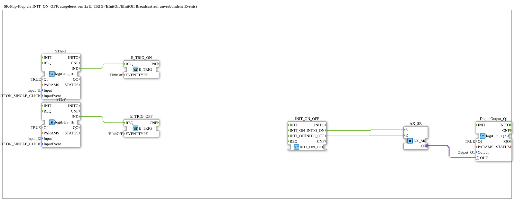

# Uebung_006g_AX: SR Flip-Flop via INIT_ON_OFF, Triggered by Two E_TRIG

* * * * * * * * * *

## Introduction

This exercise drives an SR flip-flop (`AX_SR`) not via direct event lines but via the broadcast behavior of `E_TRIG`: two `E_TRIG` blocks trigger the unconnected event inputs `INIT_ON` and `INIT_OFF` of the `INIT_ON_OFF` block. Its pass-through outputs `INITO_ON` and `INITO_OFF` set and reset the flip-flop, whose state controls the output `Q1`. A click on `I1` switches `Q1` on, a click on `I2` switches `Q1` off.

## Function Blocks (FBs) Used

- **START**: logiBUS input with click detection for the start button
    - **Type**: `logiBUS::io::DI::logiBUS_IE`
    - **Parameters**: `QI = TRUE`, `Input = Input_I1`, `InputEvent = BUTTON_SINGLE_CLICK`
    - **Explanation**: Detects a single click on `I1` and reports it as the event `IND`.
- **STOP**: logiBUS input with click detection for the stop button
    - **Type**: `logiBUS::io::DI::logiBUS_IE`
    - **Parameters**: `QI = TRUE`, `Input = Input_I2`, `InputEvent = BUTTON_SINGLE_CLICK`
    - **Explanation**: Detects a single click on `I2` and reports it as the event `IND`.
- **E_TRIG_ON**: Trigger for the event type `EInitOn`
    - **Type**: [`iec61499::events::E_TRIG`](https://meisterschulen-am-ostbahnhof-munchen-docs.readthedocs.io/projects/4diac-library-reference-docs/en/latest/Bibliotheken/StandardLibraries/events/E_TRIG/)
    - **Parameters**: `EVENTTYPE = 'EInitOn'`
    - **Explanation**: On `REQ`, triggers all unconnected event inputs named `EInitOn` in the network.
- **E_TRIG_OFF**: Trigger for the event type `EInitOff`
    - **Type**: [`iec61499::events::E_TRIG`](https://meisterschulen-am-ostbahnhof-munchen-docs.readthedocs.io/projects/4diac-library-reference-docs/en/latest/Bibliotheken/StandardLibraries/events/E_TRIG/)
    - **Parameters**: `EVENTTYPE = 'EInitOff'`
    - **Explanation**: On `REQ`, triggers all unconnected event inputs named `EInitOff` in the network.
- **INIT_ON_OFF**: Pass-through for the two init channels
    - **Type**: `iec61131::booleanOperators::INIT_ON_OFF`
    - **Parameters**: none
    - **Explanation**: Besides `INIT` and `REQ` it has two independent pass-through channels: `INIT_ON` → `INITO_ON` (event type `EInitOn`) and `INIT_OFF` → `INITO_OFF` (event type `EInitOff`). In this exercise the inputs `INIT_ON` and `INIT_OFF` deliberately remain unconnected (see note in the model).
- **AX_SR**: Set-reset flip-flop with adapter output
    - **Type**: [`adapter::events::unidirectional::AX_SR`](https://meisterschulen-am-ostbahnhof-munchen-docs.readthedocs.io/projects/4diac-library-reference-docs/en/latest/Bibliotheken/ExternalLibraries/adapter/events/unidirectional/BOOL/AX_SR/)
    - **Parameters**: none
    - **Explanation**: Controlled via the events `S` (set) and `R` (reset) and provides its state on the adapter `Q`.
- **DigitalOutput_Q1**: logiBUS digital output
    - **Type**: `logiBUS::io::DQ::logiBUS_QXA`
    - **Parameters**: `QI = TRUE`, `Output = Output_Q1`
    - **Explanation**: Passes the state of `AX_SR.Q` on to the physical output `Q1`.

## Program Flow and Connections

1. `START.IND` → `E_TRIG_ON.REQ` (EventConnection): a click on `I1` triggers the trigger for `EInitOn`.
2. `STOP.IND` → `E_TRIG_OFF.REQ` (EventConnection): a click on `I2` triggers the trigger for `EInitOff`.
3. `INIT_ON_OFF.INITO_ON` → `AX_SR.S` and `INIT_ON_OFF.INITO_OFF` → `AX_SR.R` (EventConnections): the passed-through events set and reset the flip-flop.
4. `AX_SR.Q` → `DigitalOutput_Q1.OUT` (AdapterConnection): the flip-flop state is applied to the physical output `Q1`.

**Note on the broadcast**: `INIT_ON` and `INIT_OFF` of `INIT_ON_OFF` are not connected. `E_TRIG` sends its `EVENTTYPE` to all unconnected event inputs of this type in the network, so only the matching channel (`EInitOn` or `EInitOff`) reacts here.

**Behavior**: click on `I1` → `E_TRIG_ON` → `INIT_ON_OFF.INITO_ON` → `AX_SR.S`: `Q1` is switched on. Click on `I2` → `E_TRIG_OFF` → `INIT_ON_OFF.INITO_OFF` → `AX_SR.R`: `Q1` is switched off.

## Summary

The exercise `Uebung_006g_AX` shows that an SR flip-flop can also be switched without direct event lines between the button and the flip-flop: `E_TRIG` broadcasts an event type to unconnected event inputs, `INIT_ON_OFF` passes the two channels `EInitOn` and `EInitOff` through separately, and `AX_SR` uses them to set and reset the output `Q1`.

---

### 🌐 Related topic subpages on ms-muc-docs.de

- [🌐 Eclipse 4diac IDE & Color Reference on ms-muc-docs.de](https://www.ms-muc-docs.de/iec-61499/eclipse-4diac/)
