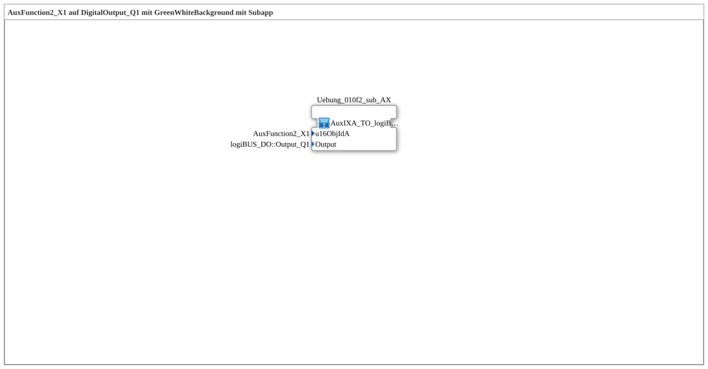

# Uebung_010f2_AX: AuxFunction2_X1 on DigitalOutput_Q1 with GreenWhiteBackground Using a Subapp

* * * * * * * * * *

## Introduction

This exercise resolves the drawback mentioned in `Uebung_010f_AX`, namely that the object ID `AuxFunction2_X1` has to be entered separately in two places (Aux FB and `GreenWhiteBackground2_AX`) – exactly as `Uebung_010c2_AX` does for `Uebung_010c_AX`. At the top level, the network consists of only a single SubApp instance of a block from the `MyLib_AX` library, which encapsulates the complete logic.

## Function Blocks (FBs) Used

At the top level of the SubApp there is no individual FB, only the SubApp instance described below.

- **Uebung_010f2_sub_AX**: Encapsulated logic of Aux input, splitter, output and background color
    - **Type**: [`MyLib::sys::AuxIXA_TO_logiBUS_QXA_BG`](https://meisterschulen-am-ostbahnhof-munchen-docs.readthedocs.io/projects/4diac-library-reference-docs/en/latest/Bibliotheken/ExternalLibraries/MyLib_AX/sys/AuxIXA_TO_logiBUS_QXA_BG/) (SubApp instance)
    - **Parameters**: `u16ObjIdA = AuxFunction2_X1` (object ID of the Aux object), `Output = logiBUS_DO::Output_Q1` (identity of the physical output)
    - **Explanation**: The SubApp has exactly two inputs, `u16ObjIdA` and `Output`. Internally it contains four blocks: `AuxFunction2_X1` (`isobus::UT::io::Auxiliary::IN::Aux_IXA`, `QI = TRUE`), `AX_SPLIT_2` (`adapter::events::unidirectional::AX_SPLIT_2`), `DigitalOutput_Q1` (`logiBUS::io::DQ::logiBUS_QXA`, `QI = TRUE`) and [`GreenWhiteBackground2_AX`](https://meisterschulen-am-ostbahnhof-munchen-docs.readthedocs.io/projects/4diac-library-reference-docs/en/latest/Bibliotheken/ExternalLibraries/MyLib_AX/sys/GreenWhiteBackground2_AX/) (`MyLib::sys::GreenWhiteBackground2_AX`).

The import `Uebungen::const::UT::DefaultPool::AuxFunction2_X1` provides the object ID constant, `logiBUS_DO` the namespace for the output identifier.

## Program Flow and Connections

1. When the SubApp is instantiated, `Uebung_010f2_sub_AX` is given the two parameters `u16ObjIdA` (object ID of the Aux object) and `Output` (target output).
2. Inside the SubApp, (invisible) DataConnections distribute `u16ObjIdA` to `AuxFunction2_X1.u16ObjId` and to `GreenWhiteBackground2_AX.u16ObjIdA`; another one distributes `Output` to `DigitalOutput_Q1.Output`. The object ID therefore only has to be specified once.
3. The signal flow inside the SubApp (AdapterConnections): `AuxFunction2_X1.IN` → `AX_SPLIT_2.IN`, `AX_SPLIT_2.OUT1` → `DigitalOutput_Q1.OUT` (the physical output follows the Aux state) and `AX_SPLIT_2.OUT2` → `GreenWhiteBackground2_AX.DI1` (background color on the VT screen and on the Aux handle).

The AUX color still goes to both the VT screen and the Aux handle – this is necessary and is not optimized away here.

## Summary

`Uebung_010f2_AX` demonstrates how an object ID that is needed several times can be reduced to a single entry point by encapsulating it in a dedicated SubApp type (here the library block `MyLib::sys::AuxIXA_TO_logiBUS_QXA_BG`). Functionally, the exercise is identical to `Uebung_010f_AX`; the difference lies solely in the reusability and maintainability of the wiring.

---

### 🌐 Related topic subpages on ms-muc-docs.de

- [🌐 Eclipse 4diac IDE & Color Reference on ms-muc-docs.de](https://www.ms-muc-docs.de/iec-61499/eclipse-4diac/)
