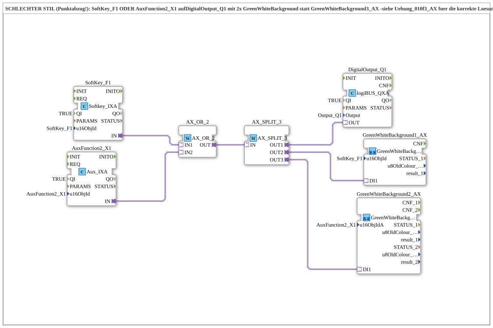

# Exercise_010f4_AX: BAD STYLE (points deducted!) — SoftKey_F1 OR AuxFunction2_X1 to DigitalOutput_Q1 with 2x GreenWhiteBackground

* * * * * * * * * *

## Introduction

**This file was deliberately left in place as a negative example** (the source explicitly marks it as "BAD STYLE – points deducted!"). Functionally it achieves the same as [Uebung_010f3_AX](./Uebung_010f3_AX.md) (SoftKey OR Aux button jointly switch `Q1`), but it does so with needlessly bloated wiring: instead of the intended block [`GreenWhiteBackground3_AX`](https://meisterschulen-am-ostbahnhof-munchen-docs.readthedocs.io/projects/4diac-library-reference-docs/en/latest/Bibliotheken/ExternalLibraries/MyLib_AX/sys/GreenWhiteBackground3_AX/), two separate instances `GreenWhiteBackground1_AX` and `GreenWhiteBackground2_AX` are used. This page deliberately documents the mistake, not a recommended solution – for the correct implementation see [Uebung_010f3_AX](./Uebung_010f3_AX.md).

## Function Blocks (FBs) Used

- **SoftKey_F1**: VT softkey input
    - **Type**: [`isobus::UT::io::Softkey::Softkey_IXA`](https://meisterschulen-am-ostbahnhof-munchen-docs.readthedocs.io/projects/4diac-library-reference-docs/en/latest/Bibliotheken/ExternalLibraries/isobus/UT/io/Softkey/Softkey_IXA/)
    - **Parameters**: `QI = TRUE`, `u16ObjId = SoftKey_F1`
    - **Explanation**: Provides the Boolean state of the softkey as the AX adapter output `IN`.
- **AuxFunction2_X1**: auxiliary input
    - **Type**: [`isobus::UT::io::Auxiliary::IN::Aux_IXA`](https://meisterschulen-am-ostbahnhof-munchen-docs.readthedocs.io/projects/4diac-library-reference-docs/en/latest/Bibliotheken/ExternalLibraries/isobus/UT/io/Auxiliary/IN/Aux_IXA/)
    - **Parameters**: `QI = TRUE`, `u16ObjId = AuxFunction2_X1`
    - **Explanation**: Provides the Boolean state of the assigned physical aux button/joystick as the AX adapter output `IN`.
- **AX_OR_2**: adapter OR operation
    - **Type**: [`adapter::booleanOperators::AX_OR_2`](https://meisterschulen-am-ostbahnhof-munchen-docs.readthedocs.io/projects/4diac-library-reference-docs/en/latest/Bibliotheken/ExternalLibraries/adapter/booleanOperators/AX_OR_2/)
    - **Parameters**: none
    - **Explanation**: Combines the two AX signals of softkey and aux button by OR into one common signal.
- **AX_SPLIT_3**: adapter signal splitter to three targets
    - **Type**: [`adapter::events::unidirectional::AX_SPLIT_3`](https://meisterschulen-am-ostbahnhof-munchen-docs.readthedocs.io/projects/4diac-library-reference-docs/en/latest/Bibliotheken/ExternalLibraries/adapter/events/unidirectional/BOOL/AX_SPLIT_3/)
    - **Parameters**: none
    - **Explanation**: Distributes the ORed signal to **three** instead of two targets, because two separate background-colour blocks have to be served instead of one combined block – the actual design flaw of this exercise.
- **DigitalOutput_Q1**: logiBUS digital output
    - **Type**: [`logiBUS::io::DQ::logiBUS_QXA`](https://meisterschulen-am-ostbahnhof-munchen-docs.readthedocs.io/projects/4diac-library-reference-docs/en/latest/Bibliotheken/ExternalLibraries/logiBUS/io/DO/logiBUS_QXA/)
    - **Parameters**: `QI = TRUE`, `Output = Output_Q1`
    - **Explanation**: Switches the physical output `Q1` as soon as the softkey or the aux button is active.
- **GreenWhiteBackground1_AX**: background colour for a normal VT object
    - **Type**: [`MyLib::sys::GreenWhiteBackground1_AX`](https://meisterschulen-am-ostbahnhof-munchen-docs.readthedocs.io/projects/4diac-library-reference-docs/en/latest/Bibliotheken/ExternalLibraries/MyLib_AX/sys/GreenWhiteBackground1_AX/) (SubApp instance)
    - **Parameters**: `u16ObjId = SoftKey_F1`
    - **Explanation**: Sets the background colour of the softkey object on the VT (TRUE → green, FALSE → white) with a single VT command. It is needed here as a **separate** instance because no combined block was used.
- **GreenWhiteBackground2_AX**: background colour for an auxiliary function object
    - **Type**: [`MyLib::sys::GreenWhiteBackground2_AX`](https://meisterschulen-am-ostbahnhof-munchen-docs.readthedocs.io/projects/4diac-library-reference-docs/en/latest/Bibliotheken/ExternalLibraries/MyLib_AX/sys/GreenWhiteBackground2_AX/) (SubApp instance)
    - **Parameters**: `u16ObjIdA = AuxFunction2_X1`
    - **Explanation**: Sets the background colour of the aux object (TRUE → green, FALSE → white) via the same `u16ObjIdA` at two receivers (VT screen and aux handle). Likewise a **separate** instance instead of being combined in `GreenWhiteBackground3_AX`.

## Program Flow and Connections

1. `SoftKey_F1.IN` → `AX_OR_2.IN1` and `AuxFunction2_X1.IN` → `AX_OR_2.IN2` (AdapterConnections): both controls each supply one AX signal to the OR operation.
2. `AX_OR_2.OUT` → `AX_SPLIT_3.IN`: the combined signal is distributed to **three** instead of two consumers.
3. `AX_SPLIT_3.OUT1` → `DigitalOutput_Q1.OUT`: the physical output `Q1` switches ON as soon as the softkey OR the aux button is active.
4. `AX_SPLIT_3.OUT2` → `GreenWhiteBackground1_AX.DI1`: separate control of the softkey background colour.
5. `AX_SPLIT_3.OUT3` → `GreenWhiteBackground2_AX.DI1`: separate control of the aux background colour.

**What was done wrong:** By using two individual `GreenWhiteBackground1_AX`/`GreenWhiteBackground2_AX` instances instead of the combined block `GreenWhiteBackground3_AX` built for this purpose (it takes `u16ObjId` AND `u16ObjIdA` at the same time and needs only one `DI1` input), an `AX_SPLIT_3` (3 targets) instead of a simple `AX_SPLIT_2` (2 targets) was required. The colour selection logic (internally `AX_SEL` white/green) therefore runs twice instead of once – needless resource consumption and needlessly large diagrams, without any functional advantage over [Uebung_010f3_AX](./Uebung_010f3_AX.md).

## Summary

This exercise is deliberately not a role model but a cautionary teaching example: before wiring several generic blocks together individually for a combined case (normal VT object + aux object), you should first check whether a suitable ready-made block already exists in the library (here: `GreenWhiteBackground3_AX`, see [Uebung_010f3_AX](./Uebung_010f3_AX.md)). Comparing both SubApps in the 4diac editor makes the difference in resource consumption immediately visible.

---

### 🌐 Related topic subpages on ms-muc-docs.de

- [🌐 Eclipse 4diac IDE & Color Reference on ms-muc-docs.de](https://www.ms-muc-docs.de/iec-61499/eclipse-4diac/)
