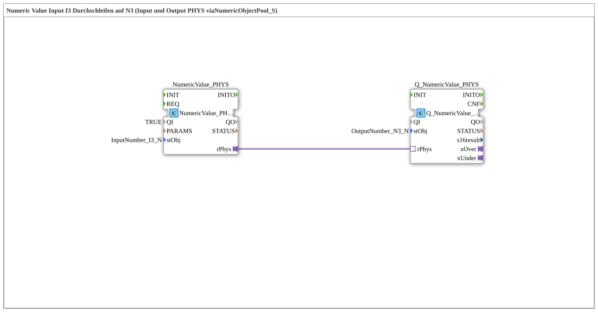

# Uebung_011f_AX: Numeric Value Input I3 Passed Through to N3 (Input and Output PHYS via NumericObjectPool_S)

* * * * * * * * * *

## Introduction

This exercise passes a numeric input value of the VT (input field `I3`) unchanged through to a numeric output field (`N3`). Input and output are both implemented as a physical `REAL` value (`PHYS`): the conversion between raw value and physical value (scaling, offset, decimals) is contained in the parameters of type `NumericObjectPool_S` (`stObj`), which are imported from the pool constants file. The SubApp has no interface of its own.

## Function Blocks (FBs) Used

- **NumericValue_PHYS**: Numeric VT input value as physical value
    - **Type**: [`isobus::UT::io::NumericValue::NumericValue_PHYSA`](https://meisterschulen-am-ostbahnhof-munchen-docs.readthedocs.io/projects/4diac-library-reference-docs/en/latest/Bibliotheken/ExternalLibraries/isobus/UT/io/NumericValue/NumericValue_PHYSA/)
    - **Parameters**: `QI = TRUE`, `stObj = InputNumber_I3_N`
    - **Explanation**: Provides the value entered in the VT input field `I3` as a physical `REAL` value via the adapter output `rPhys` (AR adapter).
- **Q_NumericValue_PHYS**: Numeric VT output value from a physical value
    - **Type**: [`isobus::UT::Q::Q_NumericValue_PHYSA`](https://meisterschulen-am-ostbahnhof-munchen-docs.readthedocs.io/projects/4diac-library-reference-docs/en/latest/Bibliotheken/ExternalLibraries/isobus/UT/Q/Q_NumericValue_PHYSA/)
    - **Parameters**: `stObj = OutputNumber_N3_N`
    - **Explanation**: Receives a physical `REAL` value via the adapter `rPhys` and writes it to the numeric output object `N3` of the VT.

The constants `InputNumber_I3_N` and `OutputNumber_N3_N` come from `Uebungen::const::UT::DefaultPool_Numeric`.

## Program Flow and Connections

1. `NumericValue_PHYS.rPhys` → `Q_NumericValue_PHYS.rPhys` (AdapterConnection): the physical value of the input `I3` is passed directly to the output `N3`.

**Example** (comment in the model): an entry of -500.00 in `I3` results in `rPhys = -500.0`; `Q_NumericValue_PHYS` (`N3`) then displays -500.00.

## Summary

The exercise `Uebung_011f_AX` shows the simplest use of the PHYS variants for numeric VT objects: an input FB and an output FB are coupled via a single AR adapter connection, and scaling and offset are contained entirely in the `NumericObjectPool_S` parameters.

---

### 🌐 Related topic subpages on ms-muc-docs.de

- [🌐 Eclipse 4diac IDE & Color Reference on ms-muc-docs.de](https://www.ms-muc-docs.de/iec-61499/eclipse-4diac/)
