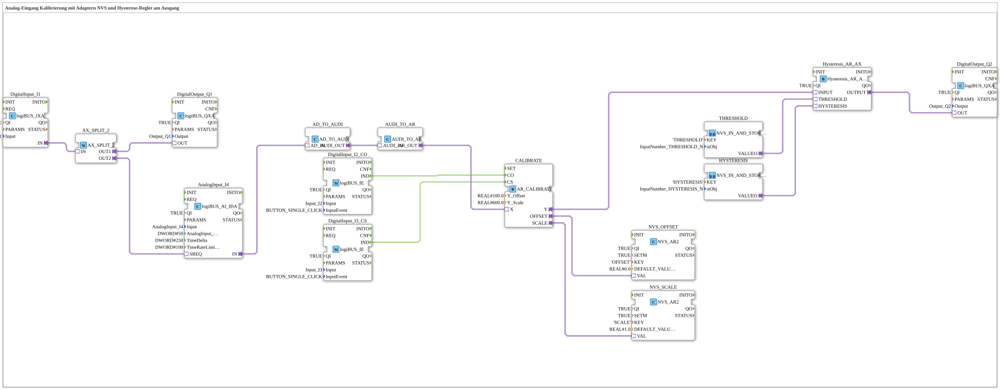

# Exercise_028b2_AR: Analog Input Calibration with NVS Adapters and Hysteresis Controller at the Output

* * * * * * * * * *

## Introduction

This exercise implements analog input calibration with offset and scaling adjustment. The calibration parameters are persistently stored in NVS (Non-Volatile Storage). Additionally, a hysteresis controller is used, which reacts to the calibrated analog value. The threshold values and hysteresis bands for the controller are also kept in NVS and can be changed via input fields in the VT. The process is controlled by digital inputs and output via digital outputs.

## Function Blocks (FBs) Used

- **DigitalInput_I2**: Digital input
    - **Type**: `logiBUS::io::DI::logiBUS_IXA`
    - **Parameters**: `QI = TRUE`, `Input = Input_I2`
    - **Explanation**: Provides the state of `I2` as AX adapter output `IN`.
- **AX_SPLIT_2**: Signal distributor
    - **Type**: `adapter::events::unidirectional::AX_SPLIT_2`
    - **Parameters**: none
    - **Explanation**: Distributes the signal of `DigitalInput_I2` to two paths: `OUT1` to `AnalogInput_I1.SREQ`, `OUT2` to the digital output.
- **DigitalOutput_Q1**: Digital output for direct transmission of the input status
    - **Type**: `logiBUS::io::DQ::logiBUS_QXA`
    - **Parameters**: `QI = TRUE`, `Output = Output_Q1`
    - **Explanation**: Switches `Q1` according to `I2`.
- **AnalogInput_I1**: Analog input with hysteresis and rate limiting
    - **Type**: `logiBUS::io::AI::logiBUS_AI_IDA`
    - **Parameters**: `QI = TRUE`, `Input = AnalogInput_I1`, `AnalogInput_hysteresis = 50`, `TimeDelta = 250`, `TimeRateLimit = 100`
    - **Explanation**: Provides the analog value as adapter `IN` (DWORD adapter `AD`); `SREQ` is supplied by `I2` via `AX_SPLIT_2`.
- **AD_TO_AR_NUM**: Adapter converter AD → REAL (numeric)
    - **Type**: `adapter::conversion::unidirectional::AD_TO_AR_NUM`
    - **Parameters**: none
    - **Explanation**: Converts the `AD` adapter (DWORD) numerically (AD → UDINT → REAL) into an `AR` adapter (REAL). An `AD_TO_AR` would behave like a `reinterpret_cast` (bit pattern) (comment in the network).
- **DigitalInput_I3_CO**: Input for triggering offset calibration
    - **Type**: `logiBUS::io::DI::logiBUS_IE`
    - **Parameters**: `QI = TRUE`, `Input = Input_I3`, `InputEvent = BUTTON_SINGLE_CLICK`
    - **Explanation**: A single click on `I3` triggers `CALIBRATE.CO`.
- **DigitalInput_I4_CS**: Input for triggering scale calibration
    - **Type**: `logiBUS::io::DI::logiBUS_IE`
    - **Parameters**: `QI = TRUE`, `Input = Input_I4`, `InputEvent = BUTTON_SINGLE_CLICK`
    - **Explanation**: A single click on `I4` triggers `CALIBRATE.CS`.
- **CALIBRATE**: Two-point calibration
    - **Type**: `adapter::Engineering::measurements::AR_CALIBRATE`
    - **Parameters**: `Y_Offset = 100.0`, `Y_Scale = 600.0`
    - **Explanation**: Calculates `Y = (X + OFFSET) * SCALE`. `CO` sets `OFFSET := Y_Offset - X`, `CS` sets `SCALE := Y_Scale / (X + OFFSET)`. `CO` must be executed before `CS`. `Y_Offset` and `Y_Scale` are target values on the output side.
- **NVS_OFFSET**: persistent storage for the offset
    - **Type**: `logiBUS::storage::esp32_nvs::NVS_AR2`
    - **Parameters**: `QI = TRUE`, `SETM = TRUE`, `KEY = 'OFFSET'`, `DEFAULT_VALUE = 0.0`
    - **Explanation**: Loads and stores the offset under the key `OFFSET` via the bidirectional adapter `VAL` (connected to `CALIBRATE.OFFSET`).
- **NVS_SCALE**: persistent storage for the scale
    - **Type**: `logiBUS::storage::esp32_nvs::NVS_AR2`
    - **Parameters**: `QI = TRUE`, `SETM = TRUE`, `KEY = 'SCALE'`, `DEFAULT_VALUE = 1.0`
    - **Explanation**: Loads and stores the scaling factor under the key `SCALE` (connected to `CALIBRATE.SCALE`).
- **Hysteresis_AR_AX**: Hysteresis comparator
    - **Type**: `logiBUS::signalprocessing::hysteresis::Hysteresis_AR_AX`
    - **Parameters**: `QI = TRUE`
    - **Explanation**: Converts `INPUT` (AR) into a digital signal `OUTPUT` (AX): switch-on at `THRESHOLD + HYSTERESIS / 2`, switch-off at `THRESHOLD - HYSTERESIS / 2`.
- **DigitalOutput_Q2**: Digital output for the hysteresis signal
    - **Type**: `logiBUS::io::DQ::logiBUS_QXA`
    - **Parameters**: `QI = TRUE`, `Output = Output_Q2`
    - **Explanation**: Switches `Q2` according to `Hysteresis_AR_AX.OUTPUT`.

### Sub-Blocks: `THRESHOLD` and `HYSTERESIS`

Both are instances of `MyLib::sys::NVS_IN_AND_STORE_AR` (in `MyLib_AX`). Internally the block consists of `NumericValue_PHYSA` (VT input field, provides `rPhys`), `NVS_AR` (`QI = TRUE`, `SETM = TRUE`, `DEFAULT_VALUE = REAL#0.0`; loads and stores under `KEY`), `AR_SPLIT_2` and `Q_NumericValue_PHYSA` (writes the value back into the VT field). The output `VALUEO` is an `AR` adapter.

- **THRESHOLD**: `KEY = 'THRESHOLD'`, `stObj = InputNumber_THRESHOLD_N`. Supplies the threshold (center of the hysteresis band) to `Hysteresis_AR_AX.THRESHOLD`.
- **HYSTERESIS**: `KEY = 'HYSTERESIS'`, `stObj = InputNumber_HYSTERESIS_N`. Supplies the full width of the hysteresis band to `Hysteresis_AR_AX.HYSTERESIS`.

## Program Flow and Connections

1. `DigitalInput_I2.IN` → `AX_SPLIT_2.IN`: `AX_SPLIT_2.OUT1` → `AnalogInput_I1.SREQ` and `AX_SPLIT_2.OUT2` → `DigitalOutput_Q1.OUT` (direct output).
2. `AnalogInput_I1.IN` → `AD_TO_AR_NUM.AD_IN`, `AD_TO_AR_NUM.AR_OUT` → `CALIBRATE.X`: the analog value is fed into the calibration as REAL via the numeric conversion.
3. `DigitalInput_I3_CO.IND` → `CALIBRATE.CO` and `DigitalInput_I4_CS.IND` → `CALIBRATE.CS`: offset and scale calibration by single click.
4. `CALIBRATE.OFFSET` → `NVS_OFFSET.VAL` and `CALIBRATE.SCALE` → `NVS_SCALE.VAL`: the calibration values are stored in and loaded from NVS.
5. `CALIBRATE.Y` → `Hysteresis_AR_AX.INPUT`, `THRESHOLD.VALUEO` → `Hysteresis_AR_AX.THRESHOLD`, `HYSTERESIS.VALUEO` → `Hysteresis_AR_AX.HYSTERESIS`.
6. `Hysteresis_AR_AX.OUTPUT` → `DigitalOutput_Q2.OUT`: the comparator result switches `Q2`.

**Learning Objectives**:

- Understanding analog signal processing with adapters and conversions in 4diac.
- Implementing persistent calibration (offset and scaling) in the NVS.
- Using a hysteresis controller with externally configurable parameters.
- Control of the process via digital inputs.

**Difficulty Level**: Advanced
**Prerequisites**: Basic knowledge of the 4diac IDE, working with analog inputs/outputs, simple adapters, and NVS memory.

## Summary

This exercise demonstrates a complete analog measurement chain: from reading the raw analog value and calibration with persistent storage to output via a hysteresis comparator. The use of adapters for type conversion and sub-blocks for reusing NVS accesses makes the setup modular and expandable. Calibration can be adjusted at any time using digital buttons without requiring changes to the program code.

---

### 🌐 Related topic subpages on ms-muc-docs.de

- [🌐 Eclipse 4diac IDE & Color Reference on ms-muc-docs.de](https://www.ms-muc-docs.de/iec-61499/eclipse-4diac/)
