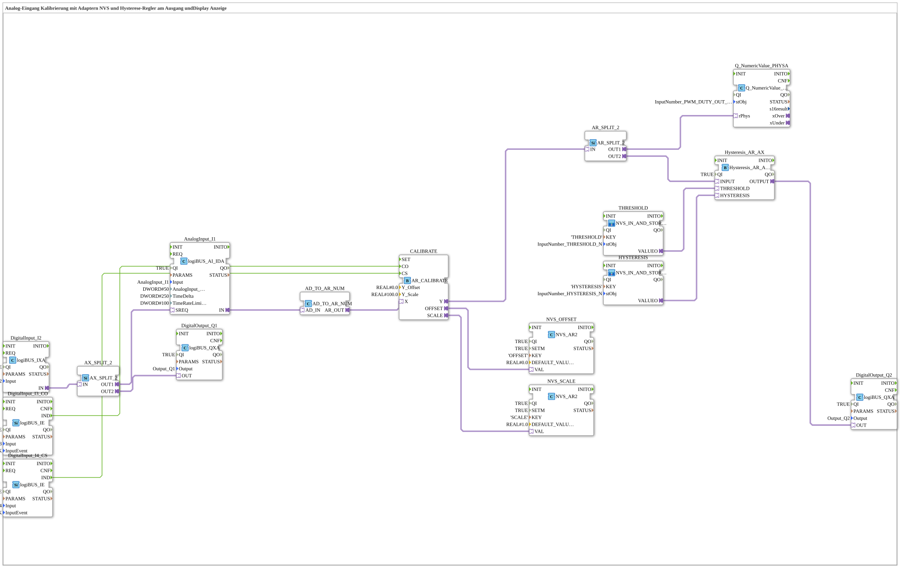

# Exercise_028c2_AR: Analog Input Calibration with Adapters, NVS and Hysteresis Controller at Output, and Display

* * * * * * * * * *

## Introduction

This exercise demonstrates the calibration of an analog input signal using NVS (Non-Volatile Storage) for offset and scaling. The calibrated signal is split into two paths: one for displaying a physical value (e.g., on a display), the other for a hysteresis controller that drives a digital output. Calibration can be initiated via digital inputs (offset and scaling commands). The hysteresis thresholds are loaded from the NVS via two sub-applications.

## Function Blocks (FBs) Used

### Sub-Blocks: `THRESHOLD` and `HYSTERESIS`

- **Type**: `MyLib::sys::NVS_IN_AND_STORE_AR`
- **Description**: Both sub-applications store a physically scaled REAL value (AR adapter) entered via the VT persistently in the NVS of the ESP32. The value is addressed via the parameter `KEY` (`'THRESHOLD'` or `'HYSTERESIS'`), the associated VT input object via the parameter `stObj` (`InputNumber_THRESHOLD_N` or `InputNumber_HYSTERESIS_N`). The output `VALUEO` provides the value.

### Overview of All Function Blocks Used

| Name | Type | Parameters (selection) |
| ------ | ----- | ---------------------- |
| `DigitalInput_I1` | `logiBUS::io::DI::logiBUS_IXA` | `QI=TRUE`, `Input = Input_I1` |
| `DigitalOutput_Q1` | `logiBUS::io::DQ::logiBUS_QXA` | `QI=TRUE`, `Output = Output_Q1` |
| `AnalogInput_I4` | `logiBUS::io::AI::logiBUS_AI_IDA` | `QI=TRUE`, `Input = AnalogInput_I7`, `AnalogInput_hysteresis=50`, `TimeDelta=250`, `TimeRateLimit=100` |
| `CALIBRATE` | `adapter::Engineering::measurements::AR_CALIBRATE` | `Y_Offset=0.0`, `Y_Scale=100.0` |
| `NVS_OFFSET` | `logiBUS::storage::esp32_nvs::NVS_AR2` | `QI=TRUE`, `SETM=TRUE`, `KEY='OFFSET'`, `DEFAULT_VALUE=0.0` |
| `NVS_SCALE` | `logiBUS::storage::esp32_nvs::NVS_AR2` | `QI=TRUE`, `SETM=TRUE`, `KEY='SCALE'`, `DEFAULT_VALUE=1.0` |
| `DigitalInput_I2_CO` | `logiBUS::io::DI::logiBUS_IE` | `Input = Input_I2`, `InputEvent = BUTTON_SINGLE_CLICK` (calibration offset command) |
| `DigitalInput_I3_CS` | `logiBUS::io::DI::logiBUS_IE` | `Input = Input_I3`, `InputEvent = BUTTON_SINGLE_CLICK` (calibration scaling command) |
| `AX_SPLIT_2` | `adapter::events::unidirectional::AX_SPLIT_2` | – |
| `THRESHOLD` | SubApp `MyLib::sys::NVS_IN_AND_STORE_AR` | `KEY='THRESHOLD'`, `stObj=InputNumber_THRESHOLD_N` |
| `HYSTERESIS` | SubApp `MyLib::sys::NVS_IN_AND_STORE_AR` | `KEY='HYSTERESIS'`, `stObj=InputNumber_HYSTERESIS_N` |
| `Hysteresis_AR_AX` | `logiBUS::signalprocessing::hysteresis::Hysteresis_AR_AX` | `QI=TRUE` |
| `AR_SPLIT_2` | `adapter::events::unidirectional::AR_SPLIT_2` | – |
| `Q_NumericValue_PHYSA` | `isobus::UT::Q::Q_NumericValue_PHYSA` | `stObj=InputNumber_PWM_DUTY_OUT_N` (display) |
| `AD_TO_AUDI` | `adapter::conversion::unidirectional::AD_TO_AUDI` | – |
| `AUDI_TO_AR` | `adapter::conversion::unidirectional::AUDI_TO_AR` | – |
| `DigitalOutput_Q2` | `logiBUS::io::DQ::logiBUS_QXA` | `QI=TRUE`, `Output = Output_Q2` |

### Short Description of the Main Components

- **AnalogInput_I4**: Reads the analog input `AnalogInput_I7` (e.g., voltage) and outputs it as an adapter interface (`AD`). Sampling is requested via `SREQ`.
- **AD_TO_AUDI, AUDI_TO_AR**: Convert the analog adapter interface (AD) via a generic `AUDI` interface into an analog real value (`AR`). This corresponds to a type conversion.
- **CALIBRATE**: Applies offset and scaling to the incoming analog value: `Y = (X + Offset) * Scale`. The offset and scaling values can be updated via the event inputs `CO` and `CS` and then stored in the NVS blocks. According to the network comment, the reference values `Y_Offset = 0.0` and `Y_Scale = 100.0` correspond to the example 0.0 ⇒ 0.5 V and 100.0 ⇒ 4.5 V (typical automotive sensor).
- **NVS_OFFSET, NVS_SCALE**: Permanently store the calibration values in the flash of the ESP32. The output `VAL` provides the currently stored value.
- **Hysteresis_AR_AX**: Compares the calibrated value with a threshold and a hysteresis. The output `OUTPUT` (→ `DigitalOutput_Q2.OUT`) switches when the value exceeds the threshold (or falls below it, including the hysteresis).
- **Q_NumericValue_PHYSA**: Prepares the calibrated value for display on a screen or other output device.
- **AX_SPLIT_2, AR_SPLIT_2**: Distribute a signal (event or data) to two outputs.

## Program Flow and Connections

1. **Analog Input**: The analog block `AnalogInput_I4` (logiBUS AI) provides an analog measurement value as an `AD` adapter.
2. **Conversion**: Via `AD_TO_AUDI` and `AUDI_TO_AR`, the value is converted into a real value (`AR`). A comment notes that a direct conversion (`AD_TO_AR`) would act like a `reinterpret_cast` – the double conversion ensures correct value transfer.
3. **Calibration**: The `AR` value is passed to `CALIBRATE.X`. The digital inputs `I2` (CO) and `I3` (CS) trigger the calculation of the offset (`CO` event) and scaling (`CS` event). The calculated values are stored via the NVS blocks.
    - `DigitalInput_I2_CO` → `CALIBRATE.CO` (determine offset)
    - `DigitalInput_I3_CS` → `CALIBRATE.CS` (determine scaling)
4. **Split of the calibrated value**: The output `CALIBRATE.Y` is distributed via `AR_SPLIT_2` to two paths:
    - Path 1: Display → `Q_NumericValue_PHYSA.rPhys` (`InputNumber_PWM_DUTY_OUT_N`)
    - Path 2: Hysteresis → `Hysteresis_AR_AX.INPUT`
5. **Hysteresis**: The sub-applications `THRESHOLD` and `HYSTERESIS` provide the values (`THRESHOLD.VALUEO` → `Hysteresis_AR_AX.THRESHOLD` and `HYSTERESIS.VALUEO` → `Hysteresis_AR_AX.HYSTERESIS`). The hysteresis block compares the input with these values and switches its output `OUTPUT`.
6. **Digital Outputs**:
    - `DigitalInput_I1` is distributed via `AX_SPLIT_2`: `OUT1` → `DigitalOutput_Q1.OUT` (the output `Q1` follows the input `I1`), `OUT2` → `AnalogInput_I4.SREQ` (triggers the analog sampling).
    - `Hysteresis_AR_AX.OUTPUT` switches the digital output `DigitalOutput_Q2` (e.g., for a switching function).

**Important note**: The double adapter conversion (`AD_TO_AUDI` + `AUDI_TO_AR`) is necessary to ensure correct value transfer (see comment in the network).

## Summary

This exercise shows how an analog input signal is calibrated with offset and scaling correction. The calibration parameters are permanently stored in the NVS and can be updated via digital buttons. The calibrated value is used for both a display and a hysteresis switching function. The wiring illustrates how to handle adapter conversions, NVS memory access, and the distribution of data flows in the 4diac IDE.

---

### 🌐 Related topic subpages on ms-muc-docs.de

- [🌐 Eclipse 4diac IDE & Color Reference on ms-muc-docs.de](https://www.ms-muc-docs.de/iec-61499/eclipse-4diac/)
- [🌐 ESP32 & ESP32-S3 DevKit on ms-muc-docs.de](https://www.ms-muc-docs.de/elektrotechnik/mikroelektronik/esp32/esp32-s3-devkit/)
- [🌐 The PWM Signal & Infographic on ms-muc-docs.de](https://www.ms-muc-docs.de/automatisierung/das-pwm-signal-die-kunst-spannung-zu-zerhacken/das-pwm-signal-die-kunst-spannung-zu-zerhacken-website/)
