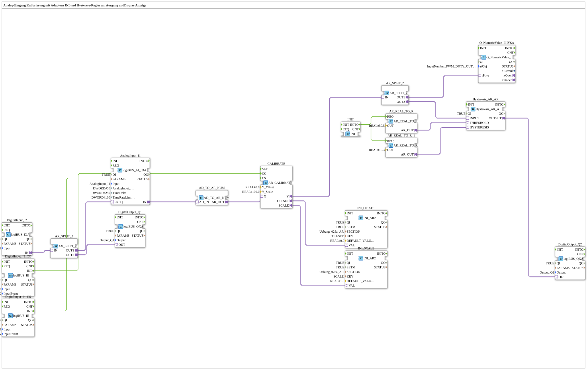

# Exercise_028c3_AR: Analog Input Calibration with INI Adapter and Hysteresis Controller at Output and Display

* * * * * * * * * *
This exercise demonstrates the calibration of an analog input (AnalogInput_I1) using a calibration adapter (AR_CALIBRATE) that loads an offset and a scaling factor from an INI file. The calibrated signal is passed to a hysteresis controller (Hysteresis_AR_AX), which switches a digital output (Output_Q2). Simultaneously, the calibrated value is displayed on a screen (Q_NumericValue_PHYSA). The exercise uses two inputs (I3, I4) to trigger the calibration and another input (I2) as an enable signal.

## Function Blocks Used (FBs)

## Introduction

### Sub-Blocks: None (all FBs are system-defined)

- **AnalogInput_I1** (Type: `logiBUS::io::AI::logiBUS_AI_IDA`)
- **Internal Parameters Used**: `AnalogInput_hysteresis = 50`, `TimeDelta = 250`, `TimeRateLimit = 100`
- **Functionality**: Reads the physical analog value (e.g., voltage) from input I1. The parameters define hysteresis, sampling time, and rate limit.
- **DigitalInput_I2** (Type: `logiBUS::io::DI::logiBUS_IXA`)
- **Functionality**: Reads the digital input I2. Used as an enable signal for output Q1.
- **DigitalInput_I3_CO** (Type: `logiBUS::io::DI::logiBUS_IE`)
  - **Parameters**: `QI = TRUE`, `Input = Input_I3`, `InputEvent = BUTTON_SINGLE_CLICK`
  - **Function**: Reads digital input I3 to trigger the calibration commit (CO).
- **DigitalInput_I4_CS** (Type: `logiBUS::io::DI::logiBUS_IE`)
  - **Parameters**: `QI = TRUE`, `Input = Input_I4`, `InputEvent = BUTTON_SINGLE_CLICK`
  - **Function**: Reads digital input I4 to trigger the calibration read start (CS).
- **DigitalOutput_Q1** (Type: `logiBUS::io::DQ::logiBUS_QXA`)
- **Function**: Sets digital output Q1 based on input I2 (enable).
- **DigitalOutput_Q2** (Type: `logiBUS::io::DQ::logiBUS_QXA`)
- **Function**: Sets digital output Q2 based on the hysteresis controller output.
- **CALIBRATE** (Type: `adapter::Engineering::measurements::AR_CALIBRATE`)
- **Internal Parameters Used**: `Y_Offset = 0.0`, `Y_Scale = 100.0`
- **Functionality**: Performs a calibration of the analog input value. Calculates an offset and scaling factor, which is written to the INI file. Inputs: X (raw value), CO (commit trigger), CS (read trigger). Outputs: Y (calibrated value), OFFSET, SCALE.

- **INI_OFFSET** (Type: `eclipse4diac::storage::INI_AR2`)

- **Internal Parameters Used**: `SECTION = 'Uebung_028a_AR'`, `KEY = 'OFFSET'`, `DEFAULT_VALUE = 0.0`
- **Functionality**: Reads the offset value from an INI file and provides it as an analogous value.
- **INI_SCALE** (Type: `eclipse4diac::storage::INI_AR2`)
- **Internal Parameters Used**: `SECTION = 'Uebung_028a_AR'`, `KEY = 'SCALE'`, `DEFAULT_VALUE = 1.0`
- **Functionality**: Reads the scale factor from an INI file and provides it as an analogous value.
- **Hysteresis_AR_AX** (Type: `logiBUS::signalprocessing::hysteresis::Hysteresis_AR_AX`)
- **Internal Parameters Used**: `QI = TRUE`
- **Functionality**: Compares the calibrated input value with a threshold and a hysteresis value. The output is set when the value exceeds the threshold and reset when it falls below the lower threshold (threshold – hysteresis/2); the upper threshold is threshold + hysteresis/2.
- **Q_NumericValue_PHYSA** (Type: `isobus::UT::Q::Q_NumericValue_PHYSA`)
- **Internal Parameters Used**: `stObj = InputNumber_PWM_DUTY_OUT_N`
- **Functionality**: Displays an analog value on a display (e.g., as a numeric value).
- **AX_SPLIT_2** (Type: `adapter::events::unidirectional::AX_SPLIT_2`)
- **Functionality**: Distributes a digital signal (AX) to two outputs (OUT1, OUT2). Here: The input from DigitalInput_I2 is split to AnalogInput_I1 as a measurement trigger (OUT1) and to DigitalOutput_Q1 (OUT2).
- **AR_SPLIT_2** (Type: `adapter::events::unidirectional::AR_SPLIT_2`)
- **Functionality**: Distributes an analog value (AR) to two outputs (OUT1, OUT2). Here: The calibrated value is sent to the display and the hysteresis controller.
- **AD_TO_AR_NUM** (Type: `adapter::conversion::unidirectional::AD_TO_AR_NUM`)
- **Functionality**: Converts an AD value (analog value adapter) numerically (AD → UDINT → REAL) into an AR value (analog real value). Note: A direct AD_TO_AR would act like a "reinterpret_cast" (bit pattern).
- **AR_REAL_TO_R** (x2) (Type: `adapter::conversion::unidirectional::AR_REAL_TO_R`)
- **Internal Parameters Used**: First: `OUT = 50.5`, Second: `OUT = 15.3`
- **Functionality**: Converts a constant real value into an AR signal. Serves as the threshold (THRESHOLD = 50.5) and hysteresis width (HYSTERESIS = 15.3) for the hysteresis controller.
- **INIT** (Type: `iec61131::booleanOperators::INIT`)
- **Functionality**: Generates a one-time initialization event (INITO) at system startup. This event triggers the two AR_REAL_TO_R blocks to set the constant values.

1. **Initialization**: At startup, the INIT block triggers the two AR_REAL_TO_R blocks, which set the constant threshold values (50.5 and 15.3) on the analog bus.
2. **Analog Value Acquisition**: The AnalogInput_I1 reads the raw value from input I1. This raw value is converted numerically to a REAL value by the converter AD_TO_AR_NUM and transferred to the CALIBRATE block.
3. **Calibration**: The digital inputs I3 (CO) and I4 (CS) control the calibration:

- When CS (I4 = TRUE), a new calibration cycle is started: The current raw value (X) is measured, and the offset and scaling are calculated.
- When CO (I3 = TRUE), the calculated values are written to the INI file (via INI_OFFSET and INI_SCALE).
- The calibrated output Y is routed to the splitter AR_SPLIT_2.

1. **Signal Distribution**:

- AR_SPLIT_2.OUT1 routes the calibrated value to the display (Q_NumericValue_PHYSA).
- AR_SPLIT_2.OUT2 routes the calibrated value to the hysteresis controller (Hysteresis_AR_AX).

1. **Hysteresis Control**: The hysteresis controller compares the calibrated input value with the threshold (50.5) and the hysteresis value (15.3). The output becomes active when the value reaches or exceeds 50.5 + 15.3/2 and becomes inactive again when it falls below 50.5 - 15.3/2; it switches the digital output Q2.
2. **Enable Signal**: The digital input I2 is routed via the splitter AX_SPLIT_2 to AnalogInput_I1 (OUT1, as a trigger for the measurement) and simultaneously to output Q1 (OUT2, directly forwarded). Therefore, the analog value can only be read when I2 is active.

**Note**: The comment in the network points out: An AD_TO_AR would be like a "reinterpret_cast" (bit pattern). AD_TO_AR_NUM, in contrast, converts the numeric value (AD → UDINT → REAL); only this yields a correct measured value.

``## Summary

The exercise "Exercise_028c3_AR" implements a complete analog input calibration with persistent storage of offset and scaling in an INI file. The calibrated value is visualized on a display and simultaneously fed to a hysteresis controller, which switches a digital output. Control is achieved via three digital inputs: Enable (I2), Commit (I3), and Start (I4). This exercise teaches the use of adapters, signal conversions, and the integration of INI memory modules in 4diac.

---

- [🌐 Eclipse 4diac IDE & Color Reference on ms-muc-docs.de](https://www.ms-muc-docs.de/iec-61499/eclipse-4diac/)
- [🌐 The PWM Signal & Infographic on ms-muc-docs.de](https://www.ms-muc-docs.de/automatisierung/das-pwm-signal-die-kunst-spannung-zu-zerhacken/das-pwm-signal-die-kunst-spannung-zu-zerhacken-website/)

]

## Program Flow and Connections

## Summary

### 🌐 Passende Themen-Unterseiten auf ms-muc-docs.de
