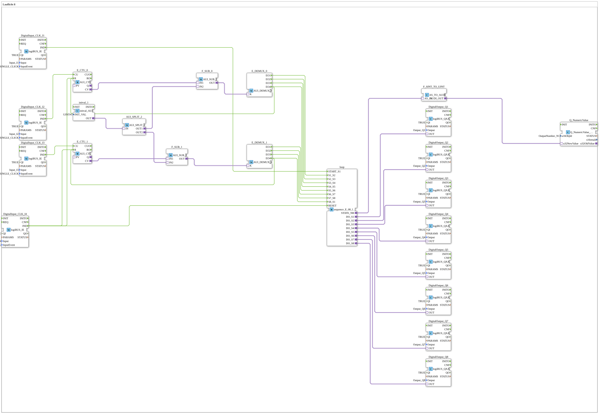

# Uebung_040_2_AX: Running Light 8

* * * * * * * * * *

## Introduction

This exercise is a running light with eight outputs (`Q1` to `Q8`), controlled by the sequence block `sequence_E_08_loop_AX` (instance `loop`). `I1` starts the sequence in step 1, `I2` and `I3` advance the steps, `I4` resets. The stepping runs via two counters (`E_CTU_0`, `E_CTU_1`), each of which triggers four transition events of the sequence via a subtractor (value from `initval_1` = 1) and a demultiplexer (`AUI_DEMUX_4`). The current step number is shown at the display `OutputNumber_N1`.

## Function Blocks (FBs) Used

- **DigitalInput_CLK_I1**, **DigitalInput_CLK_I2**, **DigitalInput_CLK_I3**, **DigitalInput_CLK_I4**: Buttons with click detection
    - **Type**: [`logiBUS::io::DI::logiBUS_IE`](https://meisterschulen-am-ostbahnhof-munchen-docs.readthedocs.io/projects/4diac-library-reference-docs/en/latest/Bibliotheken/ExternalLibraries/logiBUS/io/DI/logiBUS_IE/)
    - **Parameters**: `QI = TRUE`, `Input = Input_I1` / `Input_I2` / `Input_I3` / `Input_I4`, each with `InputEvent = BUTTON_SINGLE_CLICK`
    - **Explanation**: Report a single click on `I1` to `I4` as event `IND`.
- **loop**: Running light sequence
    - **Type**: [`logiBUS::utils::sequence::event::sequence_E_08_loop_AX`](https://meisterschulen-am-ostbahnhof-munchen-docs.readthedocs.io/projects/4diac-library-reference-docs/en/latest/Bibliotheken/ExternalLibraries/logiBUS/utils/sequence/event/sequence_E_08_loop_AX/)
    - **Parameters**: none
    - **Explanation**: Eight steps in a ring. The inputs `START_S1`, `S1_S2` to `S8_S1` and `RESET` trigger the transitions; the adapters `DO_S1` to `DO_S8` show the active step, `STATE_NR` provides the step number.
- **DigitalOutput_Q1** to **DigitalOutput_Q8**: logiBUS digital outputs
    - **Type**: [`logiBUS::io::DQ::logiBUS_QXA`](https://meisterschulen-am-ostbahnhof-munchen-docs.readthedocs.io/projects/4diac-library-reference-docs/en/latest/Bibliotheken/ExternalLibraries/logiBUS/io/DO/logiBUS_QXA/)
    - **Parameters**: `QI = TRUE`, `Output = Output_Q1` to `Output_Q8`
    - **Explanation**: Each output `Qn` is driven by `loop.DO_Sn`.
- **E_CTU_0**, **E_CTU_1**: Counters
    - **Type**: [`adapter::events::unidirectional::AUI_CTU`](https://meisterschulen-am-ostbahnhof-munchen-docs.readthedocs.io/projects/4diac-library-reference-docs/en/latest/Bibliotheken/ExternalLibraries/adapter/events/unidirectional/UINT/AUI_CTU/)
    - **Parameters**: none
    - **Explanation**: `E_CTU_0` counts the clicks on `I2`, `E_CTU_1` those on `I3` (input `CU`); the count value `CV` goes to the subtractor.
- **initval_1**: Start value 1
    - **Type**: [`adapter::types::unidirectional::AUI::initval::initval_AUI`](https://meisterschulen-am-ostbahnhof-munchen-docs.readthedocs.io/projects/4diac-library-reference-docs/en/latest/Bibliotheken/ExternalLibraries/adapter/types/unidirectional/UINT/initval/initval_AUI/)
    - **Parameters**: `INIT_VAL = 1`
    - **Explanation**: Provides the value 1 to `AUI_SPLIT_2`.
- **AUI_SPLIT_2**: Distribution of the value
    - **Type**: [`adapter::events::unidirectional::AUI_SPLIT_2`](https://meisterschulen-am-ostbahnhof-munchen-docs.readthedocs.io/projects/4diac-library-reference-docs/en/latest/Bibliotheken/ExternalLibraries/adapter/events/unidirectional/UINT/AUI_SPLIT_2/)
    - **Parameters**: none
    - **Explanation**: `OUT1` goes to `F_SUB_0.IN2`, `OUT2` to `F_SUB_1.IN2`.
- **F_SUB_0**, **F_SUB_1**: Subtractors
    - **Type**: [`adapter::iec61131::arithmetic::AUI_SUB_2`](https://meisterschulen-am-ostbahnhof-munchen-docs.readthedocs.io/projects/4diac-library-reference-docs/en/latest/Bibliotheken/ExternalLibraries/adapter/iec61131-3/arithmetic/AUI_SUB_2/)
    - **Parameters**: none
    - **Explanation**: Form `IN1 - IN2` from the count value `CV` (`IN1`) and the value from `initval_1` (`IN2`); the result `OUT` goes to the demultiplexer.
- **E_DEMUX_0**, **E_DEMUX_1**: Demultiplexers
    - **Type**: [`adapter::events::unidirectional::AUI_DEMUX_4`](https://meisterschulen-am-ostbahnhof-munchen-docs.readthedocs.io/projects/4diac-library-reference-docs/en/latest/Bibliotheken/ExternalLibraries/adapter/events/unidirectional/UINT/AUI_DEMUX_4/)
    - **Parameters**: none
    - **Explanation**: The value at the input `K` selects one of the four events `EO1` to `EO4`. `E_DEMUX_0` triggers the transitions `S1_S2` to `S4_S5`, `E_DEMUX_1` the transitions `S5_S6` to `S8_S1`.
- **F_SINT_TO_UINT**: Conversion of the step number
    - **Type**: [`adapter::conversion::unidirectional::AS_TO_AUDI`](https://meisterschulen-am-ostbahnhof-munchen-docs.readthedocs.io/projects/4diac-library-reference-docs/en/latest/Bibliotheken/ExternalLibraries/adapter/conversion/unidirectional/AS_AUDI/AS_TO_AUDI/)
    - **Parameters**: none
    - **Explanation**: Converts `loop.STATE_NR` (`AS_IN`) to an `AUDI` value.
- **Q_NumericValue**: numeric display
    - **Type**: [`isobus::UT::Q::Q_NumericValue_AUDI`](https://meisterschulen-am-ostbahnhof-munchen-docs.readthedocs.io/projects/4diac-library-reference-docs/en/latest/Bibliotheken/ExternalLibraries/isobus/UT/Q/Q_NumericValue_AUDI/)
    - **Parameters**: `u16ObjId = OutputNumber_N1`
    - **Explanation**: Displays the value at `u32NewValue` on `OutputNumber_N1`.

## Program Flow and Connections

1. `DigitalInput_CLK_I1.IND` → `loop.START_S1` (EventConnection): `I1` starts the sequence in step 1.
2. `DigitalInput_CLK_I2.IND` → `E_CTU_0.CU` and `DigitalInput_CLK_I3.IND` → `E_CTU_1.CU` (EventConnections): Each click increments the respective counter.
3. `E_CTU_0.CV` → `F_SUB_0.IN1` and `AUI_SPLIT_2.OUT1` → `F_SUB_0.IN2`, `F_SUB_0.OUT` → `E_DEMUX_0.K` (AdapterConnections): Count value minus start value selects the demultiplexer output. The same applies to `E_CTU_1`, `F_SUB_1` (`AUI_SPLIT_2.OUT2`) and `E_DEMUX_1`; `initval_1.OUT` → `AUI_SPLIT_2.IN` feeds both.
4. `E_DEMUX_0.EO1` to `EO4` → `loop.S1_S2`, `S2_S3`, `S3_S4`, `S4_S5` and `E_DEMUX_1.EO1` to `EO4` → `loop.S5_S6`, `S6_S7`, `S7_S8`, `S8_S1` (EventConnections): The demultiplexers trigger the eight step transitions.
5. `DigitalInput_CLK_I4.IND` → `loop.RESET`, `E_CTU_0.R` and `E_CTU_1.R` (EventConnections): `I4` resets the sequence and both counters. In addition, `E_DEMUX_0.EO4` resets the counter `E_CTU_0` and `E_DEMUX_1.EO4` resets the counter `E_CTU_1`.
6. `loop.DO_S1` to `loop.DO_S8` → `DigitalOutput_Q1.OUT` to `DigitalOutput_Q8.OUT` (AdapterConnections): The active step controls the corresponding output.
7. `loop.STATE_NR` → `F_SINT_TO_UINT.AS_IN`, `F_SINT_TO_UINT.AUDI_OUT` → `Q_NumericValue.u32NewValue` (AdapterConnections): The step number is shown on `OutputNumber_N1`.

## Summary

Exercise 040_2_AX builds an eight-step running light from the sequence block `sequence_E_08_loop_AX`. The step transitions are not triggered automatically but by clicks on `I2` and `I3` via two counters with subtractor and demultiplexer; `I1` starts, `I4` resets. All connections between the blocks run via adapters.

---

### 🌐 Related topic subpages on ms-muc-docs.de

- [🌐 Eclipse 4diac IDE & Color Reference on ms-muc-docs.de](https://www.ms-muc-docs.de/iec-61499/eclipse-4diac/)
