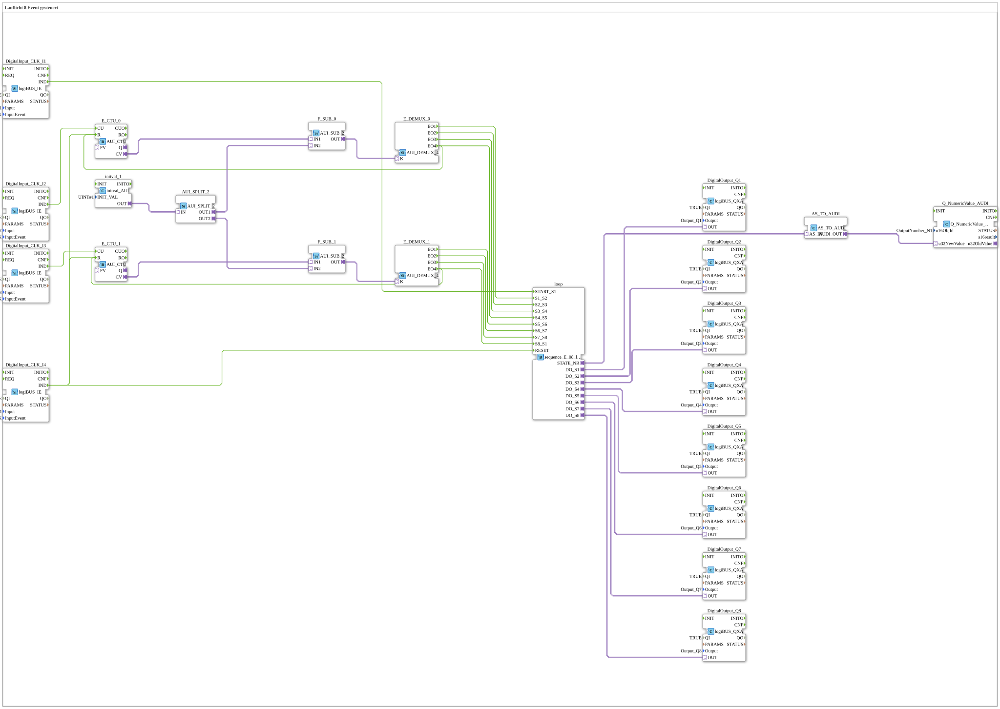

# Exercise_040_AX: 8-Event Controlled Running Light

* * * * * * * * * *

## Introduction

This article describes the logiBUS® exercise `Uebung_040_AX`. Unlike exercise 038, this sequence of steps does not advance automatically but waits for events. The goal is manual advancement of an 8-step chain.

The subapplication `Uebung_040_AX.SUB` uses `sequence_E_08_loop_AX`. Here, the inputs for the transitions (`S1_S2`, `S2_S3`, ...) are brought out as event inputs. To avoid needing 8 buttons, a logic circuit was built using counters (`AUI_CTU`) and demultiplexers (`AUI_DEMUX_4`).

## Function Blocks (FBs) Used

- **DigitalInput_CLK_I1**: Start button
    - **Type**: `logiBUS::io::DI::logiBUS_IE`
    - **Parameters**: `QI = TRUE`, `Input = Input_I1`, `InputEvent = BUTTON_SINGLE_CLICK`
    - **Explanation**: Single click on `I1` → `loop.START_S1`.
- **DigitalInput_CLK_I2**: Advances steps 1-4
    - **Type**: `logiBUS::io::DI::logiBUS_IE`
    - **Parameters**: `QI = TRUE`, `Input = Input_I2`, `InputEvent = BUTTON_SINGLE_CLICK`
    - **Explanation**: Single click on `I2` → `E_CTU_0.CU` (count up).
- **DigitalInput_CLK_I3**: Advances steps 5-8
    - **Type**: `logiBUS::io::DI::logiBUS_IE`
    - **Parameters**: `QI = TRUE`, `Input = Input_I3`, `InputEvent = BUTTON_SINGLE_CLICK`
    - **Explanation**: Single click on `I3` → `E_CTU_1.CU`.
- **DigitalInput_CLK_I4**: Reset button
    - **Type**: `logiBUS::io::DI::logiBUS_IE`
    - **Parameters**: `QI = TRUE`, `Input = Input_I4`, `InputEvent = BUTTON_SINGLE_CLICK`
    - **Explanation**: Single click on `I4` → `loop.RESET`, `E_CTU_0.R` and `E_CTU_1.R`.
- **loop**: 8-step chain (event-driven, looped)
    - **Type**: `logiBUS::utils::sequence::event::sequence_E_08_loop_AX`
    - **Parameters**: none
    - **Explanation**: States `START` and `State_01` to `State_08`; transitions via the event inputs `START_S1`, `S1_S2` ... `S7_S8`, `S8_S1` and `RESET` (from any state back to `START`). Outputs as adapters: `STATE_NR` (AS) and `DO_S1` to `DO_S8` (AX).
- **initval_1**: Initial value 1
    - **Type**: `adapter::types::unidirectional::AUI::initval::initval_AUI`
    - **Parameters**: `INIT_VAL = 1`
    - **Explanation**: Provides the UINT value 1 as adapter `OUT` on initialization.
- **AUI_SPLIT_2**: Distributor for the initial value
    - **Type**: `adapter::events::unidirectional::AUI_SPLIT_2`
    - **Parameters**: none
    - **Explanation**: Distributes the value 1 from `initval_1` to `F_SUB_0.IN2` (`OUT1`) and `F_SUB_1.IN2` (`OUT2`).
- **E_CTU_0**, **E_CTU_1**: Event counters
    - **Type**: `adapter::events::unidirectional::AUI_CTU`
    - **Parameters**: none
    - **Explanation**: `CU` increments the counter value `CV` by 1, `R` resets it to 0. `E_CTU_0` is counted up by `I2`, `E_CTU_1` by `I3`.
- **F_SUB_0**, **F_SUB_1**: Subtraction
    - **Type**: `adapter::iec61131::arithmetic::AUI_SUB_2`
    - **Parameters**: none
    - **Explanation**: Form `CV - 1` (`IN1` = counter value, `IN2` = initial value 1), so that the first click yields index 0.
- **E_DEMUX_0**, **E_DEMUX_1**: Event demultiplexers
    - **Type**: `adapter::events::unidirectional::AUI_DEMUX_4`
    - **Parameters**: none
    - **Explanation**: Depending on the index `K`, fires output `EO1` (K=0), `EO2` (K=1), `EO3` (K=2) or `EO4` (K=3).
- **AS_TO_AUDI**: Adapter converter SINT → UDINT
    - **Type**: `adapter::conversion::unidirectional::AS_TO_AUDI`
    - **Parameters**: none
    - **Explanation**: Converts the step number `loop.STATE_NR` (AS) into an `AUDI` adapter.
- **Q_NumericValue_AUDI**: VT number field
    - **Type**: `isobus::UT::Q::Q_NumericValue_AUDI`
    - **Parameters**: `u16ObjId = OutputNumber_N1`
    - **Explanation**: Shows the step number in the VT number field `OutputNumber_N1`.
- **DigitalOutput_Q1** to **DigitalOutput_Q8**: Digital outputs
    - **Type**: `logiBUS::io::DQ::logiBUS_QXA`
    - **Parameters**: `QI = TRUE`, `Output = Output_Q1` ... `Output_Q8`
    - **Explanation**: `DigitalOutput_Qn` is driven by `loop.DO_Sn`.

## Program Flow and Connections

1. `DigitalInput_CLK_I1.IND` → `loop.START_S1`: start of the chain, step 1 active.
2. `DigitalInput_CLK_I2.IND` → `E_CTU_0.CU`; `E_CTU_0.CV` and the value 1 (`AUI_SPLIT_2.OUT1`) → `F_SUB_0` → `E_DEMUX_0.K`. `E_DEMUX_0.EO1` → `loop.S1_S2`, `EO2` → `S2_S3`, `EO3` → `S3_S4`, `EO4` → `S4_S5`.
3. `DigitalInput_CLK_I3.IND` → `E_CTU_1.CU`; via `F_SUB_1` → `E_DEMUX_1.K`. `E_DEMUX_1.EO1` → `loop.S5_S6`, `EO2` → `S6_S7`, `EO3` → `S7_S8`, `EO4` → `S8_S1`.
4. `E_DEMUX_0.EO4` → `E_CTU_0.R` and `E_DEMUX_1.EO4` → `E_CTU_1.R`: each counter resets itself after the fourth click.
5. `DigitalInput_CLK_I4.IND` → `loop.RESET`, `E_CTU_0.R`, `E_CTU_1.R`: reset of the chain and both counters.
6. `loop.DO_S1` ... `loop.DO_S8` → `DigitalOutput_Q1` ... `DigitalOutput_Q8`.
7. `loop.STATE_NR` → `AS_TO_AUDI.AS_IN`, `AS_TO_AUDI.AUDI_OUT` → `Q_NumericValue_AUDI.u32NewValue`: display of the step number.

**Behavior**:

1. Start with `I1` → step 1 is active.
2. Press `I2` → counter reading 1 → index 0 → demux `EO1` → event on `S1_S2` → switch to step 2.
3. Press `I2` → counter reading 2 → index 1 → demux `EO2` → event on `S2_S3` → switch to step 3.
4. The fourth press on `I2` triggers `S4_S5` (step 5) and resets the counter. After that, `I3` is used analogously to step through steps 5 to 8 and back to step 1 (`S8_S1`).

This simulates a machine where the operator must manually enable each step ("step operation").

## Summary

The exercise shows how two counters and two demultiplexers allow just two buttons (`I2`, `I3`) to serve eight transitions of an event-driven step chain; `I1` starts, `I4` resets.

**Application example - commissioning or maintenance**: The technician advances the machine step by step to check that each subprocess functions correctly before switching to automatic operation.

---

### 🌐 Related topic subpages on ms-muc-docs.de

- [🌐 E_CTU Event Counter module on ms-muc-docs.de](https://www.ms-muc-docs.de/iec-61499/event-function-blocks/e_ctu/)
