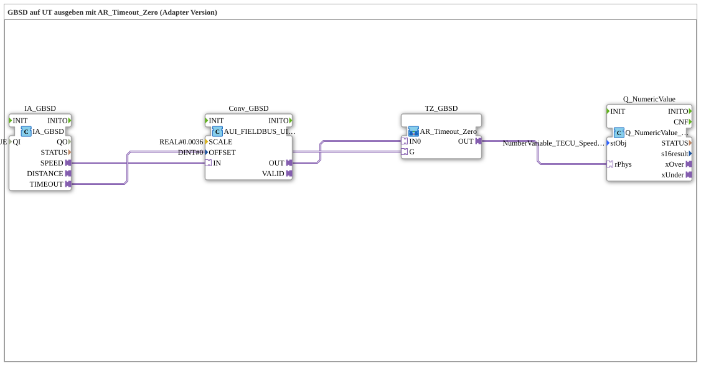

# Uebung_072d_AUI: Output GBSD on the UT with AR_Timeout_Zero (Adapter Version)

* * * * * * * * * *

## Introduction

This exercise outputs the GBSD speed of the TECU on the Universal Terminal (UT). The raw value is scaled with `SCALE = 0.0036` into a physical `REAL` value and passed through the sub-app `AR_Timeout_Zero` (Fendt circuit): in case of a real communication failure (`IA_GBSD.TIMEOUT`), `0.0` is output instead of the otherwise simply frozen last value. All connections are adapters (adapter version, analogous to `TECU_GBSD.SUB` in the Krauternter project).

## Function Blocks (FBs) Used

- **IA_GBSD**: TECU input GBSD
    - **Type**: [`isobus::tecu::IA_GBSD`](https://meisterschulen-am-ostbahnhof-munchen-docs.readthedocs.io/projects/4diac-library-reference-docs/en/latest/Bibliotheken/ExternalLibraries/isobus/TECU/IA_GBSD/)
    - **Parameters**: `QI = TRUE`
    - **Explanation**: Provides `SPEED` (raw value) and `TIMEOUT` (communication failure) as adapters.
- **Conv_GBSD**: Scaling of the raw value
    - **Type**: [`logiBUS::signalprocessing::fieldbus::AUI_FIELDBUS_UINT_TO_SIGNAL_SCALED`](https://meisterschulen-am-ostbahnhof-munchen-docs.readthedocs.io/projects/4diac-library-reference-docs/en/latest/Bibliotheken/ExternalLibraries/logiBUS/signalprocessing/fieldbus/AUI_FIELDBUS_UINT_TO_SIGNAL_SCALED/)
    - **Parameters**: `SCALE = 0.0036`, `OFFSET = 0`
    - **Explanation**: Converts the `UINT` raw value (`IN`) with scaling and offset into a `REAL` adapter value (`OUT`).
- **TZ_GBSD**: Fendt circuit (sub-app)
    - **Type**: `MyLib::sys::AR_Timeout_Zero` (SubApp instance)
    - **Parameters**: none
    - **Explanation**: `OUT` delivers `IN0` unchanged unless `G` is `TRUE` (timeout), in which case it delivers `0.0`.
- **Q_NumericValue**: numeric display
    - **Type**: [`isobus::UT::Q::Q_NumericValue_PHYSA`](https://meisterschulen-am-ostbahnhof-munchen-docs.readthedocs.io/projects/4diac-library-reference-docs/en/latest/Bibliotheken/ExternalLibraries/isobus/UT/Q/Q_NumericValue_PHYSA/)
    - **Parameters**: `stObj = NumberVariable_TECU_Speed_GBSD_N`
    - **Explanation**: Displays the physical value from `rPhys` on the UT object `NumberVariable_TECU_Speed_GBSD_N`.

## Program Flow and Connections

1. `IA_GBSD.SPEED` → `Conv_GBSD.IN` (AdapterConnection): The raw value is scaled.
2. `Conv_GBSD.OUT` → `TZ_GBSD.IN0` (AdapterConnection): The scaled value is the live value of the Fendt circuit.
3. `IA_GBSD.TIMEOUT` → `TZ_GBSD.G` (AdapterConnection): A timeout switches the output to `0.0`.
4. `TZ_GBSD.OUT` → `Q_NumericValue.rPhys` (AdapterConnection): The result is displayed on the UT.

## Summary

Exercise 072d_AUI shows the scaling of a TECU raw value with `AUI_FIELDBUS_UINT_TO_SIGNAL_SCALED` and the protection against communication failure with the sub-app `AR_Timeout_Zero`: if communication fails, the UT shows `0.0` instead of a frozen value.

---

### 🌐 Related topic subpages on ms-muc-docs.de

- [🌐 Eclipse 4diac IDE & Color Reference on ms-muc-docs.de](https://www.ms-muc-docs.de/iec-61499/eclipse-4diac/)
