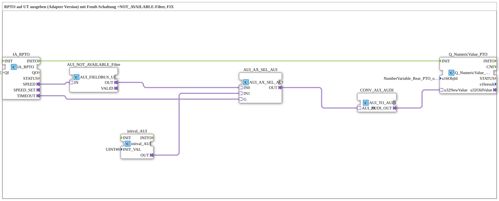

# Exercise_074a_AUI: RPTO Output on UT (Adapter Version) with Fendt Circuit and NOT_AVAILABLE Filter, FIX

* * * * * * * * * *

## Introduction

This exercise outputs the speed of the rear power take-off (RPTO) of the TECU on the ISOBUS terminal, with the Fendt circuit (0 is displayed on a timeout) and an additional NOT_AVAILABLE filter (version 1.1): the filter `AUI_FIELDBUS_UINT_TO_SIGNAL` already reacts to every single message that contains an error value `0xFFFF`, whereas the Fendt circuit only covers a complete communication failure (`TIMEOUT`).

## Function Blocks (FBs) Used

- **IA_RPTO**: ISOBUS adapter for Rear Power Take off (RPTO)
    - **Type**: [`isobus::tecu::IA_RPTO`](https://meisterschulen-am-ostbahnhof-munchen-docs.readthedocs.io/projects/4diac-library-reference-docs/en/latest/Bibliotheken/ExternalLibraries/isobus/TECU/IA_RPTO/)
    - **Parameters**: `QI = TRUE`
    - **Explanation**: Provides the PTO speed as `AUI` adapter `SPEED` and the timeout status as `AX` adapter `TIMEOUT`.
- **AUI_NOT_AVAILABLE_Filter**: NOT_AVAILABLE filter
    - **Type**: [`logiBUS::signalprocessing::fieldbus::AUI_FIELDBUS_UINT_TO_SIGNAL`](https://meisterschulen-am-ostbahnhof-munchen-docs.readthedocs.io/projects/4diac-library-reference-docs/en/latest/Bibliotheken/ExternalLibraries/logiBUS/signalprocessing/fieldbus/AUI_FIELDBUS_UINT_TO_SIGNAL/)
    - **Parameters**: none
    - **Explanation**: Mirrors `IN` to `OUT` if the signal is valid (`IN` ≤ `VALID_SIGNAL_W`), otherwise `OUT` = 0. An error value `0xFFFF` within a message is thereby already mapped to 0 here.
- **initval_AUI**: Constant for the substitute value
    - **Type**: [`adapter::types::unidirectional::AUI::initval::initval_AUI`](https://meisterschulen-am-ostbahnhof-munchen-docs.readthedocs.io/projects/4diac-library-reference-docs/en/latest/Bibliotheken/ExternalLibraries/adapter/types/unidirectional/UINT/initval/initval_AUI/)
    - **Parameters**: `INIT_VAL = 0`
    - **Explanation**: Provides the fixed substitute value `0` as `AUI` adapter value.
- **AUI_AX_SEL_AUI**: Selection (Fendt circuit)
    - **Type**: [`adapter::iec61131::selection::AUI_AX_SEL_AUI`](https://meisterschulen-am-ostbahnhof-munchen-docs.readthedocs.io/projects/4diac-library-reference-docs/en/latest/Bibliotheken/ExternalLibraries/adapter/iec61131-3/selection/AUI_AX_SEL_AUI/)
    - **Parameters**: none
    - **Explanation**: Selects via the adapter `G` between `IN0` (filtered live value) and `IN1` (substitute value `0`). `G` comes from `IA_RPTO.TIMEOUT`: on a timeout, `0` is output.
- **CONV_AUI_AUDI**: Adapter conversion
    - **Type**: [`adapter::conversion::unidirectional::AUI_TO_AUDI`](https://meisterschulen-am-ostbahnhof-munchen-docs.readthedocs.io/projects/4diac-library-reference-docs/en/latest/Bibliotheken/ExternalLibraries/adapter/conversion/unidirectional/AUDI_AUI/AUI_TO_AUDI/)
    - **Parameters**: none
    - **Explanation**: Converts the selected `AUI` value into the `AUDI` format required by `Q_NumericValue_AUDI`.
- **Q_NumericValue_PTO**: Display on the ISOBUS terminal
    - **Type**: [`isobus::UT::Q::Q_NumericValue_AUDI`](https://meisterschulen-am-ostbahnhof-munchen-docs.readthedocs.io/projects/4diac-library-reference-docs/en/latest/Bibliotheken/ExternalLibraries/isobus/UT/Q/Q_NumericValue_AUDI/)
    - **Parameters**: `u16ObjId = NumberVariable_Rear_PTO_output_shaft_speed`
    - **Explanation**: Shows the value in the object `NumberVariable_Rear_PTO_output_shaft_speed`. The event `IA_RPTO.INITO` is connected to `Q_NumericValue_PTO.INIT`.

## Program Flow and Connections

1. `IA_RPTO.INITO` → `Q_NumericValue_PTO.INIT` (EventConnection): After the TECU adapter is initialized, the display is initialized.
2. `IA_RPTO.SPEED` → `AUI_NOT_AVAILABLE_Filter.IN` (AdapterConnection): The speed is first filtered for validity.
3. `AUI_NOT_AVAILABLE_Filter.OUT` → `AUI_AX_SEL_AUI.IN0` and `initval_AUI.OUT` → `AUI_AX_SEL_AUI.IN1` (AdapterConnections): The filtered live value and the substitute value `0` are available for selection.
4. `IA_RPTO.TIMEOUT` → `AUI_AX_SEL_AUI.G` (AdapterConnection): The timeout status selects the substitute value if communication has failed.
5. `AUI_AX_SEL_AUI.OUT` → `CONV_AUI_AUDI.AUI_IN` and `CONV_AUI_AUDI.AUDI_OUT` → `Q_NumericValue_PTO.u32NewValue` (AdapterConnections): The selected value is converted and displayed.

**Behavior**: For valid messages, the terminal shows the PTO speed. If a message contains the error value `0xFFFF`, `0` is displayed; if communication fails completely (`TIMEOUT`), `0` is also displayed instead of freezing the last value.

## Summary

The exercise combines two protection mechanisms for displaying TECU values: the NOT_AVAILABLE filter for error values within a message and the Fendt circuit for communication failure.

---

### 🌐 Related topic subpages on ms-muc-docs.de

- [🌐 Eclipse 4diac IDE & Color Reference on ms-muc-docs.de](https://www.ms-muc-docs.de/iec-61499/eclipse-4diac/)
