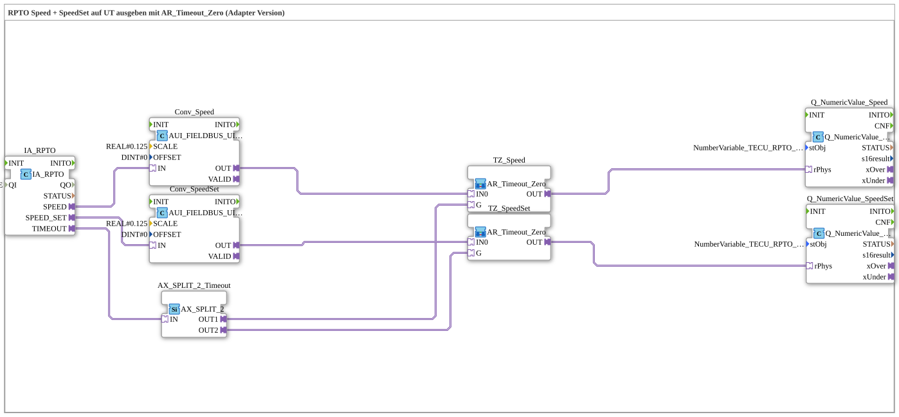

# Uebung_074c_AUI: Output RPTO Speed + SpeedSet on the UT with AR_Timeout_Zero (Adapter Version)

* * * * * * * * * *

## Introduction

This exercise outputs the speed (`SPEED`) and the set value (`SPEED_SET`) of the rear PTO (RPTO) of the TECU on the Universal Terminal (UT). Both raw values are scaled with `SCALE = 0.125` into physical `REAL` values and each is passed through its own instance of the sub-app `AR_Timeout_Zero` (Fendt circuit): in case of a communication failure (`IA_RPTO.TIMEOUT`), `0.0` is output. Because the timeout signal has two destinations, it is distributed via `AX_SPLIT_2`. All connections are adapters (analogous to `TECU_RPTO.SUB` in the Krauternter project).

## Function Blocks (FBs) Used

- **IA_RPTO**: TECU input RPTO
    - **Type**: [`isobus::tecu::IA_RPTO`](https://meisterschulen-am-ostbahnhof-munchen-docs.readthedocs.io/projects/4diac-library-reference-docs/en/latest/Bibliotheken/ExternalLibraries/isobus/TECU/IA_RPTO/)
    - **Parameters**: `QI = TRUE`
    - **Explanation**: Provides `SPEED`, `SPEED_SET` and `TIMEOUT` as adapters.
- **Conv_Speed**, **Conv_SpeedSet**: Scaling of the raw values
    - **Type**: [`logiBUS::signalprocessing::fieldbus::AUI_FIELDBUS_UINT_TO_SIGNAL_SCALED`](https://meisterschulen-am-ostbahnhof-munchen-docs.readthedocs.io/projects/4diac-library-reference-docs/en/latest/Bibliotheken/ExternalLibraries/logiBUS/signalprocessing/fieldbus/AUI_FIELDBUS_UINT_TO_SIGNAL_SCALED/)
    - **Parameters**: each `SCALE = 0.125`, `OFFSET = 0`
    - **Explanation**: `Conv_Speed` scales `SPEED`, `Conv_SpeedSet` scales `SPEED_SET`.
- **AX_SPLIT_2_Timeout**: Distribution of the timeout signal
    - **Type**: [`adapter::events::unidirectional::AX_SPLIT_2`](https://meisterschulen-am-ostbahnhof-munchen-docs.readthedocs.io/projects/4diac-library-reference-docs/en/latest/Bibliotheken/ExternalLibraries/adapter/events/unidirectional/BOOL/AX_SPLIT_2/)
    - **Parameters**: none
    - **Explanation**: `OUT1` goes to `TZ_Speed.G`, `OUT2` to `TZ_SpeedSet.G`.
- **TZ_Speed**, **TZ_SpeedSet**: Fendt circuit (sub-apps)
    - **Type**: `MyLib::sys::AR_Timeout_Zero` (SubApp instances)
    - **Parameters**: none
    - **Explanation**: `OUT` delivers `IN0` unchanged unless `G` is `TRUE` (timeout), in which case it delivers `0.0`.
- **Q_NumericValue_Speed**, **Q_NumericValue_SpeedSet**: numeric displays
    - **Type**: [`isobus::UT::Q::Q_NumericValue_PHYSA`](https://meisterschulen-am-ostbahnhof-munchen-docs.readthedocs.io/projects/4diac-library-reference-docs/en/latest/Bibliotheken/ExternalLibraries/isobus/UT/Q/Q_NumericValue_PHYSA/)
    - **Parameters**: `stObj = NumberVariable_TECU_RPTO_Speed_N` and `NumberVariable_TECU_RPTO_SpeedSet_N`, respectively
    - **Explanation**: Display the physical values from `rPhys` on the respective UT objects.

## Program Flow and Connections

1. `IA_RPTO.SPEED` → `Conv_Speed.IN` → `TZ_Speed.IN0`, `TZ_Speed.OUT` → `Q_NumericValue_Speed.rPhys` (AdapterConnections): Path of the speed.
2. `IA_RPTO.SPEED_SET` → `Conv_SpeedSet.IN` → `TZ_SpeedSet.IN0`, `TZ_SpeedSet.OUT` → `Q_NumericValue_SpeedSet.rPhys` (AdapterConnections): Path of the set value.
3. `IA_RPTO.TIMEOUT` → `AX_SPLIT_2_Timeout.IN`, `AX_SPLIT_2_Timeout.OUT1` → `TZ_Speed.G` and `AX_SPLIT_2_Timeout.OUT2` → `TZ_SpeedSet.G` (AdapterConnections): A timeout switches both outputs to `0.0`.

## Summary

Exercise 074c_AUI extends `Uebung_072d_AUI` to two values (speed and set value of the rear PTO). Because an adapter plug has only one destination, `AX_SPLIT_2` distributes the common timeout signal to both `AR_Timeout_Zero` instances.

---

### 🌐 Related topic subpages on ms-muc-docs.de

- [🌐 Eclipse 4diac IDE & Color Reference on ms-muc-docs.de](https://www.ms-muc-docs.de/iec-61499/eclipse-4diac/)
