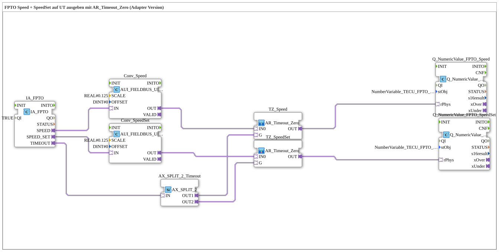

# Exercise_075a_AUI: Output FPTO Speed + SpeedSet on UT with AR_Timeout_Zero (Adapter Version)

* * * * * * * * * *

## Introduction

This exercise outputs the speed (**Speed**) and the set speed (**SpeedSet**) of the front power take-off (FPTO) of the TECU on a Universal Terminal (UT). Both raw values come via the adapter `IA_FPTO`, are scaled with `0.125` and displayed via `Q_NumericValue_PHYSA`. For each value, an instance of the "Fendt circuit" `AR_Timeout_Zero` ensures that `0.0` is displayed on a communication failure instead of the frozen last value. The exercise is analogous to `TECU_FPTO.SUB` of the Krauternter software.

## Function Blocks (FBs) Used

- **IA_FPTO**: ISOBUS adapter for the front PTO
    - **Type**: `isobus::tecu::IA_FPTO`
    - **Parameters**: `QI = TRUE`
    - **Explanation**: Provides the UINT adapters `SPEED` (output shaft speed) and `SPEED_SET` (set speed) as well as the adapter `TIMEOUT` (AX, TRUE on communication failure).
- **AX_SPLIT_2_Timeout**: Distributor for the timeout status
    - **Type**: `adapter::events::unidirectional::AX_SPLIT_2`
    - **Parameters**: none
    - **Explanation**: Distributes `IA_FPTO.TIMEOUT` to `OUT1` (→ `TZ_Speed.G`) and `OUT2` (→ `TZ_SpeedSet.G`).
- **Conv_Speed**, **Conv_SpeedSet**: Scaling of the raw values
    - **Type**: `logiBUS::signalprocessing::fieldbus::AUI_FIELDBUS_UINT_TO_SIGNAL_SCALED`
    - **Parameters**: each `SCALE = 0.125`, `OFFSET = 0`
    - **Explanation**: Convert the UINT raw value (`IN`) into a scaled REAL value (`OUT`, AR).
- **TZ_Speed**, **TZ_SpeedSet**: Timeout zeroing (SubApp instances)
    - **Type**: `MyLib::sys::AR_Timeout_Zero`
    - **Parameters**: none
    - **Explanation**: Pass `IN0` unchanged to `OUT`, unless `G` is TRUE (timeout) - then `0.0`.
- **Q_NumericValue_FPTO_Speed**: Output of the speed
    - **Type**: `isobus::UT::Q::Q_NumericValue_PHYSA`
    - **Parameters**: `stObj = NumberVariable_TECU_FPTO_Speed_N`
    - **Explanation**: Writes the physical value (`rPhys`) into the corresponding VT object.
- **Q_NumericValue_FPTO_SpeedSet**: Output of the set speed
    - **Type**: `isobus::UT::Q::Q_NumericValue_PHYSA`
    - **Parameters**: `stObj = NumberVariable_TECU_FPTO_SpeedSet_N`
    - **Explanation**: Writes the physical value (`rPhys`) into the corresponding VT object.

## Program Flow and Connections

1. Speed: `IA_FPTO.SPEED` → `Conv_Speed.IN` → `TZ_Speed.IN0`; `AX_SPLIT_2_Timeout.OUT1` → `TZ_Speed.G`; `TZ_Speed.OUT` → `Q_NumericValue_FPTO_Speed.rPhys`.
2. Set speed: `IA_FPTO.SPEED_SET` → `Conv_SpeedSet.IN` → `TZ_SpeedSet.IN0`; `AX_SPLIT_2_Timeout.OUT2` → `TZ_SpeedSet.G`; `TZ_SpeedSet.OUT` → `Q_NumericValue_FPTO_SpeedSet.rPhys`.
3. `IA_FPTO.TIMEOUT` → `AX_SPLIT_2_Timeout.IN`: a single timeout status controls both zeroings.

**Behavior**: As long as data arrives, the UT shows speed and set speed (each raw value x 0.125). On a communication failure (`TIMEOUT` = TRUE), both fields show `0.0`.

## Summary

The exercise extends the signal chain from `Uebung_073d_AUI` to two measurement values of the same ISOBUS adapter: the shared timeout status is distributed with `AX_SPLIT_2` to two `AR_Timeout_Zero` instances, so that both displays fall consistently to `0.0`.

---

### 🌐 Related topic subpages on ms-muc-docs.de

- [🌐 Eclipse 4diac IDE & Color Reference on ms-muc-docs.de](https://www.ms-muc-docs.de/iec-61499/eclipse-4diac/)
