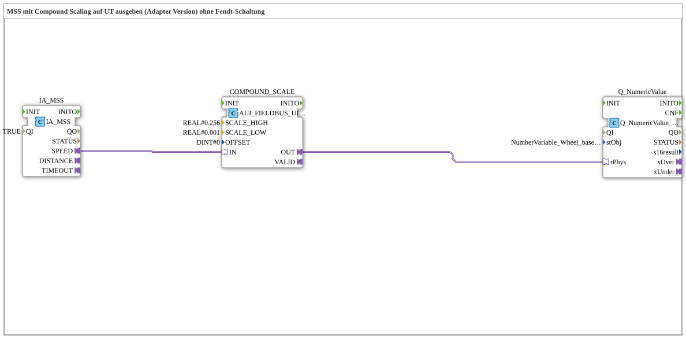

# Exercise_076b_AUI: MSS with Compound Scaling Output on UT (Adapter Version) without Fendt Circuit

* * * * * * * * * *

## Introduction

This exercise outputs the machine selected speed (MSS) of the TECU on the ISOBUS terminal. The `AUI` value is converted into a physical value using compound scaling (separate factors for the upper and lower byte). There is no Fendt circuit: on a timeout, the output is not switched to `0.0`. The exercise is the adapter version of `Uebung_076` without the Fendt circuit.

## Function Blocks (FBs) Used

- **IA_MSS**: ISOBUS adapter for Machine Selected Speed (MSS)
    - **Type**: [`isobus::tecu::IA_MSS`](https://meisterschulen-am-ostbahnhof-munchen-docs.readthedocs.io/projects/4diac-library-reference-docs/en/latest/Bibliotheken/ExternalLibraries/isobus/TECU/IA_MSS/)
    - **Parameters**: `QI = TRUE`
    - **Explanation**: Provides the machine selected speed as `AUI` adapter `SPEED`.
- **COMPOUND_SCALE**: Compound scaling
    - **Type**: [`logiBUS::signalprocessing::fieldbus::AUI_FIELDBUS_UINT_TO_SIGNAL_COMPOUND_SCALE`](https://meisterschulen-am-ostbahnhof-munchen-docs.readthedocs.io/projects/4diac-library-reference-docs/en/latest/Bibliotheken/ExternalLibraries/logiBUS/signalprocessing/fieldbus/AUI_FIELDBUS_UINT_TO_SIGNAL_COMPOUND_SCALE/)
    - **Parameters**: `SCALE_HIGH = REAL#0.256`, `SCALE_LOW = REAL#0.001`, `OFFSET = DINT#0`
    - **Explanation**: Converts the `AUI` value into an `AR` value only if the signal is valid, using separate scaling factors for the upper byte (`SCALE_HIGH`) and the lower byte (`SCALE_LOW`); `OFFSET` is added after scaling.
- **Q_NumericValue**: Display on the ISOBUS terminal
    - **Type**: [`isobus::UT::Q::Q_NumericValue_PHYSA`](https://meisterschulen-am-ostbahnhof-munchen-docs.readthedocs.io/projects/4diac-library-reference-docs/en/latest/Bibliotheken/ExternalLibraries/isobus/UT/Q/Q_NumericValue_PHYSA/)
    - **Parameters**: `stObj = NumberVariable_Wheel_based_machine_speed_N`
    - **Explanation**: Shows the physical value (`rPhys`) in the object `NumberVariable_Wheel_based_machine_speed_N`. According to the network comment this is a substitute: `NumberVariable_Machine_selected_speed` still has to be created in the object pool and entered here.

## Program Flow and Connections

1. `IA_MSS.SPEED` → `COMPOUND_SCALE.IN` (AdapterConnection): The speed value from the TECU is scaled.
2. `COMPOUND_SCALE.OUT` → `Q_NumericValue.rPhys` (AdapterConnection): The scaled value is shown on the terminal.

**Behavior**: The terminal shows the scaled MSS value. The timeout adapter `IA_MSS.TIMEOUT` is not wired.

## Summary

The exercise shows the shortest chain for a TECU value with two-stage scaling: TECU adapter → compound scaling → display. The missing object pool entry `NumberVariable_Machine_selected_speed` is noted as a TODO in the network.

---

### 🌐 Related topic subpages on ms-muc-docs.de

- [🌐 Eclipse 4diac IDE & Color Reference on ms-muc-docs.de](https://www.ms-muc-docs.de/iec-61499/eclipse-4diac/)
