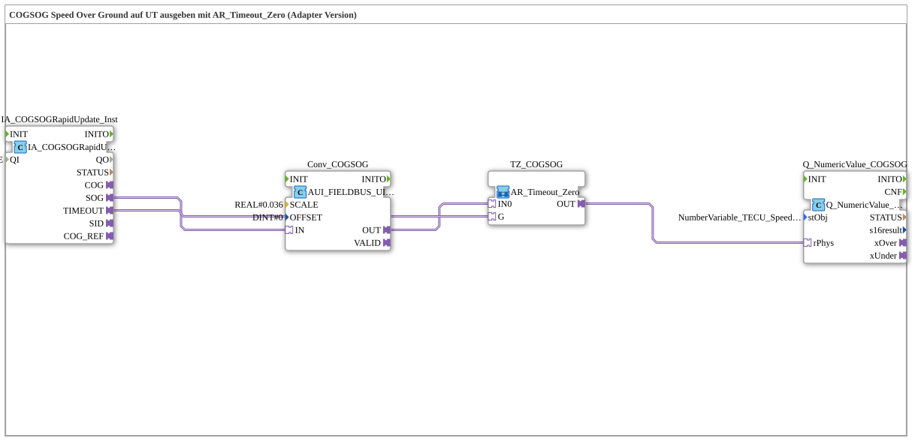

# Exercise_079a_AUI: COGSOG Speed Over Ground Output on UT with AR_Timeout_Zero (Adapter Version)

* * * * * * * * * *

## Introduction

This exercise outputs the speed over ground (COGSOG Rapid Update, Speed Over Ground) of the TECU on the ISOBUS terminal: with PHYS scaling (`0.036`) and the Fendt circuit `AR_Timeout_Zero` (adapter version, analogous to the Krauternter sub-app `TECU_COGSOG.SUB`). On a communication failure, `0.0` is displayed.

## Function Blocks (FBs) Used

- **IA_COGSOGRapidUpdate_Inst**: ISOBUS adapter for Course Over Ground and Speed Over Ground (Rapid Update)
    - **Type**: [`isobus::tecu::IA_COGSOGRapidUpdate`](https://meisterschulen-am-ostbahnhof-munchen-docs.readthedocs.io/projects/4diac-library-reference-docs/en/latest/Bibliotheken/ExternalLibraries/isobus/TECU/IA_COGSOGRapidUpdate/)
    - **Parameters**: `QI = TRUE`
    - **Explanation**: Provides, among others, the speed over ground as `AUI` adapter `SOG` and the timeout status as `AX` adapter `TIMEOUT`.
- **Conv_COGSOG**: Scaling of the fieldbus value
    - **Type**: [`logiBUS::signalprocessing::fieldbus::AUI_FIELDBUS_UINT_TO_SIGNAL_SCALED`](https://meisterschulen-am-ostbahnhof-munchen-docs.readthedocs.io/projects/4diac-library-reference-docs/en/latest/Bibliotheken/ExternalLibraries/logiBUS/signalprocessing/fieldbus/AUI_FIELDBUS_UINT_TO_SIGNAL_SCALED/)
    - **Parameters**: `SCALE = 0.036`, `OFFSET = 0`
    - **Explanation**: Converts the `AUI` value (UINT from the fieldbus) into a scaled `AR` value (REAL) only if the signal is valid; `OFFSET` is added after scaling.
- **TZ_COGSOG**: Fendt circuit (sub-app)
    - **Type**: `MyLib::sys::AR_Timeout_Zero`
    - **Parameters**: none
    - **Explanation**: Outputs `IN0` unchanged, unless `G` (here `IA_COGSOGRapidUpdate_Inst.TIMEOUT`, a real communication failure) is `TRUE`: then `0.0` is output instead of the otherwise frozen last value.
- **Q_NumericValue_COGSOG**: Display on the ISOBUS terminal
    - **Type**: [`isobus::UT::Q::Q_NumericValue_PHYSA`](https://meisterschulen-am-ostbahnhof-munchen-docs.readthedocs.io/projects/4diac-library-reference-docs/en/latest/Bibliotheken/ExternalLibraries/isobus/UT/Q/Q_NumericValue_PHYSA/)
    - **Parameters**: `stObj = NumberVariable_TECU_Speed_COGSOG_N`
    - **Explanation**: Shows the physical value (`rPhys`) in the object `NumberVariable_TECU_Speed_COGSOG_N`.

## Program Flow and Connections

1. `IA_COGSOGRapidUpdate_Inst.SOG` → `Conv_COGSOG.IN` (AdapterConnection): The speed-over-ground value is scaled.
2. `Conv_COGSOG.OUT` → `TZ_COGSOG.IN0` (AdapterConnection): The scaled value is the live value of the Fendt circuit.
3. `IA_COGSOGRapidUpdate_Inst.TIMEOUT` → `TZ_COGSOG.G` (AdapterConnection): The timeout status controls whether `0.0` is output.
4. `TZ_COGSOG.OUT` → `Q_NumericValue_COGSOG.rPhys` (AdapterConnection): The result is shown on the terminal.

**Behavior**: As long as the TECU delivers the message, the terminal shows the value scaled with `0.036`. If communication fails (`TIMEOUT`), it shows `0.0`.

## Summary

The structure of this exercise matches `Uebung_070d_AUI` (WBSD), but it uses the adapter `IA_COGSOGRapidUpdate` and the scaling factor `0.036` for the speed over ground.

---

### 🌐 Related topic subpages on ms-muc-docs.de

- [🌐 Eclipse 4diac IDE & Color Reference on ms-muc-docs.de](https://www.ms-muc-docs.de/iec-61499/eclipse-4diac/)
