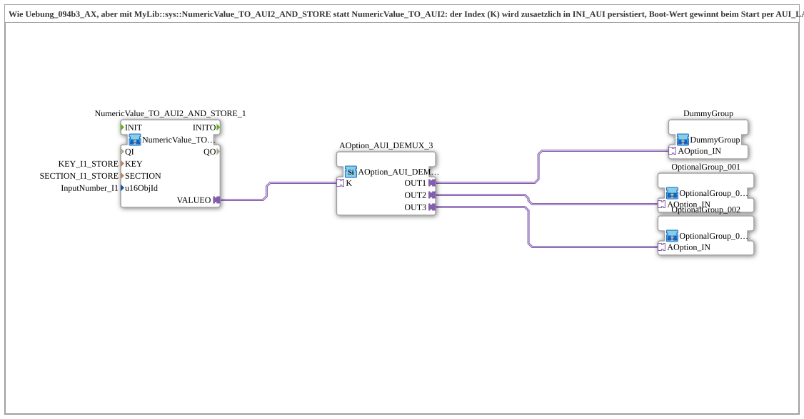

# Exercise_094b3b_AX: Option Selection with INI-Persisted Index (NumericValue_TO_AUI2_AND_STORE)

* * * * * * * * * *

## Introduction

This exercise corresponds to `Uebung_094b3_AX` but uses [`MyLib::sys::NumericValue_TO_AUI2_AND_STORE`](https://meisterschulen-am-ostbahnhof-munchen-docs.readthedocs.io/projects/4diac-library-reference-docs/en/latest/Bibliotheken/ExternalLibraries/MyLib_AX/sys/NumericValue_TO_AUI2_AND_STORE/) instead of [`NumericValue_TO_AUI2`](https://meisterschulen-am-ostbahnhof-munchen-docs.readthedocs.io/projects/4diac-library-reference-docs/en/latest/Bibliotheken/ExternalLibraries/MyLib_AX/sys/NumericValue_TO_AUI2/). The `VALUEO` plug is the same; in addition the index `K` is persisted in an INI file. At startup the stored value wins against the live reading of the VT field via `AUI_LAST_2`. The constants `KEY_I1_STORE` and `SECTION_I1_STORE` are already known from `Uebung_012c_AUDI`.

## Function Blocks (FBs) Used

- **NumericValue_TO_AUI2_AND_STORE_1**: reads the VT input field, provides it as an AUI2 plug and stores it in INI
    - **Type**: [`MyLib::sys::NumericValue_TO_AUI2_AND_STORE`](https://meisterschulen-am-ostbahnhof-munchen-docs.readthedocs.io/projects/4diac-library-reference-docs/en/latest/Bibliotheken/ExternalLibraries/MyLib_AX/sys/NumericValue_TO_AUI2_AND_STORE/) (SubApp instance)
    - **Parameters**: `KEY = KEY_I1_STORE`, `SECTION = SECTION_I1_STORE`, `u16ObjId = InputNumber_I1`
    - **Explanation**: Like `NumericValue_TO_AUI2`, with additional INI persistence: at boot the value loaded from the INI wins (merged against the live VT reading via `AUI_LAST_2`), afterwards every live change.
- **AOption_AUI_DEMUX_3**: option selection with three outputs
    - **Type**: [`Option::selection::AOption_AUI_DEMUX_3`](https://meisterschulen-am-ostbahnhof-munchen-docs.readthedocs.io/projects/4diac-library-reference-docs/en/latest/Bibliotheken/ExternalLibraries/Option/selection/AOption_AUI_DEMUX_3/)
    - **Parameters**: none
    - **Explanation**: Depending on the index `K`, activates exactly one of the outputs `OUT1`, `OUT2`, `OUT3`.
- **OptionalGroup_001**, **OptionalGroup_002**: real option groups
    - **Type**: [`MyLib_AX_Option::sys::OptionalGroup_001`](https://meisterschulen-am-ostbahnhof-munchen-docs.readthedocs.io/projects/4diac-library-reference-docs/en/latest/Bibliotheken/ExternalLibraries/MyLib_AX_Option/sys/OptionalGroup_001/) and [`MyLib_AX_Option::sys::OptionalGroup_002`](https://meisterschulen-am-ostbahnhof-munchen-docs.readthedocs.io/projects/4diac-library-reference-docs/en/latest/Bibliotheken/ExternalLibraries/MyLib_AX_Option/sys/OptionalGroup_002/) (SubApp instances)
    - **Parameters**: none
    - **Explanation**: Group 1 contains `I1`/`Q1`, group 2 contains `I2`/`Q2`.
- **DummyGroup**: neutral placeholder slot
    - **Type**: [`MyLib_AX_Option::sys::DummyGroup`](https://meisterschulen-am-ostbahnhof-munchen-docs.readthedocs.io/projects/4diac-library-reference-docs/en/latest/Bibliotheken/ExternalLibraries/MyLib_AX_Option/sys/DummyGroup/) (SubApp instance)
    - **Parameters**: none
    - **Explanation**: No real I/O and no effect; the "nothing selected" state.

## Program Flow and Connections

1. `NumericValue_TO_AUI2_AND_STORE_1.VALUEO` → `AOption_AUI_DEMUX_3.K`: The index (possibly loaded from the INI) selects the active output.
2. `AOption_AUI_DEMUX_3.OUT1` → `DummyGroup.OPTION`, `OUT2` → `OptionalGroup_001.OPTION`, `OUT3` → `OptionalGroup_002.OPTION`.

**Behavior**: As in `Uebung_094b3_AX` (1 = nothing selected, 2 = group 1, 3 = group 2); in addition the selection survives a restart.

## Summary

Swapping the block for the `_AND_STORE` variant makes the option selection restart-proof without changing the rest of the network.

---

### 🌐 Related topic subpages on ms-muc-docs.de

- [🌐 Eclipse 4diac IDE & Color Reference on ms-muc-docs.de](https://www.ms-muc-docs.de/iec-61499/eclipse-4diac/)
