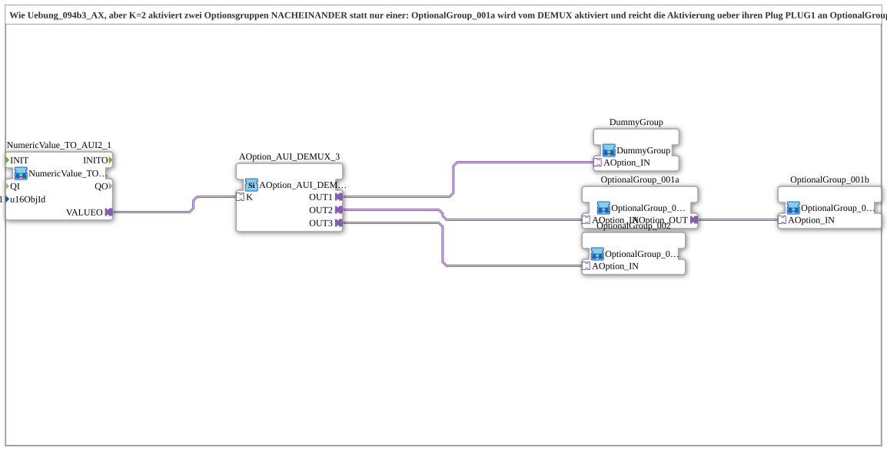

# Uebung_094b3c_AX: Option Selection with Two Sequentially Activated Option Groups (Daisy Chain)

* * * * * * * * * *

## Introduction

This exercise corresponds to [`Uebung_094b3_AX`](Uebung_094b3_AX.md), but index `K = 2` activates two option groups ONE AFTER THE OTHER instead of only one: [`OptionalGroup_001a`](https://meisterschulen-am-ostbahnhof-munchen-docs.readthedocs.io/projects/4diac-library-reference-docs/en/latest/Bibliotheken/ExternalLibraries/MyLib_AX_Option/sys/OptionalGroup_001a/) is activated by the DEMUX and passes the activation on through its plug `AOption_OUT` to [`OptionalGroup_001b`](https://meisterschulen-am-ostbahnhof-munchen-docs.readthedocs.io/projects/4diac-library-reference-docs/en/latest/Bibliotheken/ExternalLibraries/MyLib_AX_Option/sys/OptionalGroup_001b/). The DEMUX only receives its acknowledgment once both groups are initialized. The exercise shows how several groups can be started up sequentially (one after the other, not simultaneously) via the plug/socket chain without violating the DEMUX's busy gating.

## Function Blocks (FBs) Used

- **NumericValue_TO_AUI2_1**: reads the VT input field and provides it as a bidirectional AUI2 plug
    - **Type**: [`MyLib::sys::NumericValue_TO_AUI2`](https://meisterschulen-am-ostbahnhof-munchen-docs.readthedocs.io/projects/4diac-library-reference-docs/en/latest/Bibliotheken/ExternalLibraries/MyLib_AX/sys/NumericValue_TO_AUI2/) (SubApp instance)
    - **Parameters**: `u16ObjId = InputNumber_I1`
    - **Explanation**: Reads the VT input field and passes the value on via `VALUEO` to the DEMUX. The consumer reports the accepted value back via the same plug, and the echo is written back to the VT field.
- **AOption_AUI_DEMUX_3**: option selection with three outputs
    - **Type**: [`Option::selection::AOption_AUI_DEMUX_3`](https://meisterschulen-am-ostbahnhof-munchen-docs.readthedocs.io/projects/4diac-library-reference-docs/en/latest/Bibliotheken/ExternalLibraries/Option/selection/AOption_AUI_DEMUX_3/)
    - **Parameters**: none
    - **Explanation**: Depending on the index `K`, activates exactly one of the outputs `OUT1`, `OUT2`, `OUT3`.
- **DummyGroup**: neutral placeholder slot
    - **Type**: [`MyLib_AX_Option::sys::DummyGroup`](https://meisterschulen-am-ostbahnhof-munchen-docs.readthedocs.io/projects/4diac-library-reference-docs/en/latest/Bibliotheken/ExternalLibraries/MyLib_AX_Option/sys/DummyGroup/) (SubApp instance)
    - **Parameters**: none
    - **Explanation**: No real I/O and no effect; state "nothing selected".
- **OptionalGroup_001a**: first option group with pass-through
    - **Type**: [`MyLib_AX_Option::sys::OptionalGroup_001a`](https://meisterschulen-am-ostbahnhof-munchen-docs.readthedocs.io/projects/4diac-library-reference-docs/en/latest/Bibliotheken/ExternalLibraries/MyLib_AX_Option/sys/OptionalGroup_001a/) (SubApp instance)
    - **Parameters**: none
    - **Explanation**: Enables `Input_I1`/`Output_Q1` and passes the activation on through the plug `AOption_OUT`.
- **OptionalGroup_001b**: second option group (end of the chain)
    - **Type**: [`MyLib_AX_Option::sys::OptionalGroup_001b`](https://meisterschulen-am-ostbahnhof-munchen-docs.readthedocs.io/projects/4diac-library-reference-docs/en/latest/Bibliotheken/ExternalLibraries/MyLib_AX_Option/sys/OptionalGroup_001b/) (SubApp instance)
    - **Parameters**: none
    - **Explanation**: Identical in construction to `OptionalGroup_001a`, but without a plug; passes nothing on.
- **OptionalGroup_002**: further option group
    - **Type**: [`MyLib_AX_Option::sys::OptionalGroup_002`](https://meisterschulen-am-ostbahnhof-munchen-docs.readthedocs.io/projects/4diac-library-reference-docs/en/latest/Bibliotheken/ExternalLibraries/MyLib_AX_Option/sys/OptionalGroup_002/) (SubApp instance)
    - **Parameters**: none
    - **Explanation**: Group with `I2`/`Q2`; activated or deactivated via the option adapter.

## Program Flow and Connections

1. `NumericValue_TO_AUI2_1.VALUEO` → `AOption_AUI_DEMUX_3.K`: The input field value selects the active output.
2. `AOption_AUI_DEMUX_3.OUT1` → `DummyGroup.AOption_IN`, `OUT2` → `OptionalGroup_001a.AOption_IN`, `OUT3` → `OptionalGroup_002.AOption_IN`.
3. `OptionalGroup_001a.AOption_OUT` → `OptionalGroup_001b.AOption_IN`: The activation is passed on to the second group.

**Behavior**: 1 = nothing selected, 2 = `OptionalGroup_001a` followed by `OptionalGroup_001b`, 3 = `OptionalGroup_002`. The acknowledgment to the DEMUX only occurs once the entire chain (001a and 001b) is initialized.

## Summary

Compared to `Uebung_094b3_AX`, `OptionalGroup_001` is replaced by `OptionalGroup_001a` and chained to the new `OptionalGroup_001b`. This way several groups are activated one after the other before the caller receives its acknowledgment.

---

### 🌐 Related topic subpages on ms-muc-docs.de

- [🌐 Eclipse 4diac IDE & Color Reference on ms-muc-docs.de](https://www.ms-muc-docs.de/iec-61499/eclipse-4diac/)
